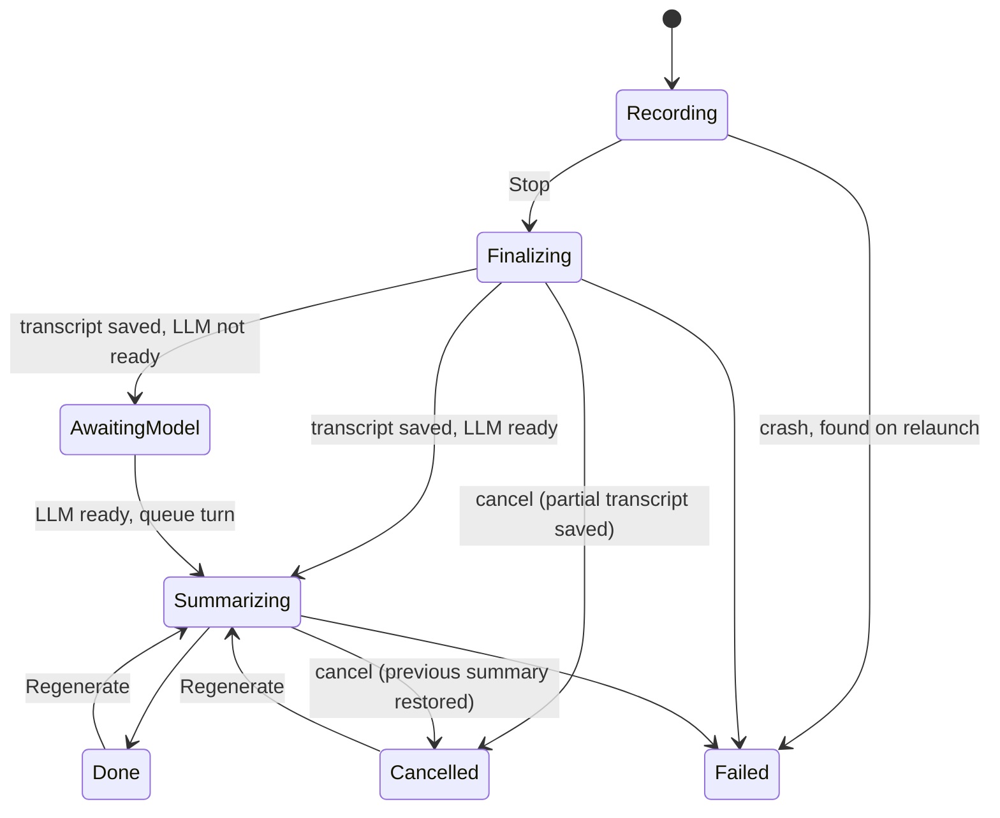
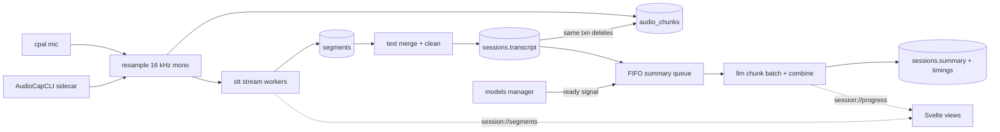
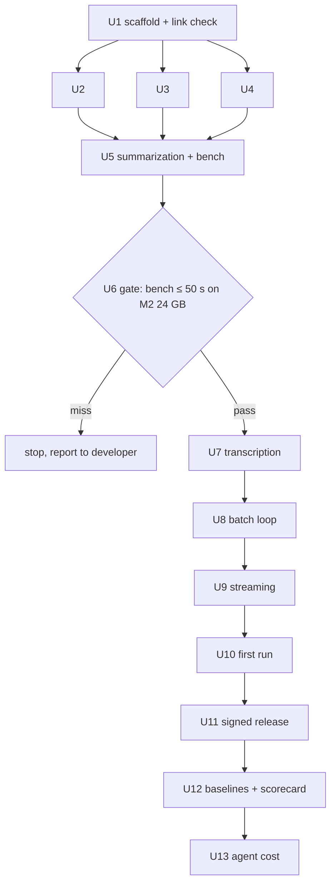

# Tauri Rewrite Evidence Prototype - Plan

## Goal Capsule

- **Objective:** The developer can make a go/no-go call on rewriting Scribular in Tauri from measured evidence: install time, session processing time and coding-agent cost, each compared against the Electron app on the same Mac.
- **Means:** A Mac-only Tauri prototype of the full on-device session loop, shipped as a downloadable build, plus the measurements and Electron baselines the scorecard needs. `plans/TAURI_MVP.md` is the architecture and milestone source this plan scopes.
- **Product authority:** This plan owns product scope and success criteria for the prototype. Where `plans/TAURI_MVP.md` disagrees on scope (encryption, audio retention, onboarding), this plan wins; its architecture choices stand unless a requirement here forces a change.
- **Open blockers:** None.
- **Stop conditions:** Work stops and goes to the developer with the evidence when any of these happens:
  - The ggml link check in U1 fails and no fallback works.
  - The U6 kill gate misses its threshold (AE3).
  - A unit needs a dependency the review rejects.
- **Execution profile:** A Rust core and a Svelte webview, built on Apple Silicon. U6, U11 and U12 need the M2 24 GB measurement machine, and U11 also needs the Apple Developer account.
- **Who finishes and ships:** The developer approves each dependency review, signs the release, and makes the go/no-go call from the scorecard. Nothing is merged into the Electron repo.

---

## Product Contract

### Summary

Build a Mac-only Tauri prototype that records a session with a live transcript, labels speakers, summarizes on-device with a chosen template, and lets the user review, edit and regenerate. It installs from a signed download with a minimal first run. The prototype also produces a scorecard that measures it against the Electron app on three go/no-go criteria.

### Problem Frame

Scribular ships today as an Electron app that depends on Ollama for summarization. A Tauri rewrite promises a smaller install, faster in-process transcription and summarization, and a codebase that is cheaper for coding agents to change. Each of those is a guess until it is measured. A rewrite is weeks of work, so the decision needs numbers from a real build, measured the same way on both apps.

The prototype's users are the developer and test or demo participants. The product's real end users are therapists recording client sessions, but no real client data goes through this prototype.

### Key Decisions

- **Three go/no-go criteria: easier install, faster processing, cheaper agent changes.** These are what a rewrite has to deliver to be worth it. Governs R14–R19. (session-settled: user-directed — chosen over an open-ended architecture test: the plan's original goal was only "test the architecture changes")
- **All measurements run on an M2 with 24 GB.** This was first set as an 8–16 GB M2/M3 with 8 GB required to pass, because that is what therapists are likely to have. No 8 GB machine was available for U6, so on 2026-10-20 the developer accepted the M2 24 GB run as passing and made it the measurement machine for U6, U12 and every Success Criterion. The scorecard therefore says nothing about memory pressure on 8 GB. Governs R14. (session-settled: user-directed, amended 2026-10-20 — chosen over waiving 8 GB for U6 only, and over a later 8 GB re-run)
- **The install clock runs from download to first recording.** It includes opening the download, granting permissions and fetching models, because that is what a new user waits through. Governs R9, R10. (session-settled: user-directed — chosen over download → app open and a relative-only comparison)
- **Record first, LLM later.** Recording is enabled once the speech model is ready, and the summarization model keeps downloading in the background. This keeps the install clock within reach without bundling models. Governs R11, R12. (session-settled: user-approved — chosen over a smaller LLM and bundling models in the download)
- **Agent cost is measured on 2–3 small backlog features, one spec each, built by the same agent in both repos.** Running several features evens out noise from any one of them. Governs R17. (session-settled: user-approved — chosen over one feature run several times and passive token tracking)
- **Cut encryption at rest and the keep-audio toggle; keep the live transcript.** Live transcription is the riskiest architecture change, so it stays in the test. Encryption and retention settings don't affect any criterion. Governs R2, R8. (session-settled: user-directed — chosen over also cutting the live transcript)
- **Always delete audio once the transcript is saved.** Audio is still written during recording so a crash doesn't lose it. Because nothing is encrypted, the prototype is for test and demo sessions only, never real clients. Governs R8. (session-settled: user-approved — chosen over never writing audio, and over keeping demo audio indefinitely)
- **Summarization speed is an early kill gate.** It is the criterion most likely to fail and the one least affected by later work, so it is measured as soon as on-device summarization works. Governs R15.
- **The scorecard reports and the developer decides.** Each criterion gets measured values and pass/fail, but there is no rule that all three must pass. Governs R19.

### Requirements

**Session loop**

- R1. The user can record microphone and system audio together on macOS, picking the input mode and the target app as in the Electron app.
- R2. A live transcript updates while recording.
- R3. Transcription runs on-device. The saved transcript merges both sources into turns labeled `Client:` and `You:` and applies the same cleanup as the Electron app.
- R4. After Stop, the session is summarized on-device using a template the user picks from a fixed set. Long transcripts are handled without the user doing anything.
- R5. Transcription and summarization show progress, and the user can cancel either one.
- R6. The user can browse past sessions, open one, edit its transcript and summary, and regenerate the summary.
- R7. Once models are installed, a session makes no network requests from start to finished summary.

**Session data**

- R8. Audio is written to disk while recording so a crash doesn't lose it, and is deleted once that session's transcript is saved. Transcripts and summaries are stored unencrypted.

**Install and first run**

- R9. The prototype ships as a signed, notarized macOS download that opens without the user bypassing Gatekeeper.
- R10. First run walks the user through microphone and system-audio permissions and downloads the speech model with visible progress.
- R11. Recording becomes available once the speech model is ready, even if the summarization model is still downloading in the background with visible progress.
- R12. If a session stops before the summarization model is ready, its transcript is saved and viewable right away, and its summary starts on its own once the model arrives.

**Evidence and scorecard**

- R13. Each session records how long transcription and summarization took after Stop, broken down by stage, in a form the developer can copy into the scorecard.
- R14. Install time and processing time are measured on the M2 24 GB measurement machine for both the prototype and the current Electron release, along with each app's download size.
- R15. The processing benchmark uses the same 50-minute recording for both apps. It is run on the prototype as soon as on-device summarization works, and a miss against the Success Criteria is reported to the developer before work continues.
- R16. The existing quality bar for live transcription still holds: the M5b check in `plans/TAURI_MVP.md` (5-minute call, transcript within ~20 s, summary starts within 10 s of Stop, word count within 5% of batch).
- R17. The agent-cost test builds each of 2–3 features in both codebases from one written spec, with the same agent and model. It records total tokens per feature per repo once that feature's tests pass.
- R18. Token-test features must not already exist in either codebase and must not depend on anything that is out of scope for the prototype.
- R19. A single scorecard reports, for each criterion, the prototype and Electron numbers, pass/fail against the Success Criteria, and caveats that affect the comparison.

### Key Flows

- F1. First run to first recording (timed per R14)
  - **Trigger:** A new user downloads the prototype.
  - **Steps:** Open the download and install; launch; grant microphone and system-audio permissions; speech model downloads with progress; Record becomes available while the summarization model keeps downloading; user starts recording.
  - **Outcome:** The clock stops when the first recording starts.
  - **Covers:** R9, R10, R11
- F2. Session
  - **Trigger:** The user presses Record.
  - **Steps:** Live transcript updates; user presses Stop; final transcript is saved with speaker labels and the audio is deleted; summary runs with progress; user reviews, edits or regenerates.
  - **Outcome:** A saved session with transcript and summary, and timings recorded for the scorecard.
  - **Covers:** R1–R8, R13
- F3. Agent-cost run
  - **Trigger:** The prototype is complete.
  - **Steps:** Write one spec per feature; the same agent builds it in the Electron repo and in the Tauri repo; record tokens once tests pass in each.
  - **Outcome:** Per-feature and total token counts for both repos.
  - **Covers:** R17, R18

### Acceptance Examples

- AE1. Summarization model not ready at Stop
  - **Covers:** R11, R12
  - **Given** the speech model is installed and the summarization model is 60% downloaded, **when** the user stops a session, **then** the transcript is saved and viewable, the summary shows as waiting on the download, and it starts on its own when the download finishes.
- AE2. Crash during recording
  - **Covers:** R8
  - **Given** a recording is in progress, **when** the app crashes, **then** the audio captured so far is still on disk after relaunch.
- AE3. Kill gate miss
  - **Covers:** R15
  - **Given** on-device summarization works, **when** the 50-minute benchmark on the measurement machine takes longer than the processing threshold, **then** the developer gets the measured numbers and the per-stage breakdown before live transcription or UI work starts.
- AE4. Cancel during summarization
  - **Covers:** R5
  - **Given** a summary is in progress, **when** the user cancels, **then** summarization stops, the transcript stays saved, and the user can regenerate later.

### Success Criteria

These are the scorecard thresholds R19 checks against. All are measured on the M2 24 GB measurement machine (see Key Decisions).

- **Install time:** download → first recording in under 2 minutes.
- **Download size:** smaller than the current Electron release.
- **Processing time:** Stop → summary complete in under 60 s for a 50-minute session.
- **Agent cost:** fewer total tokens in the Tauri repo than in the Electron repo across the 2–3 features.

### Scope Boundaries

- Encryption at rest and the keep-audio setting (Electron features #12 and #14).
- Recovering an interrupted session after a crash. Audio survives per R8, but turning it into a transcript is deferred.
- Everything on the original out-of-scope list in `plans/TAURI_MVP.md`: license/trial, auto-update, analytics, multi-speaker diarization, model catalog, prompt editing, tray menu, playback/export, re-transcription, sample sessions, custom window chrome.
- Native Core Audio taps (M6) and Windows (M7).
- Use with real client sessions.

### Dependencies / Assumptions

- Both apps are measured on the developer's M2 24 GB. R14 and R15 use that machine.
- An Apple Developer account is available for signing and notarization (R9).
- The install time depends on connection speed, since about 150 MB of speech model downloads during the measured window. The scorecard records the connection used.
- The Tauri prototype is a young codebase and Electron is mature. That can push the agent-cost result either way, and R19's caveats must say so.

### Outstanding Questions

**Resolved During Planning**

- Which 2–3 features the agent-cost test uses: KTD13.
- How a 50-minute transcript gets summarized in 60 s: KTD3 and KTD5, checked by the U6 gate.
- Which 50-minute recording R15 uses, and how both apps receive it the same way: KTD12.

### Sources / Research

- `plans/TAURI_MVP.md`: architecture, the 15-feature list, milestones M0–M5b, the M5b check and risks (ggml symbol clash, 8 GB memory).
- `plans/DEPENDENCY_REVIEW_M0.md`: M0 dependency pins awaiting approval.
- `../notes-assistant-electron/`: the Electron app used for baselines and the agent-cost test. Its `plans/` folder holds the backlog candidates.

---

## Planning Contract

`plans/TAURI_MVP.md` §2 (architecture, state machine, data model) and §3 (milestones M0–M5b) are the base design. The KTDs below record only where this plan changes or extends it.

### Key Technical Decisions

- KTD1. Storage is plain `rusqlite` with the `bundled` feature, in WAL mode, with a dedicated writer connection on its own thread. SQLCipher, the Keychain key and `keyring` are dropped. Governs R6, R8. (session-settled: user-directed — chosen over SQLCipher with a Keychain key: encryption at rest doesn't affect any go/no-go criterion)
- KTD2. Audio is written as 16 kHz mono i16 BLOB rows in `audio_chunks` while recording. Those rows are deleted in the same transaction that saves the transcript, and the `keep_audio` setting and the `audio_kept` column are removed. On launch, a session left in `Recording` or `Finalizing` becomes `Failed("interrupted")` and keeps its audio rows. Governs R8, AE2. (session-settled: user-approved — chosen over never writing audio and over keeping demo audio: crash safety with nothing left behind)
- KTD3. Summarization splits the transcript into token-budgeted chunks counted with the model's own tokenizer, replacing the fixed 3,500 characters.
  - The budget fills the 8k context after the prompt and a per-chunk output cap of about 350 tokens. A 50-minute session comes to about 3 chunks instead of about 14.
  - The chunk summaries decode as parallel sequences in one llama batch, followed by one combine pass.
  - The prompt strings are carried over verbatim from `../notes-assistant-electron/src/service/summarize.js`.
  - Governs R4, R15. The rationale: fewer, larger prefills and batched decode cut sequential model runs from about 14 to 2.
- KTD4. Prompts are formatted with the chat template in the GGUF metadata, and sampling uses the defaults Ollama ships for `gemma2:2b`. The Electron app passes no sampling options (`summarize.js` sets only `model`), so this keeps the two apps' output comparable. Governs R4.
- KTD5. Memory on 8 GB:
  - The LLM loads at Stop, in parallel with the tail transcription.
  - Whisper unloads before Summarizing on machines with 8 GB of RAM or less.
  - The KV cache stays f16 at 106 KB per token for gemma-2-2b, about 870 MB per 8k sequence. Because the KTD3 chunk sequences decode in one batch, the context is sized to hold all of them together, about 2.6 GB for a 3-chunk session. U6 records peak memory.
  - The measurement machine has 24 GB, so no measurement exercises the Whisper unload. It stays as product behavior for 8 GB Macs and is covered by tests only.
  - Governs R15.
- KTD6. Streaming follows `plans/TAURI_MVP.md` M5b. The one delta is that the overlap dedup keys on each source's own timestamps before the merge. Governs R2, R16.
- KTD7. The job state machine adds `AwaitingModel` between `Finalizing` and `Summarizing`. Summary jobs run one at a time from a FIFO queue that persists across restarts.
  - Cancelling during `Summarizing` restores the previous summary.
  - Cancelling during `Finalizing` saves the partial transcript and deletes the audio.
  - Governs R5, R12, AE1, AE4.
- KTD8. Neither model is bundled. A pinned manifest gives the URL, size and sha256 for whisper `ggml-base.bin` and `gemma-2-2b-it` Q4_K_M GGUF.
  - Downloads resume through HTTP Range into `appDataDir/models`, and a file is renamed into place only after its hash checks out.
  - The speech model downloads first, then the LLM in the background.
  - Governs R9–R12. (session-settled: user-approved — chosen over bundling models and a smaller LLM: keeps the install clock reachable without changing the model)
- KTD9. `Transcriber`, `Summarizer` and `SystemAudio` traits sit behind a `fake-engines` cargo feature. Job, queue and cancel tests then run without models or Metal.
- KTD10. The IPC contract follows `plans/TAURI_MVP.md` M0: committed ts-rs types in `src/lib/types/`, hand-written wrappers in `src/lib/api.ts`, and a Rust test that checks every registered command has a wrapper.
- KTD11. System audio reuses the `AudioCapCLI` binary from `../notes-assistant-electron/src/service/runners/AudioCapCLI` as a Tauri `externalBin` sidecar run through `tauri-plugin-shell`. It is signed with the app bundle. Governs R1, R9.
- KTD12. The benchmark source is `../notes-assistant-electron/benchmark/results/batch/2-speakers-50min/audio.wav`: 50 minutes of synthetic audio, 2 speakers, 16 kHz mono.
  - Both apps record in system-audio mode with the player app as the target while `afplay` plays the file. Both see identical input, and every turn is labeled `Client:`.
  - The U6 gate runs before recording exists. It feeds the matching `transcription-output.json` through the U3 pipeline into a dev bench binary.
  - The gate passes when summarization takes 50 s or less, which leaves 10 s of the 60 s budget for the tail window and the save.
  - Governs R15, AE3.
- KTD13. The agent-cost features are editable prompt templates, sidebar session search, and session rename. All three are absent from both codebases and need nothing out of scope (R18). Prompt editing is outside the prototype's own scope, so it exists only on the throwaway branches and never ships.
  - The Electron runs happen on a throwaway worktree branch, and the Tauri runs on a throwaway branch of this repo.
  - Tokens are the session usage totals that the coding agent reports when the feature's tests pass.
  - Governs R17, R18.
- KTD14. Dependencies follow the policy in `plans/DEPENDENCY_REVIEW_M0.md`: exact pins, versions at least two weeks old, and `build.rs` reviewed like an npm `postinstall`.
  - Each unit that adds a package lands its review document first.
  - whisper-rs and llama-cpp-2 are reviewed in U1, so the ggml link check runs on approved pins.
- KTD15. `processTranscript`, `mergeDiarizedSegments` and `chunkTranscript` are ported to `text/` and checked against fixtures. A node script in this repo generates those fixtures from the Electron JavaScript and reads that code without changing it. Governs R3.
- KTD16. Per-stage timings are stored as JSON on the session row: tail transcription, model load, each chunk, combine and save. The session view shows them with a copy button. Governs R13.

### High-Level Technical Design

Session job states. These extend the `plans/TAURI_MVP.md` §2 machine per KTD7.



Data flow from capture to saved summary.



Sequencing and the kill gate.



### Output Structure

```
src-tauri/
  Cargo.toml  build.rs  tauri.conf.json  Info.plist  entitlements.plist
  capabilities/default.json
  binaries/AudioCapCLI-aarch64-apple-darwin
  src/
    main.rs  lib.rs  commands.rs  permissions.rs
    jobs/      mod.rs  state.rs  queue.rs  summarize.rs  session.rs
    audio/     mod.rs  mic.rs  system.rs  resample.rs  chunk_writer.rs
    stt/       mod.rs  whisper.rs  stream.rs
    llm/       mod.rs  llama.rs  prompt.rs
    text/      mod.rs  clean.rs  merge.rs  chunk.rs
    store/     mod.rs  migrations.rs  sessions.rs  prompts.rs  settings.rs
    models/    mod.rs  manifest.rs  download.rs
    engines/   fake.rs
    bin/bench.rs
  tests/  (integration tests + fixtures/)
src/
  main.ts  App.svelte
  lib/api.ts  lib/types/ (generated)
  lib/components/  Sidebar  SessionDetail  SummaryPanel  Progress  RecordView
                   LiveTranscript  Settings  Timings  FirstRun  ModelStatus
scripts/  gen-text-fixtures.mjs  release-mac.sh
plans/evidence/  kill-gate.md  m5b-check.md  release.md  scorecard.md  agent-cost/
```

### Assumptions

- gemma-2-2b on an M2/M3 base chip runs at roughly 20–28 decode tokens per second. The only figure found is an estimate for larger hardware, which is why U6 measures it before anything else is built ([willitrunai](https://willitrunai.com/can-run/gemma-2-2b-on-tesla-p40-24gb)).
- whisper `ggml-base.bin` keeps far ahead of real time. The Electron benchmark transcribed the 50-minute file in 143 s, a 0.048 ratio (`benchmark/results/batch/2-speakers-50min/metrics.json`), so the tail window at Stop takes a few seconds.
- The Electron v1.5.9 release is the baseline. Its `.app` is 874 MB; U12 measures the download size.

### Risks

| Risk | Mitigation |
|---|---|
| whisper.cpp and llama.cpp both link ggml, causing duplicate symbols | U1 link check on approved pins; fallbacks from `plans/TAURI_MVP.md` §6; stop condition if none works |
| Summarization misses 60 s on the measurement machine | U6 gate before Phase B (KTD12); on a miss, report and stop rather than swap models |
| GGUF output reads worse than Ollama's | KTD4; U6 includes a side-by-side read of the DORA summary from both apps |
| Gemma GGUF host requires login, or its license limits download-on-first-run | U4 picks a host that serves the file anonymously and records the license terms next to the manifest pin |
| Sidecar fails notarization or loses screen-recording permission once signed | U11 verifies the signed sidecar with `codesign --verify --deep --strict` and a fresh-machine run |
| Streaming falls behind or duplicates words at window edges | KTD6; the R16 word-count check against batch output |
| Audio row writes stall the UI | KTD1 writer thread and WAL |
| Metal or Xcode toolchain breaks the C++ builds | Xcode version recorded in the U1 review; CPU build as a fallback for development only |

---

## Implementation Units

| U-ID | Title | Key files | Depends on |
|---|---|---|---|
| U1 | Scaffold, IPC contract and ggml link check | `src-tauri/src/commands.rs`, `src/lib/api.ts`, `spikes/ggml-link/` | — |
| U2 | Storage and session browsing | `src-tauri/src/store/`, `Sidebar`, `SessionDetail` | U1 |
| U3 | Text pipeline port with parity fixtures | `src-tauri/src/text/`, `scripts/gen-text-fixtures.mjs` | U1 |
| U4 | Model manager | `src-tauri/src/models/` | U1 |
| U5 | On-device summarization job and bench harness | `src-tauri/src/llm/`, `src-tauri/src/jobs/`, `src-tauri/src/bin/bench.rs` | U2, U3, U4 |
| U6 | Kill-gate measurement on M2 24 GB | `plans/evidence/kill-gate.md` | U5 |
| U7 | In-process transcription | `src-tauri/src/stt/whisper.rs` | U4, U6 |
| U8 | Recording and the batch session loop | `src-tauri/src/audio/`, `src-tauri/src/jobs/session.rs`, `RecordView`, `Settings`, `Timings` | U2, U3, U5, U7 |
| U9 | Streaming transcription and live transcript | `src-tauri/src/stt/stream.rs`, `LiveTranscript` | U8 |
| U10 | First run and model readiness | `src-tauri/src/jobs/queue.rs` (persistence), `FirstRun`, `ModelStatus` | U4, U8 |
| U11 | Signed, notarized distribution | `src-tauri/tauri.conf.json`, `scripts/release-mac.sh` | U10 |
| U12 | Electron baselines and scorecard | `plans/evidence/scorecard.md` | U6, U9, U11 |
| U13 | Agent-cost test | `plans/evidence/agent-cost/` | U12 |

### Phase A: Foundation and the gate

### U1. Scaffold, IPC contract and ggml link check

- **Goal:** A Tauri window shows the result of one typed command, and whisper-rs and llama-cpp-2 are proven to link together with Metal.
- **Requirements:** KTD9, KTD10, KTD14.
- **Dependencies:** Approval of `plans/DEPENDENCY_REVIEW_M0.md` and an installed stable Rust toolchain.
- **Files:**
  - Frontend: `package.json`, `vite.config.ts`, `svelte.config.js`, `tsconfig.json`, `index.html`, `src/main.ts`, `src/App.svelte`, `src/lib/api.ts`, `src/lib/types/`.
  - Rust: `src-tauri/Cargo.toml`, `src-tauri/build.rs`, `src-tauri/tauri.conf.json`, `src-tauri/capabilities/default.json`, `src-tauri/src/main.rs`, `src-tauri/src/lib.rs`, `src-tauri/src/commands.rs`.
  - Link check: `plans/DEPENDENCY_REVIEW_ENGINES.md`, `spikes/ggml-link/`.
- **Approach:** Scaffold by hand from `plans/TAURI_MVP.md` M0. Review whisper-rs and llama-cpp-2 first, then build a throwaway binary in `spikes/ggml-link/` that enables Metal on both crates and calls into each. Record the result in the engines review and delete the spike.
- **Execution note:** Run the link check before the scaffold, because a failure there ends the plan at the lowest cost.
- **Patterns:** `plans/TAURI_MVP.md` M0; pins in `plans/DEPENDENCY_REVIEW_M0.md`.
- **Test scenarios:**
  - `app_version` returns the crate version, and the window renders it.
  - Renaming a field on an exported IPC struct makes `svelte-check` fail.
  - Removing a wrapper from `src/lib/api.ts` makes `cargo test` fail.
  - After `cargo test`, `git diff --exit-code src/lib/types` is clean.
  - The link spike builds with both crates on Metal and runs one call into each.
- **Verification:** The M0 "Done when" check in `plans/TAURI_MVP.md` passes, and the engines review records a successful link.

### U2. Storage and session browsing

- **Goal:** Sessions persist in SQLite, and the user can list, open, edit and delete them.
- **Requirements:** R6, R8; KTD1, KTD16.
- **Dependencies:** U1.
- **Files:** `plans/DEPENDENCY_REVIEW_M1.md`, `src-tauri/src/store/mod.rs`, `src-tauri/src/store/migrations.rs`, `src-tauri/src/store/sessions.rs`, `src-tauri/src/store/prompts.rs`, `src-tauri/src/store/settings.rs`, `src-tauri/src/commands.rs`, `src/lib/components/Sidebar.svelte`, `src/lib/components/SessionDetail.svelte`, `src-tauri/tests/store.rs`.
- **Approach:**
  - Use the `plans/TAURI_MVP.md` §2 data model, minus `audio_kept` and `keep_audio`, plus a `timings` JSON column.
  - The seed migration copies the 7 prompts word for word from `../notes-assistant-electron/src/store/defaults.js`.
  - The commands are those listed in M1.
- **Execution note:** The Svelte components and their test wait until U6 passes (AE3), and the store and commands come first.
- **Patterns:** `plans/TAURI_MVP.md` M1.
- **Test scenarios:**
  - A saved session is listed with the same fields after the store is reopened.
  - Transcript and summary edits saved through `update_session` come back from `get_session`.
  - `delete_session` removes the session and its `segments` and `audio_chunks` rows.
  - A fresh database seeds exactly 7 prompts whose text matches `defaults.js`.
  - Running the migrations against an already-migrated database changes nothing.
  - Editing the transcript in `SessionDetail` and blurring the field calls `update_session`.
- **Verification:** `cargo test` and `vitest` pass, and sessions survive an app restart.

### U3. Text pipeline port with parity fixtures

- **Goal:** The Rust text functions produce output identical to the Electron JavaScript on shared fixtures.
- **Requirements:** R3, R4; KTD3, KTD15.
- **Dependencies:** U1.
- **Files:** `scripts/gen-text-fixtures.mjs`, `src-tauri/src/text/mod.rs`, `src-tauri/src/text/clean.rs`, `src-tauri/src/text/merge.rs`, `src-tauri/src/text/chunk.rs`, `src-tauri/tests/fixtures/text/`, `src-tauri/tests/text_parity.rs`.
- **Approach:** Character chunking stays for parity, and a token-budget mode that takes a token-count function serves KTD3. The fixture script loads the functions from `summarize.js` and `audioWorker.js:350` read-only.
- **Patterns:** `plans/TAURI_MVP.md` M2.
- **Test scenarios:**
  - The `processTranscript` fixtures (noise tokens, repeated phrases, blank lines) match the JavaScript output byte for byte.
  - Interleaved mic and system segments merge into the same `Client:`/`You:` turns as the JavaScript.
  - A single-source input merges without empty turns.
  - 3,500-character chunking matches the JavaScript, and an input under 10 words is rejected the same way.
  - Token-budget chunks never exceed the budget and never split a word.
- **Verification:** `cargo test text_parity` passes.

### U4. Model manager

- **Goal:** Both models download with visible progress, resume after an interruption, and are verified before use.
- **Requirements:** R10, R11, R12; KTD8.
- **Dependencies:** U1.
- **Files:** `plans/DEPENDENCY_REVIEW_M3.md`, `src-tauri/src/models/mod.rs`, `src-tauri/src/models/manifest.rs`, `src-tauri/src/models/download.rs`, `src-tauri/src/commands.rs`, `src-tauri/tests/models_download.rs`.
- **Approach:** Emit `models://progress` events, and expose a readiness watch channel that U10's queue subscribes to. The manifest records the license terms next to each pin.
- **Test scenarios:**
  - A download from a local test server emits progress that only increases and ends in Ready.
  - A download cut off midway resumes from the partial file's offset with a Range request.
  - A sha256 mismatch deletes the file and reports Failed, and the model is never marked Ready.
  - A model already present and verified reports Ready without any network request.
  - The speech model is requested before the LLM.
- **Verification:** `cargo test` passes, and both real models download on the dev machine.

### U5. On-device summarization job and bench harness

- **Goal:** A saved transcript summarizes on-device with the chosen prompt, with progress, cancel, regenerate and per-stage timings, and a bench binary measures the same path headless.
- **Requirements:** R4, R5, R6, R13; KTD3, KTD4, KTD5, KTD7, KTD9, KTD16.
- **Dependencies:** U2, U3, U4.
- **Files:**
  - Rust: `src-tauri/src/llm/mod.rs`, `src-tauri/src/llm/llama.rs`, `src-tauri/src/llm/prompt.rs`, `src-tauri/src/jobs/mod.rs`, `src-tauri/src/jobs/state.rs`, `src-tauri/src/jobs/queue.rs`, `src-tauri/src/jobs/summarize.rs`, `src-tauri/src/engines/fake.rs`, `src-tauri/src/bin/bench.rs`, `src-tauri/src/commands.rs`.
  - Svelte: `src/lib/components/SummaryPanel.svelte`, `src/lib/components/Progress.svelte`.
  - Tests: `src-tauri/tests/summarize_job.rs`.
- **Approach:** Commands are `regenerate_summary(sessionId, promptId)` and `cancel_job(sessionId)`. The sampling loop checks the cancellation token on every token. The bench binary takes a transcript file and a prompt id and prints the KTD16 timings as JSON.
- **Execution note:** Write the fake-engine job tests before the llama implementation. The FIFO queue starts here in memory, and U10 adds `AwaitingModel` and persistence across restarts. The Svelte components wait until U6 passes (AE3), and the Rust side and bench come first.
- **Patterns:** `plans/TAURI_MVP.md` M3; `../notes-assistant-electron/src/service/summarize.js`.
- **Test scenarios:**
  - Regenerate emits `chunk i/n`, then `combining`, then `Done` in order, and the status row is written before each event.
  - Cancelling during a chunk stops output within 1 s, restores the previous summary, keeps the transcript, and sets Cancelled. Covers AE4.
  - A transcript that fits in one chunk skips the combine pass.
  - A transcript under 10 words fails with a message and never calls the summarizer.
  - A second regenerate while one is running waits in the queue and doesn't run concurrently.
  - Done stores a timing for every stage.
  - The per-chunk and combine prompts match the Electron format strings exactly.
  - (`--ignored`) With the real model's tokenizer, the 50-minute benchmark transcript splits into 3 chunks at the KTD3 budget.
  - (`--ignored`) The real model summarizes a 30 s fixture transcript with each of the 7 prompts and produces non-empty output.
- **Verification:** The M3 "Done when" check in `plans/TAURI_MVP.md` passes, and so do `cargo test --features fake-engines` and `cargo test -- --ignored`.

### U6. Kill-gate measurement on M2 24 GB

- **Goal:** The developer has measured summarization time for the 50-minute benchmark on the M2 24 GB measurement machine before Phase B starts.
- **Requirements:** R15, AE3; KTD12.
- **Dependencies:** U5.
- **Files:** `plans/evidence/kill-gate.md`.
- **Approach:**
  - Run a release build of the bench on the M2 24 GB machine: one cold run and three warm runs, reporting the median, the per-stage split and peak memory.
  - Include a side-by-side read of the DORA summary against Electron's output for the same transcript.
  - On a miss, stop and report per AE3.
- **Test expectation:** none — this unit produces a measurement report, not code.
- **Verification:** The report names the hardware, the build, every run, and pass or fail against KTD12, and the developer has acknowledged it.

### Phase B: Session loop

### U7. In-process transcription

- **Goal:** In-memory PCM samples transcribe in-process with segment timestamps and can be cancelled.
- **Requirements:** R3, R5, R7; KTD9.
- **Dependencies:** U4, U6.
- **Files:** `src-tauri/src/stt/mod.rs`, `src-tauri/src/stt/whisper.rs`, `src-tauri/src/commands.rs`, `src-tauri/tests/stt.rs`, `src-tauri/tests/fixtures/audio/`.
- **Approach:** Follow `plans/TAURI_MVP.md` M4, with the model loaded from the U4 path instead of a bundled resource.
- **Test scenarios:**
  - (`--ignored`) The fixture WAV transcribes, and every segment has ordered timestamps.
  - (`--ignored`) Cancelling partway returns within 1 s.
  - The fake transcriber returns scripted segments with timestamps.
- **Verification:** The M4 "Done when" check in `plans/TAURI_MVP.md` passes.

### U8. Recording and the batch session loop

- **Goal:** Record, stop, save the transcript, delete the audio, and summarize, all in batch mode.
- **Requirements:** R1, R3, R4, R5, R7, R8, R13; KTD2, KTD7, KTD11, AE2.
- **Dependencies:** U2, U3, U5, U7.
- **Files:**
  - Review: `plans/DEPENDENCY_REVIEW_M5A.md`.
  - Rust: `src-tauri/src/audio/mod.rs`, `src-tauri/src/audio/mic.rs`, `src-tauri/src/audio/system.rs`, `src-tauri/src/audio/resample.rs`, `src-tauri/src/audio/chunk_writer.rs`, `src-tauri/src/jobs/session.rs`.
  - Bundle: `src-tauri/binaries/AudioCapCLI-aarch64-apple-darwin`, `src-tauri/Info.plist`, `src-tauri/capabilities/default.json`.
  - Svelte: `src/lib/components/RecordView.svelte`, `src/lib/components/Settings.svelte`, `src/lib/components/Timings.svelte`.
  - Tests: `src-tauri/tests/session_job.rs`.
- **Approach:** Follow `plans/TAURI_MVP.md` M5a without the `keep_audio` toggle. Settings hold the input mode, the target app and the default prompt. The interrupted-session sweep runs at startup, before the UI loads.
- **Patterns:** `../notes-assistant-electron/src/service/audio/audioWorker.js` for source handling.
- **Test scenarios:**
  - With fake engines, a session runs Recording → Finalizing → Summarizing → Done, and the session has 0 `audio_chunks` rows once the transcript is saved.
  - The `audio_chunks` row count grows during recording, before Stop.
  - Dropping a job mid-recording and reopening the store leaves the session `Failed("interrupted")` with its audio rows present. Covers AE2.
  - Cancelling during Finalizing saves the partial transcript, deletes the audio, and sets Cancelled.
  - Each of the mic, system and both modes records exactly its expected sources.
  - Resampling 48 kHz stereo to 16 kHz mono gives the expected sample count and an RMS within tolerance.
  - A failed summarization keeps the transcript and still deletes the audio.
- **Verification:** A real both-mode recording completes end to end, and with Wi-Fi off a session makes no network requests (R7).

### U9. Streaming transcription and live transcript

- **Goal:** The transcript updates live while recording, and only the tail is left to transcribe at Stop.
- **Requirements:** R2, R16; KTD5, KTD6.
- **Dependencies:** U8.
- **Files:** `src-tauri/src/stt/stream.rs`, `src-tauri/src/jobs/session.rs`, `src/lib/components/LiveTranscript.svelte`, `src-tauri/tests/stream_dedup.rs`, `plans/evidence/m5b-check.md`.
- **Approach:** Follow `plans/TAURI_MVP.md` M5b. The LLM load starts at Stop, in parallel with the tail transcription.
- **Test scenarios:**
  - Segments in the overlap whose `start_ms` is at or before the last saved `end_ms` for that source are dropped.
  - A window with RMS below the threshold is skipped.
  - More than 2 queued windows emits the catching-up state, and Stop drains the queue without dropping audio.
  - At Stop, Finalizing transcribes only the remaining tail.
  - `LiveTranscript` renders merged `Client:`/`You:` turns from `session://segments` events.
- **Verification:** The R16 check passes and is recorded in `plans/evidence/m5b-check.md`.

### U10. First run and model readiness

- **Goal:** A new user can grant permissions, wait for the speech model, and record while the LLM is still downloading.
- **Requirements:** R10, R11, R12, AE1; KTD7, KTD8.
- **Dependencies:** U4, U8.
- **Files:** `src-tauri/src/jobs/queue.rs`, `src-tauri/src/jobs/state.rs`, `src-tauri/src/permissions.rs`, `src-tauri/src/commands.rs`, `src/lib/components/FirstRun.svelte`, `src/lib/components/ModelStatus.svelte`, `src-tauri/tests/awaiting_model.rs`.
- **Approach:** First run walks through mic permission, screen-recording permission with an "Open System Settings" action, and the speech model download. After that, a persistent badge shows the LLM's download progress.
- **Test scenarios:**
  - Stopping with the LLM at 60% saves a viewable transcript and sets AwaitingModel, and the summary starts by itself once the model is Ready. Covers AE1.
  - `SummaryPanel` shows an AwaitingModel session as waiting on the download. Covers AE1.
  - Two sessions waiting on the model are summarized in the order they stopped.
  - Sessions still waiting when the app relaunches resume once the model is Ready.
  - Record stays disabled until the speech model is Ready.
  - A denied mic permission shows the Open System Settings action.
- **Verification:** The fake-engine tests pass, and a manual run as a fresh macOS user goes from launch to first recording.

### U11. Signed, notarized distribution

- **Goal:** A DMG that opens on a clean Mac without bypassing Gatekeeper.
- **Requirements:** R9, R14; KTD11.
- **Dependencies:** U10.
- **Files:** `src-tauri/tauri.conf.json`, `src-tauri/entitlements.plist`, `scripts/release-mac.sh`, `plans/evidence/release.md`.
- **Approach:** Sign with Developer ID under the hardened runtime, notarize with `notarytool`, and staple the ticket. Credentials come from a keychain profile and never enter the repo.
- **Test expectation:** none — release packaging, checked by the commands under Verification.
- **Verification:**
  - `codesign --verify --deep --strict` passes on the app and the sidecar.
  - `spctl -a -vv` reports "Notarized Developer ID", and `xcrun stapler validate` passes.
  - A download on a second Mac opens without a Gatekeeper prompt.
  - The DMG size is recorded in `plans/evidence/release.md`.

### Phase C: Evidence

### U12. Electron baselines and scorecard

- **Goal:** One scorecard with both apps' numbers for every Success Criterion, measured on the same M2 24 GB machine.
- **Requirements:** R14, R15, R19; KTD12.
- **Dependencies:** U6, U9, U11.
- **Files:** `plans/evidence/scorecard.md`.
- **Approach:**
  - Use a fresh macOS user for each app's install run. Electron's clock includes whatever its first run requires before a recording can start.
  - Processing runs use the KTD12 playback setup, three runs per app, reporting medians.
  - Record the network connection used and the caveats R19 requires.
- **Test expectation:** none — measurement.
- **Verification:** Every Success Criterion except agent cost, which U13 adds, has a prototype number, an Electron number, pass or fail, and caveats.

### U13. Agent-cost test

- **Goal:** Per-feature and total token counts for the same three features built in both repos.
- **Requirements:** R17, R18, F3; KTD13.
- **Dependencies:** U12.
- **Files:** `plans/evidence/agent-cost/specs/`, `plans/evidence/agent-cost/results.md`.
- **Approach:** Check that each feature is absent from both codebases before writing its spec. Each run starts a fresh agent session with the same spec and instructions, and ends when that feature's tests pass.
- **Test expectation:** none — measurement; each feature's own tests are the stop signal.
- **Verification:** The results table lists 6 runs, and the totals are copied into the scorecard.

---

## Verification Contract

Run from `src-tauri/` unless noted:

- `cargo test`: unit tests, the text parity fixtures, the command-list check and migrations.
- `cargo test --features fake-engines`: the job, queue, cancel and awaiting-model tests.
- `cargo test -- --ignored`: real whisper and llama smoke tests. Needs the downloaded models; run before U6 and before each demo, not on every change.
- From the repo root:
  - `git diff --exit-code src/lib/types`, to check the generated IPC types are committed.
  - `npx svelte-check`.
  - `npx vitest run`.

Metric gates, all on the M2 24 GB measurement machine:

| Gate | Threshold | Unit |
|---|---|---|
| Bench summarization of the 50-minute transcript | ≤ 50 s median of 3 warm runs | U6 |
| Stop → summary complete, 50-minute session | < 60 s | U12 |
| Download → first recording | < 2 min, connection recorded | U12 |
| Download size | Smaller than Electron v1.5.9 | U11, U12 |
| Live transcript (R16) | Within ~20 s of speech; summary starts within 10 s of Stop; word count within 5% of batch | U9 |

---

## Definition of Done

- Every unit's test scenarios exist and pass, and its Verification is met. A measurement unit is done when its report is committed under `plans/evidence/`.
- All Verification Contract commands pass on the final tree.
- Every added package has an approved review document and an exact pin.
- `plans/evidence/scorecard.md` covers R19 for all four Success Criteria.
- `../notes-assistant-electron/` has no changes. Its throwaway worktree and branch from U13 are removed.
- Cleanup:
  - `spikes/ggml-link/` is deleted.
  - Code from abandoned approaches is removed rather than left in the diff.
  - The U13 feature branches in this repo are not merged.
