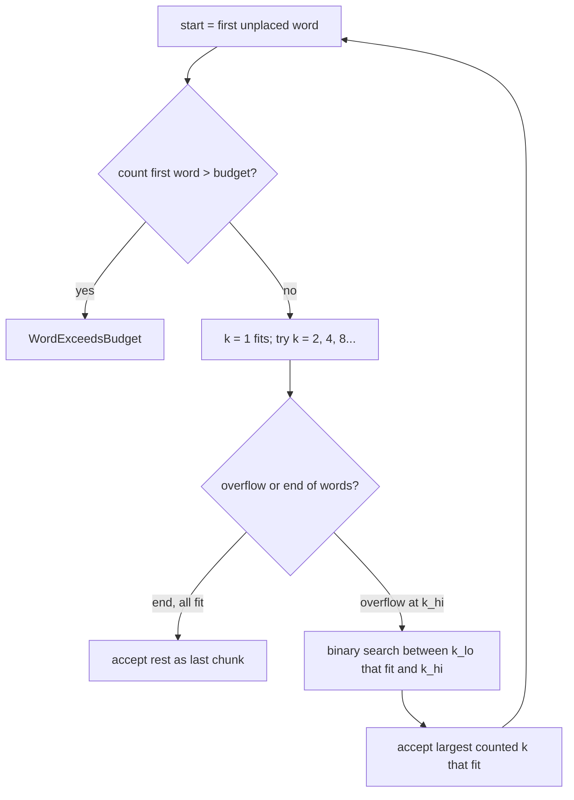

# Fix chunk_by_tokens Quadratic Slowdown - Plan

## Goal Capsule

- **Objective:** A 50-minute session summarizes in model time plus well under a second of chunking. The U6 kill gate then measures llama.cpp, not the splitter.
- **Means:** For each chunk, double the word count until it overflows, then binary-search, and accept only text that was counted exactly. A transcript that fits the budget in one count stays a single chunk (KTD1, KTD2).
- **Product authority:** `plans/2026-10-19-2001-feat-tauri-rewrite-evidence-prototype-plan.md` owns product scope. This plan changes only how KTD3 chunks are found. U2 tests a KTD3 deviation and is kept only if it measurably helps.
- **Open blockers:** None.
- **Stop conditions:**
  - A chunk could come out over budget, or the rejoin invariant could break, and the design here cannot prevent it.
  - The 50-minute benchmark yields fewer than 2 or more than 3 chunks.
- **Execution profile:** Rust only, in `src-tauri`. The default tests use a fake counter. The ignored llama tests and the bench need the gemma-2-2b GGUF and the host linking setup in `docs/solutions/runtime-errors/llama-dylib-rpath-works-under-cargo-only.md`.
- **Who finishes and ships:** The developer runs the bench on the host and decides whether to keep U2.

## Product Contract

### Summary

`chunk_by_tokens` keeps its signature, its errors and its guarantees. It finds chunk boundaries in O(log n) token counts per chunk instead of one count per word. A balanced-chunk variant is tried as a measured experiment.

### Problem Frame

The U5 bench showed 108.4 s cold and 82.8 s warm median, against about 36 s of model time. The difference is `chunk_by_tokens`, which re-tokenizes the growing chunk after every word. On the 50-minute benchmark (10,197 tokens) that is 8,123 count calls and 48.4 s, where one tokenize of the whole transcript takes 21 ms. Fixing this projects the warm run to about 37 s, which is under the 50 s KTD12 gate.

### Requirements

**Guarantees kept**

- R1. Every chunk's exact text counts at or under the budget with the caller's counter, even when the counter is non-additive.
- R2. Joining the chunks with a single space restores the input byte for byte, so no word is split or dropped.
- R3. `ChunkError::InsufficientAudio` and `ChunkError::WordExceedsBudget { tokens, budget }` fire under the same conditions and with the same values as today.
- R4. The `count_tokens: FnMut(&str) -> usize` interface and the `summarize.rs` call site are unchanged.

**Speed**

- R5. Chunking makes O(log w) counts per chunk, where w is the number of words in that chunk. A transcript that fits the budget costs one count.
- R6. On the 50-minute benchmark, chunking takes under 1 s and yields 2 or 3 chunks.

### Key Decisions

- **Search over word counts, never over token offsets.** Gemma's SentencePiece space markers and byte-fallback tokens make it unsafe to map tokens back to byte offsets. Governs R1, R2, R4.
- **A non-additive counter can leave a chunk short, never over budget.** It is an accepted cost of R1. Governs R1, R5.

### Scope Boundaries

- Out of scope: estimating tokens per word, and `chunk_by_chars` (the Electron parity splitter).
- Considered and not built: caching counts across chunks. Each chunk's search starts fresh, and the count is O(log w) anyway. Revisit only if a profile shows counting still matters.
- Considered and not built: a cap on how many times the counter is called. The doubling is bounded by the word count, so it cannot run away.

## Planning Contract

### Key Technical Decisions

- KTD1. **Doubling, then a binary search, per chunk.** Start at the first word not yet placed and grow the word count 1, 2, 4, … until the counted text is over budget or the words run out. Then binary-search between the last count that fit and the first that overflowed. Each candidate is the exact space-joined slice, and the chunk is the largest one that was counted and fit. If the first word alone is over budget, return `WordExceedsBudget` with that word's count. (session-settled: user-approved — chosen over a single tokenize mapped back to byte offsets: SentencePiece markers and byte-fallback tokens make offsets unsafe.) Governs R1, R2, R3, R5.
- KTD2. **Whole-transcript shortcut.** Count the full transcript once. If it fits, return it as one chunk. The total also feeds KTD3. (session-settled: user-approved — chosen over always running the search: a short session should cost one count.) Governs R5.
- KTD3. **Balanced chunks, as an experiment.** N = ceil(total / budget). Chunk with target = min(budget, total / N + margin). If that yields more than N chunks, re-chunk with the full budget. The target never exceeds the budget, so R1 holds. Keep it only if U2 shows a wall-time gain over noise. Expect little: each chunk decodes its ~350 note tokens in the same batch, so the longest sequence sets the time. (session-settled: user-approved — chosen over greedy-only KTD3 packing: an uneven last chunk may waste prefill, though this is unproven.) Governs R6.

### High-Level Technical Design

The per-chunk search (KTD1) has enough branches to show:

## Implementation Units

### U1. Logarithmic chunk search with whole-transcript shortcut

- **Goal:** Replace the per-word growth loop in `chunk_by_tokens` with KTD1 and KTD2.
- **Requirements:** R1–R6; KTD1, KTD2.
- **Dependencies:** None.
- **Files:** `src-tauri/src/text/chunk.rs`, `src-tauri/tests/text_parity.rs`, `src-tauri/tests/llama.rs`.
- **Approach:**
  1. Keep `words()` and its `MIN_WORDS` check first, so `InsufficientAudio` comes before any count.
  2. Run KTD2, then KTD1 in a loop over word-index ranges. Build each candidate by joining a word slice, instead of growing one string.
  3. Update the doc comment to describe the search and the short-chunk caveat. The module header's KTD3 note stays.
- **Execution note:** Add the count-call bound test and the non-additive test before changing the loop, and confirm the bound test fails on the current code.
- **Patterns to follow:** `fake_count` in `src-tauri/tests/text_parity.rs`. The existing tests there check the budget and the rejoin for budgets 64, 256 and 1024.
- **Test scenarios:**
  - The benchmark fixture at budgets 64, 256 and 1024: every chunk is at or under budget by `fake_count`, no chunk is empty, and the join restores the input. These are the existing tests, unchanged.
  - The benchmark fixture at budget 256 with a counter that tallies calls: the call count is at most about 2·log2(words) per chunk plus one, far below the word count.
  - A counter that charges a penalty when the text holds a given word pair (non-monotonic): no chunk exceeds the budget, and the join still restores the input.
  - A transcript whose total count is at or under the budget: one chunk equal to the input, and exactly one count call.
  - An oversized first word (the existing `x`×400 case at budget 50): returns `WordExceedsBudget { tokens: 100, budget: 50 }`.
  - An oversized word in the middle of a transcript: the same error, with that word's count.
  - Nine words: `InsufficientAudio` with zero count calls.
  - Input with doubled spaces (empty words): the join restores the input exactly.
  - `fifty_minute_benchmark_splits_into_at_most_three_chunks` (ignored, real model): 2 or 3 chunks, each at or under budget. Covers R6.
- **Verification:** The default test suite and the two ignored llama tests pass. The bench's warm median is within a few seconds of the model-only time.

### U2. Balanced chunk target (experiment)

- **Goal:** Measure whether KTD3 balancing lowers wall time, and keep it only if it does.
- **Requirements:** R1, R2, R6; KTD3.
- **Dependencies:** U1.
- **Files:** `src-tauri/src/text/chunk.rs`, `src-tauri/tests/text_parity.rs`.
- **Approach:**
  1. Reuse the KTD2 total. Run the U1 search with the KTD3 target, using margin = budget / 20, and fall back to the full budget when there are more than N chunks.
  2. Bench U1 alone and U1 plus U2 on the same host, with the same runs, and compare the warm median `wallMs` and max(`timings.chunkMs`), the batch time.
  3. If the gain is within noise, drop U2's code and record the numbers under the KTD3 bullet.
- **Execution note:** This is a measurement. Its outcome is a keep/drop decision with numbers, not a forced merge.
- **Test scenarios:**
  - The benchmark fixture at budget 256: every chunk is at or under the budget, the join restores the input, and the chunk count is at most the greedy U1 count.
  - A transcript of 2.1 × budget by `fake_count`: three chunks, the largest counts at most total / 3 + budget / 20, and it is strictly smaller than the first chunk greedy U1 produces. Greedy also yields three chunks here, so the size bound is what tells the two apart.
  - A counter whose balanced pass yields N + 1 chunks: the fallback returns the greedy U1 result.
- **Verification:** The keep/drop decision is recorded with warm medians for both variants. If kept, all U1 checks still pass.

## Verification Contract

| Check | Command (from `src-tauri/`) | Proves |
|---|---|---|
| Unit and parity tests | `cargo test` | R1–R5 with the fake counter |
| Real-model chunking | `cargo test --release --test llama -- --ignored` | R1, R6 with gemma's tokenizer |
| Bench | `cargo build --release --bin bench`, then run `target/release/bench <50-min transcription-output.json> --runs 4` directly | R6, and the wall-time Objective |
| Lint | `cargo clippy --all-targets` | No new warnings |

On the host, build with the separate `CARGO_TARGET_DIR` and `MACOSX_DEPLOYMENT_TARGET` from the rpath learning. Gate threshold: the warm median `wallMs` is within 3 s of `timings.modelLoadMs` + max(`timings.chunkMs`) + `timings.combineMs`. The chunks decode in one batch, and each `chunkMs` entry is that chunk's finish time measured from the batch start, so the largest entry is the chunk stage. Summing the entries would overstate it.

## Definition of Done

- U1 is merged, all checks in the Verification Contract pass, and the bench numbers are noted in the commit or the U6 evidence.
- U2 is either kept with its measured gain, or removed from the diff with the numbers recorded in KTD3.
- No dead code from the old per-word loop or from abandoned experiment variants remains.
