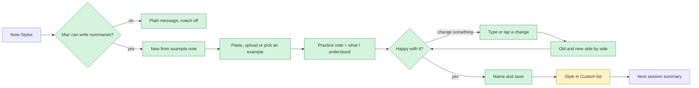

# Note Style Coach — Tauri spec
Status: draft for cwf; Date: 2026-11-07

Design source: `plans/2026-11-07-note-style-coach-design.md` (decisions marked **[Patrick]** there are settled; **[call]** items are listed under Decisions for Patrick below). Feature origin: the hackathon demo `pi0neerpat/scribular-note-style-coach` (Python + Ollama, MIT), local copy at commit `cfdf398`.

## Summary
- **What:** a therapist pastes a note they like, sees Scribular write a practice note in that style, adjusts it by typing plain requests, and saves it as a note style, with no help from us.
- **Why:** today every custom note style needs founder help, email, model testing and manual install, and that repeats on every change.
- **User-visible change:** new "New from example note" guided flow in Note Styles; a newer, larger summary model replaces the old one for everyone; the model picker in Settings is removed; Macs that can't run the new model keep recording and transcription but get a plain "can't write summaries" message.
- **Size / risk:** L. Most likely to go wrong: the new model not loading, fitting in memory beside the speech model, or writing good notes on an 8 GB Mac through the app's own engine.
- **Needs from Patrick:** approve this spec, confirm the defaults under Decisions, and pick the reviewer at hand-off.

## User workflow

**UX impact:**
- Macs that pass the RAM gate download a larger summary model once after updating; summaries wait for it, as they do on first run today. The model picker disappears from Settings.
- New three-step flow; practice notes take a model run each, may wait behind real notes, and never interrupt a recording.
- New message when summaries are unavailable: "Summaries aren't available on this Mac. Recording and transcription still work."

---

## Intent (why users need it; who)
Users are therapists, mostly non-technical. They know how their notes should read but cannot turn that into a reliable summary prompt; today that takes founder help, email, model testing and manual installation, and repeats on every change. The coach lets a therapist do it alone inside Scribular: paste a note they like, see a practice note written in that style, adjust it in plain words, save. Patrick's bar: "simplest, least complicated, most hand-holding." The therapist never sees words like "prompt" or "preferences".

The feature ships as two parts, in order:
1. **Part 1, model swap (prerequisite).** Gemma 4 E2B becomes the only summary model. The coach depends on it. **[Patrick]**
2. **Part 2, the coach.** A three-step guided flow in Note Styles (step-by-step layout chosen over a workbench). **[Patrick]**

## Tauri state today (what exists, what is missing, with file refs)

### Summary model
- Manifest: `GEMMA_2_2B = "gemma-2-2b-it-q4km"` (1,708,582,752 bytes) is the only LLM and `DEFAULT_LLM` (`src-tauri/src/models/manifest.rs:39-42,65-73`). Manifest tests assert exactly one default LLM (`manifest.rs:134`).
- Sampling: one `Params` const `GEMMA_2` (context 8192, temp 0.8, top_p 0.9, top_k 40, repeat penalty 1.1); `params()` falls through to it for any id (`src-tauri/src/llm/llama.rs:46-74`). The prompt is formatted as a single user turn through the GGUF chat template (`llama.rs:144-153`).
- Engine: `llama-cpp-2 =0.1.160` / `llama-cpp-sys-2 =0.1.160`, Metal, dynamic link (`src-tauri/Cargo.toml:38-39`).
- Selection: setting `summary_model_id` (`store/settings.rs:14`); at startup an id missing from the manifest logs a warning and keeps the default (`src-tauri/src/lib.rs:316-334`). Commands `list_summary_models`, `set_summary_model`, `switch_summary_model`, `revert_summary_model` (`src-tauri/src/commands.rs:488-607`); UI `SummaryModel.svelte` mounted in `Settings.svelte:342`, test `summary-model.svelte.test.ts`.
- Session provenance falls back to the raw model id when it is not in the manifest (`src/lib/components/SummaryPanel.svelte:37`).
- RAM: `low_memory()` reads `hw.memsize`; on 8 GB or less (or unknown) whisper is unloaded before the summary model runs (`src-tauri/src/jobs/session.rs:140-150`). It is private to `jobs/session.rs`; nothing gates downloads on RAM.

### Note styles and summarization
- `Prompt { id, name, description, text, isDefault, starred }`, `MAX_PROMPT_CHARS = 8_000` (`src-tauri/src/store/prompts.rs:15-30`). CRUD commands `get_prompt_list`, `create_prompt`, `duplicate_prompt`, `update_prompt`, `delete_prompt`, `set_prompt_starred`, `set_active_prompt` (`commands.rs:419-486`).
- UI: `NoteStyles.svelte` lists Custom then Built-in (`:41-42`), has "New style" (`:185`), star, "Make default", unsaved-changes and delete dialogs; editor `NoteStyleEditor.svelte`; tests `note-styles.svelte.test.ts`.
- Summaries wrap the style with `chunk_prompt` / `combine_prompt` and budget with `chunk_budget` (`src-tauri/src/llm/prompt.rs:12-30`). `Summarizer` / `SummarizerLoader` traits (`llm/mod.rs:55-89`); fakes `FakeSummarizer` / `FakeLoader` behind the `fake-engines` feature (`engines/fake.rs`, `Cargo.toml:14`).
- Queue: `JobQueue` with `regenerate`, `summarizing`, `is_busy`, `while_idle`, `preload`, `cancel` (`src-tauri/src/jobs/queue.rs:87-337`); persisted `summary_queue` table (migrations v2-v3).
- Migrations: v1-v7 in `store/migrations.rs:11`; next free is v8.
- Speaker labels: the system-audio side is "Client" and the microphone side "You" (`text/merge.rs:20-28`); after diarization speakers default to "Speaker N" (`text/speakers.rs:7-16`); all are user-renamable. Sample sessions use "Therapist:" / "Client:" (`store/samples.rs:5`).
- `create_prompt` and `duplicate_prompt` create starred styles (`store/prompts.rs:91-115`); the active-style fallback prefers starred styles (`prompts.rs:278`).
- `FirstRun.svelte` shows no model size; the only size text is in `SummaryModel.svelte:16`.

**Missing:** Gemma 4 manifest entry and params; hardware gate and a "summaries unavailable" state; any coach engine, practice job, bundled coach data, `style_spec` storage, coach commands or coach UI.

## Goals / Non-goals / Anti-goals
**Goals**
- A non-technical therapist goes from "a note I like" to a saved, working style without help and without seeing jargon.
- Everything runs on the device: example note, practice notes, chat, inference. No cloud fallback.
- Coach-made styles are ordinary Note Styles entries. Summarization, existing styles and existing sessions keep working.

**Non-goals**
- Recording, transcription, diarization, EHR, marketplace, cloud coaching, model-weight training.
- Improving a style from feedback on a real session's note (the demo's "Improve template").
- Style version history or rollback beyond compare-and-keep-old inside the flow. **[Patrick]**
- PDF/Word input (pasted text, `.txt`, `.md` only).
- Any other summary model, including a fallback model. **[Patrick]**
- Fixing built-in styles that read worse on the new model (report only).
- Reordering sections and free-form tone changes ("be warmer").

**Anti-goals**
- Any label, score or wording implying the note is correct, accurate or "confident". Checks measure formatting only.
- Therapist-visible jargon ("prompt", "preferences", "model", "token", "JSON").
- Regressions in existing styles, existing summaries or the summary queue; a practice run delaying or dropping a real summary.
- Example-note or practice-note facts leaking into real sessions, logs or telemetry.

## Requirements (numbered R1..)

### Part 1: model swap
- **R1** `models/manifest.rs` adds `GEMMA_4_E2B` (Gemma 4 E2B instruction-tuned, Q4_K_M GGUF, the variant the hackathon ran) with an exact upstream URL pinned to a commit, exact size, SHA-256 and license URL, and makes it `DEFAULT_LLM`. `GEMMA_2_2B` is removed from the manifest. Manifest tests still assert exactly one default LLM.
- **R2** `llm/llama.rs` gets an explicit `GEMMA_4_E2B => GEMMA_4` `Params` arm: context 8192, temperature 0.2, top_p 0.9 (the coach's settings); other values are the builder's, justified by the real-model run. `GEMMA_2` is removed; the `_` arm (unreachable after R3, since ids are matched as strings) returns `GEMMA_4`, and the `shortcut:` comment goes. Thinking is off: neither the formatted prompt nor the returned text contains a thinking block.
- **R3** At startup, a stored `summary_model_id` that is `gemma-2-2b-it-q4km` or otherwise not in the manifest is rewritten to `DEFAULT_LLM` (no warning log for the known old id).
- **R4** The summary-model picker UI is removed (`SummaryModel.svelte`, its mount in `Settings.svelte`, its test). Backend selection commands and their tests stay.
- **R5** No UI text names the old model or its 1.7 GB size. First run gets no new size text (it has none today).
- **R6** Hardware gate: before any LLM download starts, physical RAM is compared with `MIN_SUMMARY_RAM_BYTES`, set from the real-model measurements. Below it, the LLM is never downloaded; speech and speaker models still download. Whisper unloading uses its own 8 GiB threshold so its sequencing rule can change independently. Unknown RAM passes the summary gate (load failure is caught by `LoadFailed`); it keeps triggering whisper unloading.
- **R7** One backend state `SummaryAvailability` = `Ready | Downloading | Unsupported | LoadFailed`, exposed by command and event. `Unsupported` (gate) and `LoadFailed` (model fails to load on a Mac that passed) show the plain message in the session summary area, Note Styles (coach entry disabled), Settings and first run. Existing summaries stay viewable; regenerate is disabled; recording and transcription are unaffected. `LoadFailed` is not permanent: it clears on the next app launch, and Settings offers "Try again", which re-verifies the file's SHA-256 (re-downloading if it fails) and re-attempts the load. `Downloading` shows the existing "Waiting for the summary model download…" state.
- **R8** On a Mac that passed the gate, the old 2B file is deleted only after Gemma 4 has downloaded, passed SHA-256 and produced one short test summary on that Mac. On a Mac that fails the gate, the 2B file is deleted at startup (it can no longer be used). A failed or interrupted update never deletes the 2B file before those conditions hold.
- **R9** Existing sessions keep their stored `model_id`; regenerate uses the current model. The session view shows the stored id as today (`SummaryPanel.svelte:37`).
- **R30** On Macs that unload Whisper, the live-transcript wait notice appears only while a summary is running or ready to start; waiting only for another source's Whisper load stays silent.

### Part 2: coach engine (`src-tauri/src/coach/`)
- **R10** `extract`: deterministic port of `split_sections` / `extract_preferences`. Produces a `StyleSpec` (sections with name, required flag, guidance; sentence min/max; quotes max and required-when-available; pronouns; voice; emphasis list) plus a list of uncertain items. The `StyleSpec` stores headings and structural measures only, never sentences or facts from the example.
- **R11** `compile`: deterministic port of `validate_preferences` / `compile_prompt` with the fixed grounding block. The grounding block is always present after any edit; compiled text is at most `MAX_PROMPT_CHARS`; `StyleSpec` records a `compiler_version`.
- **R12** `checks`: the nine formatting checks (sections present, no repeated sections, optional omission, length, exact quotes, quote attribution, no names, pronouns, no preamble). Quote-attribution and pronoun checks read the speaker labels present in the transcript they are given; no role word ("Therapist", "Client", "You") is hard-coded.
- **R13** `retry`: on failed checks, add the matching correction blocks and regenerate, at most three attempts total; return the best attempt with its pass count and the failed check ids.
- **R14** `interpret`: a request becomes a validated typed patch, a clarifying question, or "unsupported". Allowed changes: sentence min/max (1-10), quote max (0-6), quotes required, emphasis, add section, remove section, rename section, set section optional or required. Section edits are matched to existing headings in code and tried deterministically before the model is asked; the model returns JSON only and never writes prompt text; patches with stale `before` values, unknown paths or out-of-bounds values are rejected; a style always keeps at least one required section. A request naming a section that does not exist returns a question listing the real section names. Vague requests return one focused question with answer options.
- **R15** Practice generation uses the same `chunk_prompt` / `combine_prompt` path and single-turn template as real summaries, not a system/user pair.
- **R16** Bundled data ported from the hackathon repo at `cfdf398`: four fictional sample notes (narrative, DAP, SOAP, brief CBT) and the nine annotated fixtures with `fixtures.json`. The ten library transcripts are not ported.

### Part 2: practice job and privacy
- **R17** A practice job has no session, is never persisted in `summary_queue`, never counts toward usage, and each attempt is a separate queue unit. Real summaries always run first; a queued real summary may run between attempts. While real work runs or waits, the coach shows a "waiting for your other notes to finish" state.
- **R18** A practice job is not started while recording and is cancelled when a recording starts; the user can cancel it at any time. Cancel leaves no partial state.
- **R19** No example-note, practice-transcript, practice-note or chat-request text appears in logs, diagnostics reports or telemetry; only event kinds and counts.

### Part 2: data model
- **R20** Migration v8 (or the next free version at implementation) adds nullable `prompts.style_spec TEXT` (JSON). `Prompt` gains `style_spec: Option<StyleSpec>` (`styleSpec` in TS); `ts-rs` types regenerated. Existing prompts read back unchanged with `styleSpec: null`.
- **R21** Saving a coach style creates a custom, starred prompt (starred as `create_prompt` does today) whose `text` is the compiled text and `style_spec` the spec; it appears under Custom. "Use it for my next sessions" (on by default) sets it active.
- **R22** Saving a hand edit to a coach-made style's text asks for confirmation first, then clears `style_spec`, making it an ordinary custom style. Name-only edits and starring do not detach.
- **R23** Saved text is frozen: a compiler change never rewrites saved styles. "Adjust with the coach" recompiles from `style_spec` with the current compiler and goes through the side-by-side before anything is saved.

### Part 2: UI
- **R24** Note Styles shows "+ New from example note"; a coach-made style shows "Adjust with the coach", which opens Steps 2-3 on the saved spec. Both are disabled with the plain message when `SummaryAvailability` is not `Ready`.
- **R25** Step 1: paste, upload `.txt`/`.md`, or pick one of the four samples; one button "Build my style". Empty, too-short and too-long input get plain errors (limits chosen by the builder, upper limit within `MAX_PROMPT_CHARS`).
- **R26** Step 2: the practice note is labelled "Practice session, not a real client"; above it, "What I understood" lists detected sections, length and voice in plain words and asks the uncertain items as questions. The best attempt is always shown with a label of the form "Matches your style: N of M formatting checks passed" and one sentence naming any failure; the therapist can always continue. "Try another practice session" switches the fictional session; the first is picked automatically. Progress text and Cancel are visible during generation.
- **R27** Step 3: a text box ("What would you like different?") plus one-tap suggestions (shorter, one sentence per section, include an exact quote when there is one, add a section, remove a section, make a section optional). Remove and make-optional show the current sections as buttons. Each accepted change re-runs the same practice session and shows old and new side by side with "Use this" and "Keep the old one"; nothing changes until "Use this". Unsupported requests get "I can change length, quotes and sections" and the suggestions again.
- **R28** Finish: name field (default "My note style"), "Use it for my next sessions" checkbox, Save.
- **R29** No coach-visible string contains "prompt", "preference", "model", "token", "JSON", "confident", "confidence" or "accurate".

## Acceptance scenarios (numbered AS1..; Given/When/Then; each tagged automated or manual)

### Part 1
- **AS1** (automated, cargo test) Given the manifest, then exactly one LLM exists, it is `GEMMA_4_E2B`, it is `DEFAULT_LLM`, its SHA-256 is 64 hex chars, and `gemma-2-2b-it-q4km` is absent. (R1)
- **AS2** (automated, cargo test) Given `params(GEMMA_4_E2B)`, then context 8192, temperature 0.2, top_p 0.9. (R2)
- **AS3** (automated, cargo test) Given a store with `summary_model_id = gemma-2-2b-it-q4km`, when the app starts, then the setting reads `DEFAULT_LLM` and no warning is logged. (R3)
- **AS4** (automated, vitest + grep) Given Settings renders, then no summary-model picker is present; a grep of `src/` finds no `1.7 GB`, `gemma-2` or `Gemma 2` in UI copy. (R4, R5)
- **AS5** (automated, cargo test) Given RAM below `MIN_SUMMARY_RAM_BYTES` (injected), when downloads start, then the LLM is not requested, speech models are, and `SummaryAvailability` is `Unsupported`. (R6, R7)
- **AS6** (automated, cargo test, fake-engines) Given a loader that fails to load, when a summary is requested, then `SummaryAvailability` is `LoadFailed`, the session keeps its transcript and is not lost, and a recording can still start; when "Try again" runs with a loader that now succeeds, then the state returns to `Ready`; given a fresh start, then the state is not `LoadFailed`. (R7)
- **AS7** (automated, vitest) Given `Downloading`, then the summary area shows the existing waiting message. Given `Unsupported` or `LoadFailed`, then the summary area, Note Styles, Settings and first run show the plain message, the coach entry is disabled, regenerate is disabled, and an existing summary is still visible. (R7, R24)
- **AS8** (automated, cargo test) Given an old 2B file, when Gemma 4 is downloading, fails SHA-256, or has not yet produced its test summary, then the 2B file exists; when all three pass, then it is deleted; given a gate-failing Mac, then it is deleted at startup. (R8)
- **AS9** (automated, cargo test) Given a session that already has a summary and `model_id = gemma-2-2b-it-q4km`, when it is regenerated (fake engine), then the summary is written with the current model id and the old id stays in `previous_model_id`. (R9)
- **AS10** (manual real-app, 8 GB Mac VM) Given a fresh update from the current release, when the app starts, then Gemma 4 E2B downloads, loads through `llama-cpp-2 0.1.160`, runs under the 8 GiB whisper-unload sequencing (whisper unloaded before the summary), lets a new recording start while a summary is running without either failing, writes a fixture session's summary with no thinking text, and the 2B file is then removed. Record: peak RSS, load time, tokens/s, the transcript phrases asserted, and the value chosen for `MIN_SUMMARY_RAM_BYTES` with its reasoning. Report load failure as a blocker. (R1, R2, R6, R8)
- **AS10a** (manual real-app, 8 GB Mac VM) Given a summary is running, when a recording starts on a low-memory Mac, then the live-transcript area shows "Live transcript will start when the current summary finishes." while the header still shows Recording; with mic+system input it appears once and clears once. If Stop is pressed during the wait, the message may remain under "Transcribing…" until transcription starts, then disappears; the final transcript is still complete. After the summary finishes, the buffered live transcript catches up with the final transcript complete (assert the expected phrases and no lost audio). On a Mac above the threshold (`unload_whisper` false), no message appears and live text starts immediately. A window reload during the wait does not restore the message. (R30)
- **AS11** (manual real-app, report only) Given the seven built-in styles, when each summarizes the bundled fixtures on Gemma 4 E2B, then list any that are clearly worse, with the reason, in the PR. No fixes. (Goal: existing styles)

### Part 2: engine
- **AS12** (automated, cargo test) The 37 demo engine tests (`tests/test_coach.py`) and the engine-level cases of `tests/test_feedback_api.py` (vague request, stale base rejected, fenced JSON, malformed response, inference failure leaves the style unchanged) are ported to Rust and pass, adapted only where the Rust API differs. Its HTTP-route, Ollama-address and version-history cases have no Tauri counterpart and are not ported. (R10-R14)
- **AS13** (automated, cargo test) Golden tests: each of the four sample notes extracts to a fixed `StyleSpec` and compiles to fixed text that contains the grounding block and is at most `MAX_PROMPT_CHARS`; all nine bundled fixtures load with their `fixtures.json` metadata. (R10, R11, R16)
- **AS14** (automated, cargo test) Given an example note containing a client name and a quote, then the serialized `StyleSpec` contains neither. (R10)
- **AS15** (automated, cargo test) Given a fixture and its relabelled copies ("You:" / "Client:", the app's default, and "You:" / "Speaker 1:", after diarization, instead of "Therapist:" / "Client:"), then the quote-attribution and pronoun checks give the same results for the same note. (R12)
- **AS16** (automated, cargo test, fake-engines) Given a fake engine whose first two outputs fail a check and third passes, then three attempts run, the second and third prompts contain the matching correction block, and the result reports the third attempt; given three failing outputs, then the best one is returned with its failed ids. (R13)
- **AS17** (automated, cargo test) Given requests "remove Next Actions", "make Risk optional", "rename Client Discussed to Presenting Concerns", then each produces the expected patch without calling the engine; given "remove Homework" with no such section, then a question listing the real sections is returned; given removal of the last required section, then the patch is rejected. (R14)
- **AS18** (automated, cargo test, fake-engines) Given a vague request, then one question is returned; given model output with prose around JSON, an unknown path, an out-of-range value or a stale `before`, then the patch is rejected and the style is unchanged. (R14)
- **AS19** (automated, cargo test, fake-engines) Given a long fixture transcript that needs more than one chunk, when a practice note is generated, then the calls go through `chunk_prompt` then `combine_prompt` with the compiled text as base. (R15)

### Part 2: job, privacy, data
- **AS20** (automated, cargo test, fake-engines) Given a practice job running and a real summary queued, then the real summary runs before the next practice attempt, the practice job is never written to `summary_queue`, no session row is created, and the telemetry session and seconds counters (`diag/telemetry.rs:147-152,192`) are unchanged. (R17)
- **AS21** (automated, cargo test, fake-engines) Given a practice job, when a recording starts or the user cancels, then the job stops, emits a cancelled event, and leaves no stored state; given an active recording, then starting a practice job is refused. (R18)
- **AS22** (automated, cargo test) Given a full coach run with sentinel strings in the example, transcript and request, then neither the log file nor a diagnostics report nor a telemetry payload contains them. (R19)
- **AS23** (automated, cargo test) Given a v7 database with custom and built-in prompts, when migrated, then all rows read back unchanged with `style_spec` null; a coach save round-trips its `StyleSpec`. (R20, R21)
- **AS24** (automated, cargo test) Given a coach style, when its text is updated, then `style_spec` is null; when only its name or star changes, then `style_spec` is kept. (R22)
- **AS25** (automated, cargo test) Given a saved coach style and a compiler change (test double), then its stored text is unchanged; "adjust" returns a recompiled candidate without saving. (R23)

### Part 2: UI
- **AS26** (automated, vitest) Step 1: empty, too-short and too-long input show plain errors and keep "Build my style" disabled; picking a sample fills the input; `.txt`/`.md` upload works and other types are refused plainly. (R25)
- **AS27** (automated, vitest) Step 2: shows the practice label, "What I understood", the "N of M formatting checks passed" label and failure sentence, Continue always enabled, Cancel during generation, and the waiting state when the backend reports real work ahead; the first practice session is chosen without user input, and "Try another practice session" requests a different one. (R26, R17)
- **AS28** (automated, vitest) Step 3: tapping "Remove a section" shows section buttons; a change shows old and new side by side; "Keep the old one" leaves the spec unchanged; "Use this" replaces it; an unsupported reply shows the suggestions again; a clarifying question renders its answer options as buttons, and an unknown section name renders the real section names as buttons. (R14, R27)
- **AS29** (automated, vitest) Finish: default name "My note style", checkbox on; Save calls the save command with the spec and `useNext`; the style appears under Custom with "Adjust with the coach", which opens Step 2 with the saved spec; editing its text shows the detach confirmation. (R21, R22, R24, R28)
- **AS30** (automated, vitest) Every rendered coach screen and error state contains none of the R29 words. (R29)
- **AS31** (manual real-app, 8 GB Mac VM) Full flow on Gemma 4 E2B: each of the four samples → practice note → one typed change and one section change → save → record a fixture session with the new style; then summarize a long fixture transcript that needs more than one chunk with a coach style, so the compiled text is exercised in the combine pass on the real model. Assert transcript phrases and the presence of the style's section headings only. Record times per step as single runs, not benchmarks. (R15, R17, R26-R28)
- **AS32** (manual real-app) Unaided walkthrough by a non-technical therapist from "a note I like" to a saved style. Pass/fail criteria are agreed with Patrick before it runs; until then, report it as unverified. (Goal: hand-holding)

## Design notes (modules, commands/events, data model + migration, UI components)
- **Where it runs / data flow:** UI → `api.ts` → coach commands → `coach::extract` / `compile` (sync, deterministic) → practice job on `JobQueue` → `Summarizer` via `chunk_prompt` / `combine_prompt` → `coach::checks` → `retry` → result event. `interpret` runs deterministic matching first, then a short JSON-only model call through the same queue.
- **Modules:** new `src-tauri/src/coach/{mod,spec,extract,compile,checks,retry,interpret,data}.rs` (layout is the builder's); bundled data under `src-tauri/src/coach/data/` via `include_str!`. Touched: `models/manifest.rs`, `models/mod.rs` (gate, 2B cleanup), `llm/llama.rs`, `lib.rs` (setting rewrite, availability), `jobs/queue.rs` (practice units, priority, cancel on record), `jobs/session.rs` (`low_memory()` uses the shared RAM helper), `store/migrations.rs`, `store/prompts.rs`, `commands.rs`.
- **Commands & events (suggested names):** `get_summary_availability` + event `summary-availability`; `coach_samples`; `coach_build(exampleText) -> CoachDraft { spec, understood }`; `coach_practice(spec, sampleId) -> jobId` with events `coach-progress`, `coach-result`, `coach-cancelled`; `coach_cancel(jobId)`; `coach_interpret(spec, request) -> CoachReply = Patch | Question | Unsupported`; `coach_save(name, spec, useNext) -> PromptList`. All types via `ts-rs`, wrapped in `src/lib/api.ts`.
- **Migration:** v8, `ALTER TABLE prompts ADD COLUMN style_spec TEXT;` append-only.
- **UI components:** `NoteStyleCoach.svelte` (three steps + finish, in Note Styles), `SummaryUnavailable.svelte` (shared message), edits to `NoteStyles.svelte`, `NoteStyleEditor.svelte` (detach confirm), `Settings.svelte`, `FirstRun.svelte`, `SummaryPanel.svelte`; remove `SummaryModel.svelte`. Tests in the existing `*.svelte.test.ts` style.
- **Spec author's calls:**
  - Practice data uses the hackathon fixtures as written ("Therapist:" / "Client:"); checks read labels from the transcript, so real "You" / "Speaker N" labels work too.
  - `StyleSpec` is a typed Rust struct serialized as JSON, not free JSON, so `ts-rs` and validation share one shape.
  - `SummaryAvailability` is one state for all four surfaces so they cannot disagree.
  - Deterministic section matching runs before the model, to keep the common requests fast and independent of the small model.
  - 2B file deleted at startup on gate-failing Macs, since nothing can use it.
  - Unknown RAM passes the gate: on macOS it practically never happens, and blocking summaries on a read error would be worse than a caught load failure.
  - Section remove / rename / optional-required are new relative to the demo (it only supports `sections.add`); they get their own tests in AS17.

## Dependencies and security check
**New dependencies: none.** The extraction and checks are ported with std string handling. If the builder needs regular expressions, use `regex =1.13.1` (MIT/Apache-2.0, already in `Cargo.lock` transitively) and record the check below in the PR.

Security check for the model download (in the PR description):
- [x] **License**: Gemma 4 E2B is Apache-2.0; license URL recorded in the manifest.
- [x] **Pinned artifact:** Hugging Face pinned-revision metadata and a stream-only download match the manifest size and SHA-256; AS10 still verifies the app download and inference (R1).
- [ ] **Known vulnerabilities:** `cargo audit` / `npm audit` unchanged by this work.
- [ ] **Bundled data** from the MIT hackathon repo is fictional; copyright line kept in a NOTICE entry.

## Models
- **Gemma 4 E2B instruction-tuned, Q4_K_M GGUF** (`GEMMA_4_E2B`): the only summary model. Source URL, size, SHA-256 and license are pinned by the builder in R1 and checked by AS1. Required download on Macs that pass the gate, through the existing `ModelManager` download, retry and SHA-256 verification; skipped on Macs below the gate. Replaces `gemma-2-2b-it-q4km` (removed per R8).

## Out of scope
- Improving a style from a real session's note: future spec, not yet written.
- Style version history and rollback: future spec if requested.
- PDF/Word input, section reordering, free-form tone changes: future coach iteration.
- Re-tuning built-in styles for Gemma 4: follow-up from AS11's report.
- Windows/Linux hardware gate: later platform milestone.

## Depends on / interacts with (other specs by slug)
- **03-note-styles-model-choice**: owns `Prompt`, Note Styles UI and the model switcher this spec removes. Landed; this spec builds on it.
- **05-auto-update**: delivers the update that triggers the new download; no change, but the larger download follows it.
- **07-onboarding-samples**: first run and sample sessions; first-run size text and the unavailable message touch `FirstRun.svelte`.
- **09-session-management-recovery**: summary undo (`previous_model_id`) and queue recovery; practice units must not appear in recovery.

## Coordination notes
- Part 1 lands before Part 2; the coach's real-model checks need Gemma 4 in the app.
- `jobs/queue.rs` is touched by PR1 (availability on load failure) and PR3 (practice units); keep them sequential.
- Implementation by Codex CLI on the VM, independent review by Claude CLI. Tests assert transcript phrases and structure, never summary wording (`CLAUDE.md`).

## Decisions for Patrick (with recommended default)
1. Delete the old 2B file only after Gemma 4 is downloaded, verified and has written a test summary; delete immediately on Macs that fail the gate. **Default:** yes.
2. Include "Adjust with the coach" on coach-made styles in this version. **Default:** yes (cheap, spec is stored).
3. "Use it for my next sessions" checked by default at save. **Default:** on.
4. Hand-editing a coach style's text detaches it after a confirmation. **Default:** yes.
5. Result label wording: "Matches your style: N of M formatting checks passed". **Default:** this wording.
6. "What I understood" shown above the practice note, with uncertain items as questions. **Default:** yes.
7. Practice generation refused while recording and cancelled when a recording starts. **Default:** yes.
8. Pass/fail criteria for the unaided therapist walkthrough (AS32). **Default:** therapist saves a style that produces their sections on the practice session within 15 minutes, without asking for help; criteria confirmed before the run.
9. Reviewer for `cwf init`. **Default:** ask at hand-off.

## Size (S/M/L, rough days) and suggested PR split if > ~1 PR
**L, about 9-12 days.**
1. PR1 (M): model swap, params, setting rewrite, picker removal, hardware gate, `SummaryAvailability`, 2B cleanup — AS1-AS10, AS10a, AS11 report.
2. PR2 (M): `coach/` engine and bundled data, no UI — AS12-AS19.
3. PR3 (M): `style_spec` migration, coach commands, practice job and queue priority, privacy — AS20-AS25.
4. PR4 (M): coach UI and Note Styles/editor changes — AS26-AS30.
5. PR5 (S): real-model end-to-end evidence and walkthrough — AS31, AS32.

## Execution notes (2026-11-08)

- Approved by Patrick 2026-11-07. Every "Decisions for Patrick" item takes its stated default. Patrick confirmed all defaults on 2026-11-08, including decision 8 (AS32 pass = a non-technical therapist saves a style that produces their sections on the practice session within 15 minutes, without asking for help).
- Workflow: cwf, reviewer cubic, harness codex, review phase claude (`--harness codex --phase-harness review=claude`).
- PR plan (one cwf task per PR, run one at a time, stacked branches):
  - p1 model swap (AS1-AS11, AS10a), branch from origin/main with design + spec commits cherry-picked
  - p2 coach engine (AS12-AS19), based on p1
  - p3 data/commands/practice job (AS20-AS25), based on p2
  - p4 coach UI (AS26-AS30), based on p3
  - p5 real-model evidence + walkthrough (AS31-AS32), based on p4
- Each PR: uitest screenshot in body, local recording path (runs/<ts>/recording.mp4) on the first lines of the description. Never merged without Patrick's review.
- Recordings and screenshots go under `runs/<ts>/` in the task clone (not committed).

### This task (p1)
- This task = p1, model swap (PR1 in the split above): manifest swap to Gemma 4 E2B, params, setting rewrite, picker removal, hardware gate, `SummaryAvailability`, 2B cleanup. Covers AS1-AS10, AS10a and AS11 (AS11 is a report only, no fixes).
- Other PRs' scope (coach engine, `style_spec` migration, coach commands, practice job, coach UI, AS12-AS32) is out of bounds for this task.
- PR base = `main`.
- Before the real Gemma 4 download for AS10, check `df -h /System/Volumes/Data` shows >= 6 GB free; never delete `~/Library/Caches/scribular-uitest` or `~/cargo-target/scribular-tauri`.
