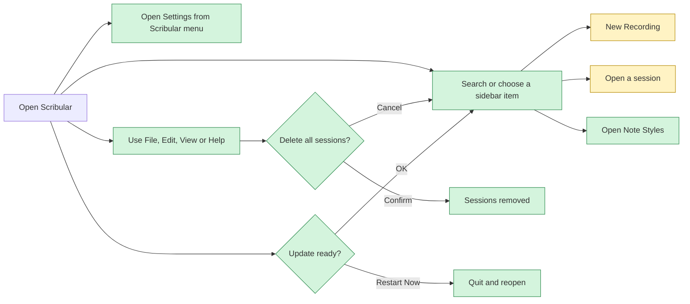

# App shell and navigation — Tauri spec
Status: approved (Patrick, 2026-11-16, incl. default decisions); Date: 2026-11-16

## Summary
- **What:** One main window with a searchable session sidebar, a separate Settings window, and a complete Mac menu bar.
- **Why:** Therapists need to find sessions, start work, and change preferences without hunting through unrelated pages.
- **User-visible change:** Note Styles joins the sidebar; a lapsed license leaves sessions readable; updates and Delete All use clear alerts.
- **Size / risk:** L; native menu state and the read-only boundary could disagree with the visible controls.
- **Needs from Patrick:** Confirm the recommended defaults under Decisions for Patrick.

## User workflow

**UX impact:**
- Search and Note Styles stay one click away; Settings opens in its own window.
- A license lapse blocks changes while keeping sessions available to view and copy.
- Delete All asks before removal; a ready update waits until recording stops before asking to restart.

---

## Intent (why users need it; who)
Clinicians using the Mac app need a reliable place to start a recording, find past sessions, manage their note styles, and reach infrequent preferences. The approved [app-shell design](http://100.108.210.63:3000/pi0neerpat/scribular-docs/src/branch/main/design/app-shell/README.md) and [design principles](http://100.108.210.63:3000/pi0neerpat/scribular-docs/src/branch/main/design/README.md) are the behavioral source of truth; the [app-shell gap analysis](http://100.108.210.63:3000/pi0neerpat/scribular-docs/src/branch/main/design/_gaps/app-shell.md) and [cross-cutting gaps](http://100.108.210.63:3000/pi0neerpat/scribular-docs/src/branch/main/design/_gaps/README.md) identify the current seams. Patrick's 2026-11-16 decisions narrow recording modes to microphone and microphone plus app audio, keep a manual call-app picker, use the style selected at Stop, omit call-app detection, and require no old-app migration.

## Tauri state today (what exists, what is missing, with file refs)
- `src/App.svelte:42-47,174-192` switches Record, History, and Settings pages, shows the tour button, and locks navigation during model work; `src/lib/navigation.ts:4-5` has `record | history | settings | session-detail`. The locked-store replacement and quit confirmation already exist in `src/App.svelte:145-151`.
- `src/lib/components/SessionHistory.svelte:100-143` lists sessions without grouping or search, has inline row actions and an inline Delete All confirmation. `src-tauri/src/commands.rs:335-376` exposes list/get/delete/clear commands; `src-tauri/src/jobs/queue.rs:333-364` skips active sessions during clear; `src-tauri/src/store/sessions.rs:863-865` removes dependent session data.
- `src/lib/components/Settings.svelte:47-64,263-273,308-323,384-401` holds five in-window categories, defaults to Session, and includes Note Styles, About, sample restore, and update controls. `src-tauri/src/store/settings.rs:15-43,73-104` and `src/lib/types/AppSettings.ts:3` persist two app preferences, with no automatic-update preference. Recording source and target app are already saved in `RecordingSettings` (`src-tauri/src/store/settings.rs:45-55`).
- `src-tauri/src/lib.rs:213-220` installs Tauri's default app menu; `src-tauri/src/shell/tray.rs:18-55` provides the existing tray menu and recording actions. `src/lib/api.ts:72-73,131-133,283-284` wraps existing session and settings commands. `REVIEW.md:19-38` requires one API wrapper per Rust command/event and attention to reload, IPC, and private data.
- `src/lib/components/UpdateBar.svelte:20-46` displays a Ready bar with Later/Restart/What's new. `src-tauri/src/lib.rs:419-465` starts automatic hourly checks; `src-tauri/src/update/mod.rs:344-389` supports staged install on quit. `src/lib/api.ts:60-65` wraps update state/events.
- `src/lib/components/RecordView.svelte:316-322` blocks starting when access does not allow it, but mutation commands in `src-tauri/src/commands.rs:345-380,434-485,733-758` do not share a read-only authorization check. `src/lib/types/AccessState.ts:4-7` has the access variants; `src/lib/license.ts:35-38` identifies denied states.
- **Missing:** persistent sidebar and search command; separate Settings webview; complete native menus and enablement; automatic-update preference; lapsed-license read-only enforcement across mutation commands; the specified update alert and File-menu Delete All flow. Recording, note editing, and coach gaps belong to their respective specs.

## Goals / Non-goals / Anti-goals
**Goals:** Give the main window persistent, keyboard-accessible navigation and search; move app preferences to a separate window; provide complete native menus with correct availability; enforce license lapse at the Rust boundary; make update and destructive actions predictable.

**Non-goals:** Implement recording capture/Stop-to-session, note editing and Undo, coach internals, style visibility rules, first-use education, shortcut assignments, or theme. Those have named owners below. Search ranking, export, sync, and multiple Macs are deferred.

**Anti-goals:** Do not keep the old in-window Settings or a third app-audio-only mode; do not treat a disabled button as the sole license gate; do not delete or expose session data from a cancelled alert; do not migrate old Electron settings/data or add compatibility for them.

## Requirements (numbered R1..)
### Main window and navigation
- **R1** Replace the page-switching Record/History/Settings navigation with one main-window sidebar ordered search, New Recording, Note Styles, then session groups Today, Yesterday, Earlier in the user's local calendar. Keep Sample in its date group. Selection opens the corresponding content in the main window; no separate History or Settings page remains. Preserve locked-store replacement, quit confirmation, focus restoration, and model-work navigation lock.
- **R2** Sidebar session rows show the session title/status and an interrupted recording's Recover badge, a writing indicator while a note processes, and a copied checkmark after successful final-note copy. Put per-row Recover, Stop/Cancel where applicable, and Delete in a context menu; action availability follows the current session state. A successful session change, recovery, deletion, or recording completion refreshes the list without losing a valid selection.
- **R3** Sidebar search filters sessions by case-insensitive substring of title, displayed local date, transcript, or note, without remote indexing or logging query/content. Search is read-only, works across all date groups, and an empty query restores all rows. Edit ▸ Find focuses and selects the field. A search failure shows a retryable error while preserving the prior list/selection; result order remains the normal newest-first order.
- **R4** The fixed Note Styles item opens the style list/editor in the main content area; the record toolbar's trial/license action opens Settings ▸ License. The shell supplies navigation entry points to the recording-and-session, onboarding, and note-style-coach owners, including Manage Note Styles… and coach sheet presentation, without implementing their internal flows.

### Menu and Settings
- **R5** Install one native macOS menu bar with the exact Scribular, File, Edit, View, Window, and Help item structure in the approved design (`app-shell/README.md:200-210`). Scribular contains About, Check for Updates…, Settings…, standard Services/Hide items, and Quit. File contains New Recording, Start/Stop, Pause/Resume, New Style from Example Note…, New Blank Style, Copy Note, Rewrite Note As submenu, Recover Interrupted Recording…, Delete All Sessions…, and Close Window. Edit contains Undo/Redo, standard text actions, Delete Session, and Find. View contains Note/Transcript/Audio, live transcript, Note Styles, Previous Session, Next Session, sidebar, and full screen. Window contains standard window actions and Scribular to reopen the main window. Help contains standard Search, Scribular Help, Keyboard Shortcuts (opens Settings ▸ Keyboard Shortcuts), Welcome, coach, sample restore, support/privacy/site. Route app-specific items to the active main-window flow and preserve close-to-tray and quit confirmation.
- **R6** Menu enablement and visibility reflect the same current recording, selection, summary, model lock, license, and coach-availability state as the UI. A command rechecks state on execution so a stale menu cannot start forbidden work or act on the wrong session. The keyboard-shortcuts spec owns accelerators and the Shortcuts pane; this spec owns menu item identity, placement, routing, and enablement.
- **R7** Scribular ▸ Settings… opens/focuses one separate Settings webview window, defaulting to General when newly opened; repeat invocation does not create duplicates. Its five panes, in order, are General (note-ready alert, anonymous usage/crash data, automatic updates, version; developer controls only in dev builds), Appearance (content owned by theme, including Stars motion), Recording (speaker identification and download, keep audio), Keyboard Shortcuts (content owned by keyboard-shortcuts), and License (trial/license entry/removal/Buy). Close Settings independently of the main window. Remove Note Styles, About, support links, sample restore, and Delete All from Settings; preserve dirty-editor protection when moving Note Styles.
- **R8** Persist `checkForUpdatesAutomatically` in `AppSettings` (Rust and generated ts-rs TypeScript); default it on for a new install, as checks currently run automatically. Turning it off stops scheduled checks, including after restart; manual Check for Updates… remains available. Turning it on resumes checks. Save failure leaves the displayed choice at the last persisted value and reports an error.

### License, deletion, and updates
- **R9** Use one shared access decision for trial/licensed/grace versus trial ended/invalid/lapsed. In denied states, the record screen, each note, and Note Styles show the approved renewal banner with Enter License… and Buy, and keep existing sessions, notes, transcripts, and retained audio viewable and copyable. Disable starting recording, note rewrite/edit, coach, style creation/edit/visibility changes, and other new content mutations in UI and native menus; allow an already-started recording/job to finish or cancel safely. Rust mutation commands recheck access and return a stable denial without changing data; viewing, copying, license entry, and renewal remain available. Deletion is never gated by license: Delete Session, Delete All Sessions and deleting a custom note style stay available in every access state (data sovereignty, Patrick 2026-11-16). Locked-store state still takes precedence over the shell.
- **R10** File ▸ Delete All Sessions… is unavailable when recording is active or there are no sessions, and opens a native destructive confirmation naming the current session count and loss of local audio, transcripts, and notes. Cancel is the default; Escape/Return cancel. Only an explicit click on Delete All Sessions calls the existing clear operation. Refresh the sidebar and report deleted/skipped counts or an error; a partial failure must not claim all sessions were removed. A denied license never disables deletion; the only availability rules are recording-active and no-sessions.
- **R11** When a downloaded update becomes ready, show one alert per version with “An update is ready.”, version text, OK and Restart Now. Defer it throughout recording and show it after Stop; do not interrupt capture. OK leaves the staged update to install on normal quit; Restart Now uses the existing guarded quit/relaunch path, respecting active-work confirmation. Do not show the main-window UpdateBar. Alert failure must leave the ready update installable on quit and provide a recoverable error or manual Check for Updates path.
- **R12** Mount the note-style-coach-owned Note Styles banner and the recording-and-session-owned per-note fallback at their shell destinations; consume the shared coach availability gate for coach entry points. The shell must not block recording or session access because summary/coach work is unavailable.
- **R13** Protect private data and failure paths across shell IPC: search and menu payloads contain IDs/actions rather than transcript, audio, or note bodies where possible; no such content appears in logs/telemetry; listener setup uses a snapshot after subscription so reloads do not miss license/update/recording state; background update/search/coach failure never loses a session or blocks recording.

## Acceptance scenarios (numbered AS1..; Given/When/Then; each tagged automated or manual)
- **AS1** (manual real-app; R1) Given sample and dated sessions, when the app opens and the operator selects New Recording, Note Styles, and each date group, then one main window retains the sidebar and shows the selected content; record selected item, visible grouping, locked-store replacement, model-lock dimming, and focus after close/reopen.
- **AS2** (automated, vitest; R2) Given interrupted, queued, and complete sessions, when rows render and their state changes, then Recover, writing, and copied markers and context actions match state and the selected row survives a list refresh when it still exists.
- **AS3** (automated, cargo test + vitest; R3) Given titles, local dates, transcript, and note terms, when a mixed-case query is submitted or cleared, then matching sessions appear in newest-first groups or all rows return; a query/error does not log private text or clear the previous list.
- **AS4** (manual real-app; R3-R4) Given a session and styles, when Edit ▸ Find is chosen and then Note Styles, Manage Note Styles…, and the trial action are used, then Find focuses/selects search, the style list opens in the main window, and License opens in Settings; record the navigation and focus behavior.
- **AS5** (manual real-app; R5-R6) Given idle, recording, queued-note, selected-note, lapsed-license, and locked-store states, when each of the six native menus is opened and relevant items invoked, then the item list, enabled state, action target, and close/quit behavior match R5-R6; record menu screenshots and the resulting view/action for each state.
- **AS6** (automated, cargo test; R6,R9) Given a stale enabled menu action or direct IPC call after license state changes to denied, when a content mutation is requested, then the command rejects it and stored content is unchanged.
- **AS7** (manual real-app; R7) Given main and Settings windows, when Settings is invoked twice, switched among General, Appearance, Recording, Keyboard Shortcuts, and License, closed, and invoked again, then there is one window, General is the fresh default, Stars motion appears only in Appearance, moved content is absent, and main-window work remains available; record both window titles/panes.
- **AS8** (automated, cargo test + vitest; R8) Given automatic updates on by default, when the setting is switched off/on and the app restarts, then scheduled checks stop/resume, manual checks still work, and a failed save restores the persisted switch value.
- **AS9** (automated, cargo test + vitest; R9) Given each allowed and denied `AccessState`, when view/copy and every user-content mutation in the Design notes inventory is attempted, then only denied states reject mutations, renewal remains usable, `delete_session`/`clear_all_sessions`/`delete_prompt` succeed in every denied state, and no stored session/style changes; inspect the visible renewal banners separately in AS10.
- **AS10** (manual real-app; R9,R12) Given a lapsed license and then unavailable summary model, when record, note, and Note Styles are opened, then one renewal banner appears on each applicable surface, view/copy still work, coach actions dim, Note Styles has one state-specific banner (Try Again only for LoadFailed), and each unavailable note has the owned fallback line; record views and attempted actions.
- **AS11** (automated, cargo test + vitest; R10) Given zero, several, recording, lapsed-license, and partial-clear states, when Delete All is requested/cancelled/confirmed, then availability and default cancellation match R10, only explicit confirmation invokes clear, and deleted/skipped counts are accurate.
- **AS12** (manual real-app; R10) Given multiple sessions with retained audio, when File ▸ Delete All Sessions… is opened, Return/Escape is pressed, then reopened and the red action clicked, then cancellation leaves all sessions and explicit confirmation removes the reported sessions; record the alert, count, selected default, and final sidebar.
- **AS13** (automated, cargo test + vitest; R11) Given a Ready update event during recording and duplicate Ready events for the same version, when recording stops, then exactly one alert is queued; OK preserves install-on-quit and Restart Now uses the guarded relaunch path.
- **AS14** (manual real-app; R11) Given a downloadable test update, when it becomes ready during recording, then no alert appears until Stop; record the alert/version/choices and verify OK followed by normal quit installs it, then repeat with Restart Now and record the resulting version. Report unverified if no signed test update is available.
- **AS15** (automated, cargo test + vitest; R13) Given reload between event subscription and snapshot, stale menu state, and failed search/update availability calls, when the shell resumes, then the latest state wins, private bodies are absent from diagnostics, the session remains accessible, and recording can still start when access allows.

## Design notes (modules, commands/events, data model + migration, UI components)
- **Where it runs / data flow:** Rust owns the app menu, Settings window creation, access enforcement, persisted preferences, search, and updater schedule. The main Svelte webview owns sidebar selection, visible alerts, and content routing. Menu events carry command IDs and selected session IDs; the receiving flow verifies its current context before acting. The Settings webview reads/writes the same Rust settings and access state; both windows subscribe then snapshot to converge after missed events.
- **Modules touched or added:** `src/App.svelte`, `src/lib/navigation.ts`, `src/lib/components/SessionHistory.svelte`, `Settings.svelte`, `UpdateBar.svelte`, `LicenseGate.svelte`, `src/lib/api.ts`, and generated `src/lib/types/AppSettings.ts`; `src-tauri/src/lib.rs`, `shell/`, `commands.rs`, `store/sessions.rs`, `store/settings.rs`, `update/mod.rs`, and command/event contract tests. Recording-and-session owns changes inside `RecordView.svelte`/`SummaryPanel.svelte`; note-style-coach owns style rows, coach, and shared availability; keyboard-shortcuts owns accelerator bindings and its pane; theme owns appearance.
- **Commands & events:** Add `search_sessions(query)` returning `SessionListItem[]`, filtered in the encrypted local store across title/date/transcript/note; keep `list_sessions` for the empty query. Reuse `get_app_settings`/`set_app_settings`, `clear_all_sessions`, `get_update_state`/`update://state`, access-state subscription, and existing session actions. Add only the small menu/window routing IPC and state event needed for both webviews; each new command/event gets a `src/lib/api.ts` wrapper and generated ts-rs payload type if it carries structured data. Rust enforces access in shared mutation paths, so tray, menus, and direct IPC cannot bypass it. Avoid serializing sensitive search fields into menu events.
- **Read-only command inventory:** Gate `start_recording`, `transcribe_file`, `recover_session`, `regenerate_summary`, `undo_summary`, `redo_summary`, `update_session`, `create_prompt`, `duplicate_prompt`, `update_prompt`, the note-style-coach `showInStyleMenu` visibility mutation, `set_active_prompt`, and `update_speaker_map`, plus new note/coach content-mutating commands added by the owning specs. `stop_recording`, `cancel_job`, `confirm_speaker_labels`, and `skip_diarization` remain available to safely finish or cancel work already running; the existing background pipeline may finish and save an already-started session. Preference changes, license actions, view, copy, and all deletion (`delete_session`, `clear_all_sessions`, `delete_prompt`) remain available and must never be added to the gate. The owner of each new mutation extends the shared check and AS9 coverage in its PR.
- **Data model + migration:** `AppSettings.checkForUpdatesAutomatically: bool` uses a new key in the existing settings table, default true. No schema migration is needed for that key or for sidebar grouping/search over current session fields; confirm the query uses the encrypted DB and existing indexes are adequate for this small local dataset. If implementation reveals a necessary index or column, append the next free migration in `src-tauri/src/store/migrations.rs`; never edit shipped migrations. Do not import or migrate Electron settings/data, including stars animation.
- **UI components:** One persistent sidebar; context menu on session rows; one native Settings window with five panes; license banner on the three named surfaces; native destructive and update alerts. Native menu structure follows design, while the keyboard-shortcuts spec attaches shortcuts. Keep a stable selection when a filter changes; if it becomes hidden, leave content visible until the user selects another result, to avoid a surprising context switch.
- **Spec author's calls:** Search uses substring matching and current sort because ranking is outside scope. Local displayed date matching avoids a separate date parser. Automatic checks default on to preserve today's behavior. Deletion is never license-gated (Patrick, 2026-11-16: data sovereignty). A confirmed clear reports skipped sessions because the existing queue can partially clear. The shell owns menu command routing; feature specs own action semantics.

## Dependencies and security check
**New dependencies: none planned.** Reuse the existing Tauri stack, macOS native alert facilities, updater, SQLite, and ts-rs. If implementation requires a new dialog crate/plugin, record its exact pin, closed-source-compatible license, vulnerability check, install-time code, and artifact source/hash in this section before adding it; stop only for a concrete material issue. Implementation review must verify the local encrypted search path, Rust authorization for mutations, and no session content in logs or menu events.

## Out of scope
- `recording-and-session`: source picker, manual call-app picker, two modes only (In the room = mic; On a call = mic plus app audio), recorder controls/levels/late attach, style chosen at Stop, Stop-to-session, note-first tabs, editable note/Undo, copied marker, and action semantics for session row controls.
- `keyboard-shortcuts`: accelerator assignments, global shortcut, Shortcuts pane contents.
- `onboarding`: welcome sheet, On-a-call first-use sheet, first-note tip, Note Styles empty-state card.
- `note-style-coach`: coach engine/sheet steps, practice notes, shared coach availability gate, Show in style menu and style provenance.
- `session-coach`: in-note coach conversation and style-update offer.
- `theme`: appearance and visual styling.
- Future iteration: Google Meet/Zoom or Meet-tab detection, “Zoom is open” status, call-app auto selection; search ranking, export, sync, multiple Macs. No old-app settings/data migration or compatibility.

## Depends on / interacts with (other specs by slug)
- **app-shell**: this spec owns sidebar, native menu structure, Settings window, read-only license gate, update alert, and Delete All; land shell navigation/menu/state plumbing first.
- **recording-and-session**: owns record-screen source choice, recorder/Stop-to-session, note-first session, edit/Undo, copied marker; share sidebar session list, menu action IDs, recording/busy state and read-only check. Its source and style timing work can follow the shell entry points; its note and recording actions must be wired before full menu acceptance.
- **keyboard-shortcuts**: owns accelerators, global shortcut, Shortcuts pane; attach to stable menu IDs after shell menu structure lands.
- **onboarding**: owns welcome/first-use sheets, first-note tip, Note Styles empty card; enter through shell navigation and Help ▸ Welcome after main/Settings separation.
- **note-style-coach**: owns coach engine, practice notes, shared coach availability gate, Show in style menu; shell provides Note Styles route and File/Help menu entry points, but consumes its gate for enablement.
- **session-coach**: owns in-note conversation and style-update offer; consumes shell navigation/access state and does not redefine shell menus.
- **theme**: owns appearance; Appearance is the second pane; theme owns its content and visuals.

## Coordination notes
Implement shell routing, menu IDs, and access checks once; feature specs consume them rather than duplicate gates. Keep `src/lib/api.ts` command/event coverage and ts-rs generated types synchronized. A lapsed license does not override locked-store replacement. The manual call-app picker remains despite deferring app detection. New code must preserve existing local data and shipped append-only schema migrations, while doing no old-app import.

## Decisions for Patrick (with recommended default)
All defaults below approved by Patrick on 2026-11-16 unless marked otherwise.
1. Should a lapsed license permit session deletion? **Decided (Patrick, 2026-11-16):** Yes. Data sovereignty, including deletion, is core; deletion is never taken away in any access state.
2. After a search hides the selected session, should its detail remain visible? **Default:** Yes, until the user picks a result or clears search; this avoids discarding the current reading context.

## Size (S/M/L, rough days) and suggested PR split if > ~1 PR
**L, about 10–14 working days across four PRs.** Main risk: shared state drifting between the native menu, two webviews, and Rust authorization.
1. PR1 (M, 3–4 days): Sidebar, grouping/search command and navigation, session row actions, stable selection — AS1–AS4.
2. PR2 (M, 2–3 days): Native menu structure/routing and separate Settings window/panes — AS5, AS7; expose stable IDs for keyboard-shortcuts and feature owners.
3. PR3 (M, 2–3 days): Shared read-only gate at command boundary and renewal/summary-unavailable placements — AS6, AS9–AS10, AS15.
4. PR4 (M, 3–4 days): Automatic-update preference and ready alert, Delete All native confirmation, integration/manual checks — AS8, AS11–AS14 plus repeat AS5 for final menu enablement.
