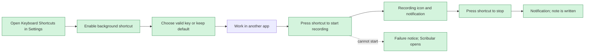

# Keyboard Shortcuts — Tauri spec
Status: draft for cwf; Date: 2026-11-16

## Summary
- **What:** Mac keyboard shortcuts for recording, navigating, and working with notes, plus one optional shortcut that works from another app.
- **Why:** A clinician can control Scribular during a call without switching windows or hunting for the menu-bar icon.
- **User-visible change:** Menus show their keys; a Keyboard Shortcuts pane lists them and lets the clinician change only the background recording key.
- **Size / risk:** L; global-key registration and recording state can disagree across a hidden window, lock, or failed registration.
- **Needs from Patrick:** none; this draft applies the approved design and the 2026-11-16 decisions.

## User workflow

**UX impact:**
- Background control is off until enabled; ordinary menu shortcuts work when Scribular is frontmost.
- A successful background start or stop leaves the current app in front. Failed start opens Scribular with the reason.
- Stop from the background key is immediate and uses automatic speaker detection when enabled.

---

## Intent (why users need it; who)
Clinicians need familiar Mac keys for routine app actions and a deliberate, opt-in way to start or stop Scribular while a call or other app is in front. The approved [keyboard-shortcuts design](http://100.108.210.63:3000/pi0neerpat/scribular-docs/src/branch/main/design/keyboard-shortcuts/README.md) defines the key map and behavior; [design principles](http://100.108.210.63:3000/pi0neerpat/scribular-docs/src/branch/main/design/README.md) favor Mac-native actions and local data. This spec follows Patrick's 2026-11-16 decisions: only In the room (mic) and On a call (mic plus app audio) recording sources; style changes during recording take effect when that recording stops; no call-app detection; no old-app settings or data migration.

## Tauri state today (what exists, what is missing, with file refs)
- `src-tauri/src/lib.rs:212-218` installs `Menu::default`; there are no Scribular menu accelerators. `src-tauri/Cargo.toml:20-25` has tray and notification support but no global-shortcut plugin.
- `src-tauri/src/shell/tray.rs:18-60,103-185` offers Start, Stop, speaker-count choices, icon refresh, and no accelerator labels. Tray Start emits `tray-start-recording`; tray Stop calls the recorder with `None` for automatic detection (`tray.rs:40-97`).
- `src/App.svelte:65-76` forwards tray Start to the record view. `src/lib/components/RecordView.svelte:135-136,184-245` starts through saved recording settings, model/license/permission checks, and the tray failure path. `src-tauri/src/commands.rs:972-984,1010-1050` exposes the existing failure notice and start/stop commands.
- `src-tauri/src/store/settings.rs:15-33,73-110` has encrypted key-value settings and `AppSettings`; `src-tauri/src/store/migrations.rs:12-27` has append-only migrations through v7. `src/lib/api.ts:280-311` wraps recording/settings commands. `src-tauri/src/lib.rs:499-529` checks Rust command/event wrappers.
- `src/lib/navigation.ts:4-9` still has Record/History/Settings/session-detail navigation. `src/lib/components/Settings.svelte:55-70` has no Keyboard Shortcuts category. `src/lib/types/InputMode.ts:3` still includes `system`; removing that mode belongs to recording-and-session.
- `REVIEW.md:5-37` identifies clinicians' transcripts as sensitive, uses `src/lib/api.ts` for IPC, and calls out Rust/Svelte state synchronization and privacy as review seams. `plans/parity/08-app-shell-tray-notifications.md:167` retained the default menu for earlier parity; the new approved app-shell and keyboard designs supersede that choice.

**Missing:** a native menu command binding layer; dynamic menu availability; pause/resume and several command destinations owned by other specs; the Shortcuts pane; opt-in global registration and persisted chord; chord capture/validation; success notices; keyboard navigation of the sidebar.

## Goals / Non-goals / Anti-goals
**Goals:** Make every approved app shortcut discoverable and operative in its valid context; offer one safe, editable, opt-in global recording toggle; persist its preference; keep registration, tray labels, and menu state in sync; retain existing recording gates and privacy rules.

**Non-goals:** Build the app-shell menu structure, Settings window, sidebar, read-only license gate, or Help ▸ Keyboard Shortcuts item/route; implement pause/resume, note editing/undo, session deletion, source choice, or style creation. Their owners provide those actions and state; this spec binds keys to them.

**Anti-goals:** Do not add another global key, editable in-app menu keys, an unprompted recording start, background audio capture outside the chosen source, a separate recording pipeline, or old-app migration. Do not let a shortcut bypass permission, model, license, confirmation, or locked-store gates.

## Requirements (numbered R1..)
### In-app commands
- **R1** The app-shell native menu exposes the exact frontmost-app bindings: File ⌘N New Recording (navigate only), ⌘R Start/Stop Recording, ⌥⌘R Pause/Resume, ⌥⌘N New Style from Example Note, ⇧⌘C Copy Note, ⌘W Close; Edit ⌘Z/⇧⌘Z Undo/Redo, ⌘X/C/V/A standard text actions, ⌘⌫ Delete Session, ⌘F Find; View ⌘1/2/3 Note/Transcript/Audio, ⌥⌘S Note Styles, ⌥⌘↑/↓ Previous/Next Session, ⌃⌘S Show/Hide Sidebar, ⌃⌘F Full Screen; app ⌘, Settings, ⌘H/⌥⌘H Hide/Hide Others, ⌘Q Quit; Window ⌘M Minimize, ⌘0 Scribular; Help ⌘? Scribular Help. Help ▸ Keyboard Shortcuts opens the Shortcuts pane without an accelerator. No key is assigned to Rewrite Note As, Export Note, or Delete All Sessions.
- **R2** App-shell's menu state shows Start versus Stop and Pause versus Resume from recorder state, preserving the same accelerators. Each binding inherits its owner's enablement and execution guard: for example, Start respects lock/license/model/source gates; Stop remains available during an active or paused recording; note actions require a selected note and respect read-only access; modal state blocks unrelated actions. An outside recording start from the background shortcut or menu-bar icon follows recording-and-session’s coach-interrupt path even if the Note Style Coach sheet is open; other modal actions remain blocked. An unavailable key has no side effect.
- **R3** Shortcut dispatch uses the owning action and its existing guard: ⌘R shares record-screen start/stop; ⌥⌘R shares recorder pause/resume; copy copies the entire note; ⌘⌫ targets the selected session and shows its confirmation; Undo/Redo invokes recording-and-session’s persistent per-session note history for edits, rewrites, and accepted Session Coach changes; focused text fields retain native text undo/redo. ⌥⌘↑/↓ works with note focus without moving the text caret; ⌘F focuses sidebar search; ⌘1/2/3 select the session's Note/Transcript/Audio tab. Input fields keep standard text editing keys.
- **R4** Focused sidebar sessions support ↑/↓ to move selection and Return to open. Escape and ⌘. cancel an applicable sheet, dialog, or shortcut capture with the same focus restoration and unsaved-change protection as its owner; neither cancels an active recording. These context keys do not intercept normal typing or text selection.

### Background recording and preferences
- **R5** `ShortcutSettings` (Rust serde/ts-rs and generated TypeScript) contains `globalShortcutsEnabled: bool` (default false) and `toggleRecording: Option<String>` (default chord ⌃⌥⌘R; `null` means Not set). Only this one chord is editable in Scribular. The dedicated Keyboard Shortcuts pane lists it first, explains on enable that it works in every app and recording should start only with client consent, and lists fixed app keys read-only in Recording, Notes and sessions, and Find and view groups; Restore Defaults restores the chord and leaves the enabled switch unchanged.
- **R6** After encrypted store unlock, Rust registers the saved chord only when enabled and set. Disabling, clearing, locking, and quitting unregister it immediately. A hidden/backgrounded window still receives it; a locked store never does. Registration state is reported separately from the saved preference so a failed launch registration is visible and never represented as active. The menu-bar icon shows the active chord beside Start/Stop only while actually registered, including the speaker-count stop submenu.
- **R7** The capture field shows held modifiers and records a physical letter, digit, or F-key with ⌘ or ⌃ plus at least one additional modifier, displaying modifiers in Mac order ⌃⌥⇧⌘. Escape cancels and restores the prior value; Delete clears to Not set. Capture temporarily unregisters the active chord, then restores it on cancel or invalid input. Focus leaving the field without a valid replacement also restores it.
- **R8** The same canonical menu binding table drives the fixed shortcut list and collision validation. Refuse a candidate that violates R7, collides with any Scribular menu key, or matches the explicit macOS-reserved set in the approved design. A system-reserved chord that never reaches capture remains unmodified. No Zoom, Meet, Teams, browser-tab, or call-app detection or warning is implemented.
- **R9** A preference change is transactional with registration: accept and persist only after successful registration (or unregistration for off/Not set); if the OS rejects a chord, keep the previous saved and active chord and show an inline actionable error. At startup, retain the saved preference if registration fails, show inactive/error state, and allow retry or editing. Restore Defaults follows the same rule. A stale Settings save cannot overwrite unrelated settings.
- **R10** On a first Pressed event only, the active global chord toggles recording through the same tray/record action and its guards. Suppress held-key repeats and a second press within one second; serialize toggles until the start or stop outcome is known. Successful start/stop neither shows nor focuses Scribular, never plays a sound, and sends one success notification per completed transition. The start notice names the selected note style; the stop notice says the note is being written. If OS notifications are unavailable, tray state still confirms recording and the action completes.
- **R11** A global Stop follows recording-and-session’s background Stop rule: immediate, no speaker-count popover, automatic detection when Identify speakers is on; the menu-bar speaker-count submenu remains available. A paused recording stops by the same chord. Start reads the current source (mic or mic plus manually selected app), and Stop uses the style selected at that moment. Failure to start retains the existing reason notification/foreground path; failure to stop reports the error and does not claim success or lose the active session.
- **R12** Shortcuts do not log or emit audio, transcript, note, speaker, session title, or custom style content to diagnostics; only safe error kinds and registration state may be logged. Chord settings stay in the encrypted app DB. UI and Rust both enforce action availability; the front-end is not the sole license or permission gate. A global registration failure cannot block recording through the app or tray.

## Acceptance scenarios (numbered AS1..; Given/When/Then; each tagged automated or manual)
- **AS1** (manual real-app; R1, R3) Given the app-shell menu and owner destinations, when each R1 key is pressed in its valid context, then its menu label and action match the map; ⌘N only navigates. Record the menu screenshots and action results; mark any destination not yet delivered unverified.
- **AS2** (automated, Rust menu-state test; R2) Given idle, recording, paused, locked, lapsed, and no-selection states, when menu state changes, then Start/Stop and Pause/Resume labels and enabled flags match R2 and keep their keys. A disabled command has no dispatch.
- **AS3** (manual real-app; R3, R4) Given a note with editable text, a selected session, sidebar focus, and an open modal, when the relevant keys are used, then full-note copy, undo/redo, delete confirmation, search/tab/session navigation, sidebar ↑/↓/Return, and Esc/⌘. behave as R3–R4. Record focus and confirmation outcomes; mark owner features not yet delivered unverified.
- **AS4** (automated, Rust store test and ts-rs check; R5, R6) Given a fresh encrypted DB, when settings are read, saved, reloaded, reset, disabled, or cleared, then defaults, `null`, enabled state, and Rust/TS shape match; no schema change is required for key-value settings.
- **AS5** (automated, shortcut registration state-machine test; R6, R9) Given unlocked/locked, enabled/disabled, hidden, registration success/failure, and quit transitions, when registration is reconciled, then only the permitted chord is active, the prior registration survives a failed replacement, and visible status/tray label match the actual active chord.
- **AS6** (automated, capture/validation unit test; R7, R8) Given modifier, key, Escape, Delete, blur, menu-collision, and reserved-key cases, when the field captures input, then only valid candidates are saved; invalid/cancel/blur restore the prior registration, Delete gives Not set, and no call-app warning appears.
- **AS7** (manual real Mac; R5, R6, R9) Given the Shortcuts pane with the switch off, when it is enabled, then it explains every-app reach and client consent; given the app hidden and then restarted with the switch on, when the key is pressed and when another app claims the proposed key, then the app responds only to an active registration, reports an OS rejection inline where available, and preserves the old chord. Record the disclosure, macOS version, other app, active chord, and actual behavior; if macOS silently shares it, report that limit rather than claiming conflict detection.
- **AS8** (automated, toggle coordinator test; R10) Given Pressed, repeat, Released, rapid double press, and in-flight start/stop events, when the global handler runs, then exactly one valid transition and one matching success notice occur; failed transitions emit no success notice.
- **AS9** (manual real-app; R10, R11) Given background shortcuts on, a ready model, a valid mic source, and Scribular hidden behind another app, when the chord starts then stops a recording, then the other app stays frontmost, tray state changes, two success notices appear if permitted, no sound/dialog occurs, and a session proceeds to note creation. Repeat with Identify speakers and paused state; record session IDs/states without sensitive contents.
- **AS10** (manual real-app; R11, R12) Given a blocked start (license, model, or microphone), no call app selected for On a call, and an induced stop failure, when the chord is pressed, then the existing foreground failure path explains start failures, no false success notice appears, a stop failure retains/reports the session, and app/tray recording still works after a global registration error. Record only error category and state.
- **AS11** (manual real-app; R11) Given a recording begun with one note style, when a different style is selected during recording and the chord stops it, then the stopped session uses the newly selected style; the manually chosen mic or mic-plus-app source is used. Record style IDs and session state, not note content.
- **AS12** (automated, privacy/availability checks; R12) Given unavailable actions and representative sensitive strings, when shortcut dispatch, registration errors, and failure logging run, then owner guards refuse invalid actions and diagnostic output contains no sensitive strings.

## Design notes (modules, commands/events, data model + migration, UI components)
- **Where it runs / data flow:** Native app menu events and the Rust global-shortcut handler dispatch action IDs to the front end for navigation/start actions or call the existing Rust recorder for background Stop. The shared recording owner provides one start/stop coordinator and state snapshot so tray, menu, record button, and global key cannot race or disagree. Rust registration owns actual active state; the Settings pane reads and changes it through IPC.
- **Modules touched or added:** `src-tauri/src/lib.rs` plugin/command wiring; a small Rust shortcut module for canonical chords, reserved collisions, active registration, and repeat/transition guard; `src-tauri/src/shell/tray.rs` chord display and shared Stop; `src-tauri/src/store/settings.rs` keys; `src-tauri/src/commands.rs` IPC; `src/lib/api.ts`, generated `src/lib/types/ShortcutSettings.ts`, `src/App.svelte`, and a Shortcuts pane component. App-shell owns native menu construction, item IDs, routing, enablement, Settings window, sidebar, and Help routing. Recording-and-session owns pause, recording state, sources, note tabs/edit/undo/copy, and stop-to-session. Do not duplicate these in this spec's PRs.
- **Commands & events:** `get_shortcut_settings -> ShortcutSettings`, `set_shortcut_settings(settings: ShortcutSettings) -> ShortcutRegistrationState`, and `shortcut_registration_state -> ShortcutRegistrationState` provide saved and active chord plus safe error category. `shortcut_action` carries a typed action ID for native menu commands that must reach Svelte; use `ts-rs` for Rust-owned payloads and add every command/listener to `src/lib/api.ts`. Reuse `tray-start-recording`, `tray-stop-failed`, `start_recording`, and `stop_recording` behavior; the owner may consolidate their internal coordinator without changing the public meaning. No transcript/audio payload crosses the new event.
- **Migration:** No old-app migration or compatibility. New shortcut settings are key-value entries in the current encrypted DB, so no schema migration is needed. Missing enabled key means false; missing chord key means ⌃⌥⌘R; an explicit empty value means Not set. If an implementation needs a schema change, append the next free migration at implementation time and never edit shipped migrations.
- **UI components:** The app-shell Settings window mounts the Shortcuts pane. It owns switch, capture field, fixed-list display, inline validation/registration error, and Restore Defaults. App-shell menu uses the canonical binding table and owner-provided availability; the tray displays the active chord. Existing dialogs add ⌘. through their owners while retaining Escape and focus behavior.
- **Spec author's calls:** Use separate shortcut IPC instead of widening the current all-at-once `AppSettings` save, preventing an unrelated Settings pane from overwriting the chord. Represent Not set explicitly so clearing differs from the default. Make actual registration state visible because an enabled preference can fail at launch. Use “Recording started · {selected note style}” and “Recording stopped · Your note is being written.” as success notification copy; the style name is the only user-created text included.

## Dependencies and security check
| Crate / package | Exact pin | License | Why not in-house |
|---|---|---|---|
| [tauri-plugin-global-shortcut](https://github.com/tauri-apps/plugins-workspace/tree/v2/plugins/global-shortcut) (Rust only) | `=2.3.2` | MIT OR Apache-2.0 | Tauri's native system hot-key registration and lifecycle; avoid a bespoke macOS event tap. |

No JavaScript global-shortcut package or webview permission is needed: registration stays in Rust. Verify the pin works with this checkout's Tauri version before implementation. Dependency/security checks to record in the implementing PR:
- [ ] Confirm closed-source license compatibility from the pinned crate license.
- [ ] Run `cargo audit`/OSV on the resolved pin and record relevant findings and used code paths.
- [ ] Inspect the crate's `build.rs` and transitive install-time scripts for downloads or execution.
- [ ] Record URL and SHA-256 for any downloaded native artifact; otherwise record none.
- [ ] Confirm the `=2.3.2` pin and lockfile resolution.

## Out of scope
- Automatic Zoom/Google Meet detection, Meet-tab detection, “Zoom is open” status, and call-app-specific shortcut warnings: a future call-app iteration. On a call retains a plain manual app picker (recording-and-session).
- App-audio-only mode and migration from the old app's settings/data, including stars-animation migration: excluded by Patrick's 2026-11-16 decisions. This spec neither removes the mode nor adds migration code; recording-and-session and theme own their respective current-app changes.
- Menu key customization inside Scribular, a second global shortcut, Windows/Linux, export/print commands, and a shortcut overlay: future scope only if requested.
- Menu structure, sidebar, Settings window, read-only license gate, update alert, Delete All: app-shell. Source picker, pause/levels/late attach, Stop-to-session, note-first view, in-place edit/undo, copied marker: recording-and-session. Welcome/first-use/first-note/empty-state UI: onboarding. Coach engine, practice notes, availability gate, Show-in-style-menu: note-style-coach. In-note coach conversation/style-update offer: session-coach. Appearance: theme.

## Depends on / interacts with (other specs by slug)
- **app-shell** (`plans/2026-11-16-app-shell-spec.md`): lands menu/Settings/sidebar framework first; keyboard-shortcuts supplies accelerator IDs and dynamic state, not a second menu or window. Coordinate menu/Help ownership and lock/read-only behavior.
- **recording-and-session** (`plans/2026-11-16-recording-and-session-spec.md`): lands source choice, pause, session/note actions and state first; shortcuts invoke them. Its removal of `system` input mode and current-style-at-Stop rule also apply to background recording.
- **onboarding** (`plans/2026-11-16-onboarding-spec.md`): first-use sheets can own keyboard focus; shortcut dispatch respects modal blocking except the outside-recording interrupt path for an open Note Style Coach sheet, owned by recording-and-session.
- **note-style-coach** (`plans/2026-11-16-note-style-coach-spec.md`): owns New Style from Example Note destination and shared coach availability gate; ⌥⌘N only routes there when available.
- **session-coach** (`plans/2026-11-16-session-coach-spec.md`): in-note coach input keeps standard text keys; shortcut dispatch honors its modal/focus state and note-edit undo ownership.
- **theme** (`plans/2026-11-16-theme-spec.md`): appearance has no shortcut; no stars-animation migration is introduced here.

## Coordination notes
This file is the **keyboard-shortcuts** (`plans/2026-11-16-keyboard-shortcuts-spec.md`) owner. The seven-slug set is app-shell, recording-and-session, keyboard-shortcuts, onboarding, note-style-coach, session-coach, and theme. App-shell's custom menu replaces the older default-menu parity requirement; one canonical action table must serve menu labels, key dispatch, Settings list, and conflict checks. The PRs below depend on owner actions being callable; integration tests should target their real commands rather than duplicate their implementations.

## Decisions for Patrick (with recommended default)
None. The approved design and Patrick's 2026-11-16 decisions settle the behavior. The selected style name appears in the background-start notification as designed; no note, transcript, session title, or patient content appears there.

## Size (S/M/L, rough days) and suggested PR split if > ~1 PR
**L, about 7–10 implementation days after app-shell and recording-and-session action surfaces land.**
1. PR1 (M, 2–3 days): canonical app binding table, accelerators on app-shell's native menu IDs, dispatch to owner actions, sidebar/modal context keys; AS1–AS3. App-shell supplies dynamic enablement.
2. PR2 (M, 2–3 days): encrypted shortcut settings, Rust-only global registration/lifecycle, capture/validation, Shortcuts pane and Help route; AS4–AS7.
3. PR3 (M, 3–4 days): shared toggle/notification/race integration, tray label, failure/privacy checks and real-Mac verification; AS8–AS12.
