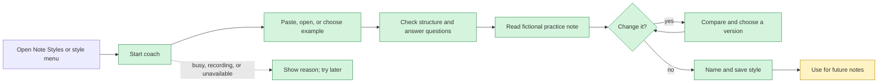

# Note Style Coach — Tauri spec
Status: draft for cwf; Date: 2026-11-16

## Summary
- **What:** Turn an example note into a reusable note style, test it on a fictional session, and adjust it before saving.
- **Why:** A therapist can make notes look like their own without writing instructions or asking for help.
- **User-visible change:** A three-step coach, practice note, explicit change comparison, and Adjust action for coach-made styles; style-menu visibility replaces stars.
- **Size / risk:** L; protecting example content while the coach uses the local summary engine is the main risk.
- **Needs from Patrick:** Review this draft; no unresolved product decision.

## User workflow

**UX impact:**
- The coach blocks the main window while open; Cancel/Esc confirms discard, and an outside recording start discards it and starts recording.
- Reading and writing show progress in the conversation. Practice notes are fictional and never become sessions.
- A lapsed license permits viewing styles but no style changes; busy or recording states disable only coach entry, subject to the license gate.

---

## Intent (why users need it; who)
Therapists want a familiar note shape without learning prompt syntax. From Note Styles, a note's style menu, onboarding, or the native menu, they give the coach an example, answer only uncertain layout questions, inspect a fictional practice note, request and approve changes, then save a style for future notes. Source of truth: `docs/design/note-style-coach/README.md` (approved 2026-11-16), `docs/design/README.md:9-14`, and `docs/design/_gaps/note-style-coach.md`; the 2026-11-16 design overrides the 2026-11-07 spec where they differ. This spec covers functionality, not mockup styling.

## Tauri state today (what exists, what is missing, with file refs)
- Rust `Prompt` has id, name, description, text, default and starred fields, with an 8,000-character text cap; store inserts and row decoding use fixed columns (`src-tauri/src/store/prompts.rs:15-52`). `NoteStyles.svelte` groups Custom and Built-in, with manual editing and star/default actions (`src/lib/components/NoteStyles.svelte:1-43,176-220`). `src/lib/api.ts:143-175` wraps style IPC.
- SQLite migrations are append-only through v7 and `summary_queue` stores real-session jobs (`src-tauri/src/store/migrations.rs:10-19,26-28,57-64`). The worker processes session-ID summary jobs (`src-tauri/src/jobs/queue.rs:1-67`). Commands and exported Rust/TS types live in `src-tauri/src/commands.rs:104-132,413-484`; registration is in `src-tauri/src/lib.rs:132-160`.
- P1 is merged: Gemma 4 E2B is the sole default LLM (`src-tauri/src/models/manifest.rs:38-42,64-79`), and `SummaryAvailability` already has Ready, Downloading, Unsupported and LoadFailed with retry (`src-tauri/src/models/mod.rs:28-40`, `src-tauri/src/commands.rs:629-672`, `src/lib/api.ts:186-219`). Do not repeat the model swap.
- **Missing:** coach engine and samples, temporary practice path, coach commands/events/types, persisted structural style spec, shared coach availability gate, three-step sheet, adjustment and comparison, and Show in style menu (`docs/design/_gaps/note-style-coach.md:5-21`). Sidebar, native menus, note-first session, and license-wide read-only behavior are dependencies owned by other specs.

## Goals / Non-goals / Anti-goals
**Goals:** A local, guided example-to-style flow; a testable structural engine; disposable practice generation; explicit approval before applying a revision; durable coach-origin styles; one coach availability result consumed by every entry point.

**Non-goals:** Rebuild P1/model selection; redesign the app shell, recorder, onboarding, in-note session coach or theme; migrate data/settings from the old app; rewrite past notes when a style changes; detect Zoom or Google Meet.

**Anti-goals:** Store raw examples, practice transcripts, practice notes or chat as sessions or diagnostics; let a coach job block recording or outrank real summaries; silently apply a proposed change; let a disabled UI be the only enforcement of license, busy or recording rules.

## Requirements (numbered R1..)
### Intake and flow
- **R1** The coach is a blocking main-window sheet with one-way steps Your example note → Check and adjust → Save. New starts at Step 1; Adjust on a coach-origin style starts at Step 2, skips example questions, and opens at the existing practice-note/revision conversation with Step 1 marked done. No Back or resume. Cancel/Esc asks to discard, with Keep Going as default; confirmed Stop clears the draft. A background shortcut or menu-bar recording start cancels/discards the draft and starts recording immediately; the recording screen owns its one dismissible explanation.
- **R2** Step 1 accepts pasted text, UTF-8 `.txt`/`.md`, or four bundled fictional samples (Narrative, DAP, SOAP, Brief CBT); rejects empty, fewer than 100 or more than 12,000 Unicode characters, unreadable, or unsupported input with plain errors before engine work. The file picker checks extension/decoding and Rust checks text size/content. The raw example exists only for the open sheet and is released after structural extraction; sample/example text is never sent off-device.
- **R3** Step 2 reports reading/writing progress in one coach message, explains extracted structure in plain words, asks each uncertain item one at a time with suggested answers, Skip, use your best guess, and a typed reply. It echoes the interpretation of a typed answer; answers are applied together before the first practice note. During active work, reply and Continue are disabled, while Cancel remains available.

### Structural engine and practice
- **R4** `coach::extract` deterministically derives typed `StyleSpec` sections (heading, required flag, generic guidance), sentence min/max, quote maximum/required-when-available, pronouns, voice, emphasis and `compiler_version`, plus uncertain items. It retains layout/structural headings only, not client facts, source sentences or quotations. `coach::compile` deterministically includes a non-removable grounding block and rejects output over `MAX_PROMPT_CHARS` (8,000); validation also runs at save and adjust boundaries.
- **R5** The practice path runs a bundled fictional transcript through the real `chunk_prompt`/`combine_prompt` summary path with the compiled style. Nine formatting-only checks cover section presence, duplicate sections, optional-section omission, section length, exact quotes, quote attribution, names, pronouns and preamble. Speaker-sensitive checks derive labels from the provided transcript. A failed check adds its correction block and retries up to three attempts total; return the best attempt, pass count and failed check IDs. Show results only in coach messages; a ready best attempt may still proceed when checks fail.
- **R6** A practice job is temporary: no session row, `summary_queue` row, usage charge, audio, or durable conversation. It never starts while recording or real summaries are active/queued; if real work arrives, real work has priority between practice attempts. Recording start or Cancel interrupts it without saving a partial result. The coach never holds a recording start waiting for the model.
- **R7** A requested change becomes a validated typed patch, one focused clarification with answer options, or an unsupported reply with length/quotes/sections suggestions. Support sentence bounds 1–10, quote max 0–6 and required-when-available, emphasis, and add/remove/rename/required/optional section changes; keep at least one required section. Match section names deterministically before optional JSON-only model interpretation; reject stale `before`, unknown paths, malformed output and out-of-range values. The model cannot write style prompt text directly.
- **R8** A proposed patch rewrites the same fictional practice session without changing the draft until the person chooses Use This. Show marked Changes plus Before/After; Keep the Old One retains the prior spec/note. While a proposal waits, these choices replace the reply field and Continue is disabled. After a choice, the conversation resumes. Continue requires a ready note and no work/proposal; Adjust additionally requires at least one accepted change.

### Styles, availability and privacy
- **R9** Save validates the name and spec, compiles the style and atomically creates a custom coach-origin row or updates the adjusted row in place. Default name is “My note style”; Use it for my next sessions is on by default and atomically makes the saved style active when checked. Save returns to its entry context; it does not rewrite the current or any earlier session. Saved compiled text is frozen until explicit adjustment; a later compiler version only recompiles a candidate for review.
- **R10** `prompts.style_spec` is nullable typed JSON: non-null identifies a coach-origin style. Coach-made rows expose Edit then Adjust; manual rows Edit only; built-ins stay read-only. A text edit to a coach style asks confirmation and clears `style_spec` only on confirmed save; name-only and visibility edits preserve it. “Prompt” is labelled “Note Style Text” in the hand editor. No Select/Selected action appears in Note Styles; existing-style selection belongs to New Recording.
- **R11** Replace the star concept with a persisted “Show in style menu” boolean/switch, independent of active next-session selection. Its value determines which styles appear in quick style menus; new coach styles start shown. Reuse this app's existing `starred` DB bit for visibility, exposing `showInStyleMenu` in the Rust/TS contract. Do not migrate old-app star settings or other old-app data. This app's DB receives only append-only migrations at the next free version; existing rows remain readable with null `style_spec` and the same visibility bit.
- **R12** A single backend coach availability result combines `SummaryAvailability`, real summary running/queued state, recording state, and shared license access. Trial, licensed, and grace access may coach; ended, invalid, and lapsed access are read-only. Every coach entry (Note Styles, note style menu, onboarding tip/card, File and Help) consumes the same gate, updates when state changes, shows the reason, and is rechecked by Rust for starting/continuing coach work; Cancel/cleanup always works. The canonical reason/message/retry table below is the only coach gate copy; recording takes precedence over busy and access denial takes precedence over model state. Session Coach uses the same reason and retry action in its disabled input, with no extra banner. Busy, recording and summary failure gate coach work only: ordinary style editing and visibility changes remain available when the license allows them. The shared app-shell license gate blocks all mutations after lapse.

| Gate reason (first matching) | Entry-point reason / Session Coach input | Retry |
|---|---|---|
| Recording | “The coach isn't available while you're recording.” / “Recording in progress · The coach isn’t available while you’re recording.” | None; re-enable after Stop |
| Access denied | “License ended · Coach unavailable.” | Enter License… / Buy through app-shell |
| Real summary running or queued | “The coach opens when your other notes are done.” | None; re-enable when queue empties |
| Summary Downloading | “Summaries are downloading. Coach unavailable.” | None; re-enable when ready |
| Summary Unsupported | “Summaries aren't available on this Mac. Recording and transcription still work.” / “Summaries unavailable · Coach unavailable.” | None |
| Summary LoadFailed | “Summaries couldn't load. Recording and transcription still work.” / “Summaries couldn't load · Coach unavailable.” | Try Again |
| Ready and no blocker | Available | None |

- **R13** Keep example text, practice transcript/note, answers and change requests out of logs, diagnostics and telemetry; log only event kinds/counts. Clear temporary state after Save, Cancel, recording interruption, window close, relaunch or failure. Never persist a practice note or count it as a session/usage event. Errors leave existing styles and sessions intact and offer retry or Cancel; a failed revision leaves the accepted draft unchanged.
- **R14** Coach copy and errors use plain terms: no “prompt”, “preference”, “model”, “token”, “JSON”, “confident”, “confidence” or “accurate”. The practice note is labelled “Practice session, not a real client”; the formatting count appears in the conversation. Adjust and hand editing remain available under their respective gates.

## Acceptance scenarios (numbered AS1..; Given/When/Then; each tagged automated or manual)
- **AS1** (manual real-app; R1) Given a new or Adjust entry, when opened, then the correct step is active and main-window actions are blocked; record the sheet state, menu-bar or shortcut action, recording state, and explanation line; given Cancel/Esc, the confirmation defaults to Keep Going and Stop clears all draft state; given an external recording action, the sheet closes, recording begins without waiting, and the owned recording explanation appears once.
- **AS2** (automated; `ui-script`, `log/db/state`; R2) Given paste, text of exactly 100 and 12,000 Unicode characters, each supported file type and each of four samples, when accepted, then Step 2 starts; given empty, under-limit, over-limit, invalid UTF-8 or another extension, then a plain error leaves the sheet usable. Direct Rust calls reject empty, 99-character, and 12,001-character text; on closure, no raw-example state remains.
- **AS3** (automated; `ui-script`; R3) Given an example with uncertain items, when reading completes, then questions arrive one at a time, suggested/skip/typed answers work and a typed answer is echoed; when the last is answered, then all answers affect the first practice note. During read/write, only Cancel is actionable and one in-chat progress state appears.
- **AS4** (automated; `cargo test`, `log/db/state`; R4) Given the four samples and an example containing a client-name/quote sentinel, when extracted/compiled, then golden `StyleSpec` and compiled text match expected structures, no client sentence/quote sentinel survives, grounding remains and output never exceeds 8,000 characters; forged specs are rejected on save.
- **AS5** (automated; `cargo test`, fake engines, `log/db/state`; R5) Given an over-one-chunk transcript, when practicing, then chunk/combine calls use the compiled style; given two failed attempts and a passing third, then three attempts and matching correction blocks occur; given all failures, then the best result and nine check IDs/pass count are returned. Relabelled speakers produce equivalent speaker-sensitive results.
- **AS6** (automated; `cargo test`, fake engines, `log/db/state`; R6) Given a running/queued real summary or recording, when practice is requested, then it is refused; given real work arriving between attempts, then it runs before the next attempt; given Cancel or recording start, then practice stops and there is no session/queue row or usage increment.
- **AS7** (automated; `cargo test`, fake engines, `log/db/state`; R7) Given section edits, bounds and vague/unsupported requests, when interpreted, then deterministic section matches need no model, vague requests return one question, unsupported requests return suggestions, and unknown section names list real headings; malformed/stale/out-of-range patches leave the spec unchanged.
- **AS8** (automated; `ui-script`, `log/db/state`; R8) Given a ready practice note, when a revision finishes, then Changes/Before/After and Use This/Keep the Old One appear and Continue is blocked; Keep preserves old spec/note, Use accepts new spec/note, and Adjust cannot Continue until it uses a change. Given a failed rewrite, the accepted draft is intact.
- **AS9** (automated; `cargo test`, `ui-script`, `log/db/state`; R9) Given a new/adjusted style, when Save runs with checkbox on/off, then create/update, active selection and returned context match the choice atomically; existing session summaries are byte-for-byte unchanged. Given a compiler-version change, stored text stays frozen until an explicit approved adjust save.
- **AS10** (automated; `cargo test`, `ui-script`, `log/db/state`; R10) Given coach, manual and built-in rows, when shown, then their actions match origin; a text edit asks before detaching, name-only/visibility edits keep `style_spec`, and a declined detach changes nothing; the hand editor says Note Style Text.
- **AS11** (automated; `cargo test`, `ui-script`, `log/db/state`; R11) Given this app's pre-change DB, when migrated, then rows remain readable, `style_spec` is null, the existing visibility bit is exposed as `showInStyleMenu`, and migration history remains append-only; toggling visibility changes quick-menu membership without changing active style. No old-app import runs.
- **AS12** (automated; `cargo test`, `ui-script`; R12) Given trial/licensed/lapsed, ready/downloading/unsupported/load-failed, real queue busy and recording states, when each entry renders or calls Rust directly, then it receives the same gate and reason; LoadFailed offers retry, Unsupported does not; manual style edits remain available under busy/recording/unavailable but lapsed blocks all mutations. Entries re-enable when the blocker clears.
- **AS13** (automated; `cargo test`, `log/db/state`; R13) Given sentinel text in an example, fictional transcript, reply and practice output, when a full run, cancellation, failure and relaunch occur, then no sentinel appears in logs/diagnostics/telemetry or durable coach/session data; existing styles and sessions remain unchanged after a failed save/revision.
- **AS14** (automated; `ui-script`; R14) Given every coach step, error and unavailable state, when rendered, then banned jargon is absent, the practice label is present where a note appears and formatting results appear in conversation only.
- **AS15** (manual; `manual-only` because real-model timing and therapist comprehension require people; R3, R5, R8, R9) Given a supported Mac and a fresh trial, have a non-technical therapist use a sample and their own de-identified note, make one typed and one section change, choose each comparison action, adjust the saved style, then record a fixture session using it. Record step times, observed blockers, transcript phrases and section headings; report this scenario unverified if no participant/device is available, without inventing a pass.

## Design notes (modules, commands/events, data model + migration, UI components)
- **Where it runs / data flow:** `NoteStyleCoach.svelte` → `src/lib/api.ts` → Rust coach commands → deterministic extract/compile → transient practice through existing `Summarizer` and chunk/combine path → checks/retry → event/result → explicit save to `Store`. Model interpretation is limited to validated JSON patches. The real summary queue remains authoritative for whether coach work may begin or continue.
- **Modules:** Add `src-tauri/src/coach/` for spec, extraction, compiler, checks, interpreter and fictional data; integrate temporary work into `src-tauri/src/jobs/queue.rs` without `summary_queue` persistence. Touch `store/prompts.rs`, `store/migrations.rs`, `commands.rs`, `lib.rs`, generated TS types, `src/lib/api.ts`, Note Styles/editor and coach entry components. Reuse P1 availability rather than changing manifest/LLM parameters.
- **Commands & events:** `coach_samples()`, `coach_build(exampleText) -> CoachDraft`, `coach_answer(draftId, answer) -> CoachReply`, `coach_practice(draftId) -> jobId`, `coach_interpret(draftId, request) -> CoachReply`, `coach_choose(draftId, proposalId, useThis) -> CoachDraft`, `coach_save(draftId, name, useNext) -> PromptList`, `coach_cancel(draftId)`, and `get_coach_availability() -> CoachAvailability`; emit `coach-progress`, `coach-result`, `coach-cancelled`, `coach-availability`. IDs are opaque and scoped to the live process; Rust owns draft/proposal state and validates sequence, license and availability, so callers cannot forge a spec or bypass comparison. Export `StyleSpec`, `CoachDraft`, `CoachReply`, `CoachAvailability`, event payloads and updated `Prompt` through `ts-rs`; wrap all IPC/listeners in `src/lib/api.ts`. Subscribe before fetching the availability snapshot to avoid a stale initial state.
- **Migration:** Next free append-only version (v8 as of `src-tauri/src/store/migrations.rs:10-19`) adds nullable `prompts.style_spec TEXT`; no old-app import/back-compat. Reuse the existing `starred` storage bit for visibility; the public Rust/TS/API name becomes `showInStyleMenu`, with no star language. Preserve existing app rows and defaults, and keep active prompt selection independent. Save/adjust and active selection share a DB transaction.
- **UI components:** Main-window coach sheet and Note Styles rows are in this spec. App shell supplies sidebar and native menu entry locations; onboarding supplies first-note tip/empty-state card; recording-and-session supplies New Recording style choice, Stop/session flow and external-recording explanation. Disabled native menu entries need an available reason through menu help or adjacent explanation. Retain existing focus/unsaved-edit guards and accessible dialog semantics.
- **Spec author's calls:** (1) Keep the existing `starred` database bit as the visibility bit; rename the public contract to avoid a needless migration of that value. (2) Use process-local opaque draft IDs so raw examples never round-trip after extraction and stale proposals cannot overwrite accepted state. (3) Accept 100–12,000 Unicode characters (inclusive) for examples: enough for a short note and a longer structured note; enforce the same range in UI and Rust. The 8,000-character cap applies to compiled style instructions, not raw example length. (4) When a ready practice note fails checks after three tries, show the failures and permit Continue, matching the prior engine spec and the design's ready-note rule. (5) Preserve structural headings as intentional style metadata; test that body facts and quotations never enter them.

## Dependencies and security check
**New dependencies: none.** Reuse current Rust/TS libraries and bundled fictional text. Before a PR adds a dependency despite this plan, record its exact pin, closed-source-compatible license, affected vulnerability paths (`cargo audit`/`npm audit`/OSV), install-time scripts or downloads, and artifact URL/SHA-256 where applicable in that PR. No dependency approval gate is needed without a concrete license, exploitable vulnerability or functional issue.

## Out of scope
- Google Meet tab and Zoom detection, “Zoom is open” status, and automatic call-app choice: future recording iteration; `recording-and-session` owns a plain manual call-app picker. App-audio-only mode is removed by that spec; only In the room and On a call remain.
- Old-app settings/data migration, including stars-animation migration; this spec only migrates this app's own SQLite schema. `theme` owns appearance.
- Real-session note Coach conversation or style-update offer: `session-coach`; note editing/undo: `recording-and-session`.
- PDF/Word input, tone changes, section reordering, real-note seeding, history/resume of coach drafts, notification when busy, and a post-save tip: future coach iteration unless separately approved.

## Depends on / interacts with (other specs by slug)
- **app-shell** (`plans/2026-11-16-app-shell-spec.md`): lands sidebar, File/Help menu structure, Settings window and app-wide read-only license gate first; owns update alert and Delete All. Coach supplies commands/availability for its entry items, without owning those structures.
- **recording-and-session** (`plans/2026-11-16-recording-and-session-spec.md`): owns In the room/On a call source choice, manual call-app picker, recorder/pause/levels/late attach, Stop→session, note-first view, in-place edit/undo and copied marker. Its selected style at Stop is used for that session, including changes made mid-recording; coach save never rewrites the session. It owns the one-time recording-screen explanation after an outside start interrupts coach.
- **keyboard-shortcuts** (`plans/2026-11-16-keyboard-shortcuts-spec.md`): owns accelerators, background shortcut and Shortcuts pane; calls recording start through the shared interrupt path when coach is open.
- **onboarding** (`plans/2026-11-16-onboarding-spec.md`): owns welcome sheet, On-a-call first-use sheet, first-note tip and Note Styles empty-state card; its coach links consume this spec's shared availability.
- **note-style-coach** (`plans/2026-11-16-note-style-coach-spec.md`): this spec owns coach engine, practice notes, shared coach availability gate and Show in style menu. It exposes those contracts to entry points and session coach.
- **session-coach** (`plans/2026-11-16-session-coach-spec.md`): owns in-note conversation and style-update offer. It consumes this spec's style compilation/validation and availability state, while its own proposal/undo lifecycle stays separate.
- **theme** (`plans/2026-11-16-theme-spec.md`): owns appearance; no coach persistence or workflow changes here.

## Coordination notes
App shell and recording/session should establish their shared navigation, license and record-start contracts before coach entry integration. Coach engine/data can land before the sheet. Keep only one `CoachAvailability` computation in Rust, consumed by each entry; use app-shell's license gate rather than redefining read-only access. When recording starts externally, stop coach work and release its sheet without delaying capture. The selected style for a recording is resolved at Stop by `recording-and-session`, not snapshotted by coach.

## Decisions for Patrick (with recommended default)
No unresolved product decisions. **Default:** use the approved 2026-11-16 design and the author's implementation calls above; return to Patrick only if a material conflict emerges during implementation.

## Size (S/M/L, rough days) and suggested PR split if > ~1 PR
**L, about 12–18 engineering days after the app-shell and recording contracts are ready.**
1. **PR1 (M, 4–5 days):** structural engine, fictional data, typed spec/compiler/interpreter and golden/security tests (AS4, AS7).
2. **PR2 (M, 4–6 days):** transient practice jobs, events/commands/types, availability, migration and atomic style operations (AS5–AS7, AS9–AS13).
3. **PR3 (M, 4–7 days):** sheet, Note Styles/editor, entry-point integration, UI checks and real-model/therapist walkthrough (AS1–AS3, AS8–AS15). AS1 stays manual because the current uitest harness cannot click tray menu items (`plans/uitest/05-native-surfaces.md:119-120`); record real-app evidence. Coordinate menu/onboarding/recording edits with their owning PRs rather than duplicating shared surfaces.
