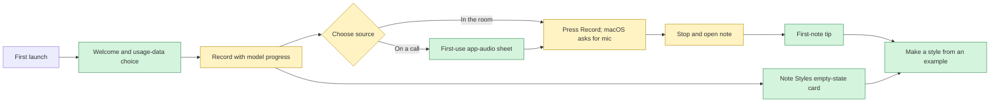

# Onboarding — Tauri spec
Status: draft for cwf; Date: 2026-11-16

## Summary
- **What:** One welcome sheet, followed by guidance only when someone first needs it.
- **Why:** People can reach their first recording without a tour, checklist, or early permission requests.
- **User-visible change:** A download ring on Record, a first-call permission sheet, one first-note tip, and a Note Styles invitation replace the current first-run prompts.
- **Size / risk:** L; persisted one-time state and macOS audio permission reporting are the main risks.
- **Needs from Patrick:** One permission retry default below.

## User workflow

**UX impact:**
- Welcome adds one Continue click. Quitting during download returns to the Record progress ring.
- Microphone permission appears on Record; app-audio guidance appears only on first On a call selection.
- The tip appears after the first completed note. The Note Styles card appears whenever no custom style exists.

---

## Intent (why users need it; who)
First-time Mac users should understand that Scribular makes local notes, then start recording with only the choices needed at that moment. The approved design is `docs/design/onboarding/README.md` (2026-11-16); its first-run flow supersedes `plans/parity/07-onboarding-samples.md` and the current tour. Patrick's 2026-11-16 decisions limit source modes to In the room and On a call, keep style changes usable during recording with the style at Stop governing the note, retain a manual call-app picker, exclude call-app detection, and exclude old-app migration.

## Tauri state today (what exists, what is missing, with file refs)
- `src/App.svelte:97-109,129-142,173-192` shows a four-card tour after unlock, marks onboarding complete only when closed, and exposes Show tour in the main navigation. `src/lib/components/OnboardingTour.svelte:13-18,40-50,83-98` contains the tour and its navigation.
- `src/lib/components/FirstRun.svelte:62-115` starts model downloads, shows the permission/model checklist, exposes a separate usage-data prompt, and displays summary-model download status globally. `src/lib/components/RecordView.svelte:317-322` disables Record until speech is ready.
- `src-tauri/src/commands.rs:95-99,144-155,214-231` and `src-tauri/src/store/settings.rs:19,125-131` expose `OnboardingState { completed }`, `complete_onboarding`, and persisted telemetry consent. `src/lib/api.ts:40-45` wraps onboarding IPC; `src/lib/types/OnboardingState.ts` is generated by ts-rs.
- `src-tauri/src/store/settings.rs:133-175` persists recording mode, target app, and style; `src-tauri/src/store/sessions.rs:57-80` still includes `InputMode::System`. Source controls currently live in `src/lib/components/Settings.svelte:261-289,327-340`.
- `src-tauri/src/commands.rs:1047-1059` opens System Settings, but there is no permission-status command for the first-call sheet. `src/lib/components/SummaryPanel.svelte:150-190` has no first-note tip; `src/lib/components/NoteStyles.svelte:36-43,177-190` has no coach empty state. `src-tauri/src/store/migrations.rs:11-20,67-82` is append-only.

**Missing:** welcome-seen-at-display semantics; welcome consent; Record progress ring without the checklist; one-time call-audio explainer with permission status; first-note tip with dismiss state; custom-style empty state with coach entry points. Sidebar, menu, Settings window, recorder/session handoff, and coach behavior are owned by their linked specs.

## Goals / Non-goals / Anti-goals
**Goals:** Replace the tour and separate first-run prompts with one welcome sheet and contextual guidance; persist one-time state; keep first-run failures recoverable and private.

**Non-goals:** Build the sidebar, native menu, Settings window, record-screen source control, recorder/session page, coach engine, or shared gates here. No old-app migration or compatibility layer.

**Anti-goals:** Prompt for permission before the action needs it; block recording on summary-model download, telemetry, or coach work; transmit session content or enable usage reporting without explicit opt-in; resurrect app-audio-only mode.

## Requirements (numbered R1..)
### Welcome and readiness
- **R1** After the encrypted store is unlocked, first launch shows one welcome sheet over the main window with three capability statements, a usage-data checkbox initially off, and Continue. It replaces the tour and has no trial or coach pitch. Model download proceeds behind the sheet.
- **R2** On first display, persist explicit telemetry off, then persist `onboarding_completed` as welcome-seen before Continue is enabled. Reopening after quit, including during download, does not auto-show it again once both writes succeed. If either write fails, keep the sheet with retry and reopen it on relaunch. Help ▸ Welcome to Scribular may reopen the same sheet without resetting consent or one-time flags; app-shell owns that menu action.
- **R3** The welcome checkbox uses existing `set_telemetry_setting`; checked is stored as on only after an explicit check and successful save. A read/write failure surfaces an error and retry without enabling reporting or silently treating opt-in as saved. Remove the separate FirstRun usage-data prompt; Settings remains the later place to change consent.
- **R4** Speech-model progress and retry appear on the Record control as a ring and plain status. Record is unavailable until speech is ready. On relaunch, subscribe to progress before snapshot and resume verified download state. Summary model download is quiet except on a finished session waiting for it; download failure exposes the retry at the blocked Record control; recording-and-session owns the waiting session’s note-state retry and copy. The pre-record permission/model checklist and global waiting-summary line are removed.
- **R5** Trial initialization, model downloads, seeded sample session, and encrypted-store gate continue through their existing paths. Welcome does not start trial a second time. Permission checks do not run solely because the app or welcome opens.

### Contextual prompts
- **R6** On first selection of On a call (`micAndSystem`), show the one-time app-audio sheet explaining the macOS Screen & System Audio Recording switch and open its System Settings pane. Persist `app_audio_explainer_shown` when displayed. Not Now closes the sheet and returns source choice to In the room without starting app capture. The sheet reports pending/granted using an actual macOS status query; when access is reported granted, it marks itself complete without another click. If macOS reports unknown status, show an unknown state and a Try recording action; recording-and-session owns that real guarded capture attempt and marks access granted only after successful app capture. Reopening after an interrupted first sheet does not auto-show it; recording-and-session owns the record-screen permission retry route. No audio is captured by the sheet itself.
- **R7** Selecting In the room (`mic`) or opening the app never asks for system-audio access. First Record press requests microphone permission through existing capture; denial leaves recording stopped, explains the denial, and offers the existing Microphone Settings route. On a call still records mic plus one manually selected app, with the picker and persistence owned by recording-and-session. App-audio-only (`system`) is removed by that spec from UI, command validation, Rust and ts-rs types; onboarding must not expose it.
- **R8** After the first non-sample session reaches its first completed note, show one tip next to the note-style menu: “Want notes that look like yours?” with the described example-note guidance and **New Style from Example Note…**. Persist `first_note_tip_dismissed` only when closed or used; the tip never auto-returns. The action opens note-style-coach at Step 1. While recording, its action follows the shared coach availability gate and shows the reason it is disabled.
- **R9** On opening Note Styles while no custom style exists, show the **Make notes that look like yours** card above built-ins with local-only explanation, **New Style from Example Note…**, and **Use a Sample Note**. The first action opens coach Step 1; the second opens it with the sample chooser open. The card is not dismissible, has no seen flag, appears even before the first note, and disappears whenever a custom style exists, including one made by hand. Both actions follow the shared coach gate for recording, queued notes, and license lapse.
- **R10** Onboarding entry points use the same coach route and availability result as the note-style-coach spec. A disabled action cannot open or mutate coach state. A lapsed license leaves existing sessions viewable/copyable through app-shell's read-only gate.

### Failure, privacy, and contracts
- **R11** Extend `OnboardingState` with the explainer-shown and first-tip-dismissed booleans; keep `completed` as welcome-seen. Expose idempotent commands to mark each one-time state and a read-only `system_audio_permission_status` command backed by a macOS Screen & System Audio Recording status query. Register commands in Rust, wrap in `src/lib/api.ts`, and regenerate ts-rs types. Do not derive persisted flags from browser storage.
- **R12** Onboarding storage/IPC failure shows a recoverable error; recording/session data is never deleted or rewritten as a side effect. No transcript, audio, speaker text, note text, or example note is logged or sent with onboarding/telemetry events. Model downloads use the existing fixed manifest.
- **R13** New state uses `settings` key/value rows where possible, with no DB migration for those flags. Any schema change needed by this or the recording spec is appended at the next free version; shipped migrations are not edited. No old-app settings, notes, or animation migration is added.

## Acceptance scenarios (numbered AS1..; Given/When/Then; each tagged automated or manual)
- **AS1** (automated, vitest + cargo test) Given a fresh unlocked store, when the welcome sheet displays, then it is the only first-run prompt, consent off is saved before `completed`, and reopening returns to Record even while speech download is incomplete. Given either write fails, when the app relaunches, then the sheet returns with retry and reporting remains off. Covers R1–R3, R5.
- **AS2** (automated, vitest) Given saved opt-in or an IPC failure, when Help reopens welcome or consent is changed, then it preserves prior choice on reopen, saves opt-in only on explicit check, and surfaces save failure with retry. Covers R2–R3, R12.
- **AS3** (automated, vitest + cargo test) Given model progress, a verified partial download, reload, failure, or summary download, when the Record view loads, then listener/snapshot merge keeps the newest speech state, the download resumes from verified files rather than restarting, Record is gated only by speech readiness and existing recording gates, retry remains available, and no global summary-wait/checklist appears. Covers R4–R5.
- **AS4** (manual real-app, fresh macOS permission state) Given the first On a call selection, when Not Now is chosen and then the sheet is reopened through the record-screen retry route, and System Settings access is granted, then Not Now returns to In the room without capture, and the sheet shows pending then granted without another click if macOS reports status; if status remains unknown, it never claims grant until a successful real capture. After relaunch it does not auto-open. Record the displayed states and a screenshot before/after grant or capture. Covers R6, R11.
- **AS5** (automated, cargo test + vitest) Given In the room or On a call, when recording begins, then only mic or mic+selected-app modes are passed, respectively; no system-only option is exposed, and denied mic leaves no active recording with a settings route. Covers R7.
- **AS6** (automated, vitest + cargo test) Given sample notes, a first real completed note, and relaunch, when notes open, then samples do not trigger the tip, the real note does, and closing/using it persists dismissal. Recording disables only its coach action with a reason. Covers R8, R10–R11.
- **AS7** (automated, vitest) Given zero versus one custom style, when Note Styles opens, then the card appears versus disappears; its two actions open coach Step 1 versus Step 1 with sample chooser. Recording, queued notes, and lapsed license disable both via the shared gate. Covers R9–R10.
- **AS8** (automated, cargo test) Given repeated flag writes, failed writes, and an existing DB, when onboarding commands run, then flags are idempotent, unrelated sessions/settings survive, and the schema stays append-only. Covers R11–R13.
- **AS9** (manual real-app, clean profile) Given first launch, when pressing Continue, choosing In the room, recording, and stopping, then macOS asks for mic only at Record, the sample is available, `get_access_state` reports an active trial without a welcome-sheet mention, and the first completed note shows the tip. Record screen captures, permission prompt timing, and the access-state value. Covers R1, R5, R7–R8.
- **AS10** (automated, cargo test) Given sentinel transcript/note/audio content in a session, onboarding command failures, and telemetry off, when state/permission reads and reporter calls run with a captured log sink and stub report sender, then the sentinel is absent from logs/payloads, no report is sent, and the session rows remain. Covers R3, R12.

## Design notes (modules, commands/events, data model + migration, UI components)
- **Where it runs / data flow:** After store unlock, `App.svelte` reads onboarding state; the welcome sheet writes seen state on display. Existing model progress events and snapshot drive the Record ring. A completed real note triggers the tip once. Note Styles derives its card from the custom-style list, not time or a flag.
- **Modules** touched or added: `src/App.svelte`; replace `OnboardingTour.svelte` with a welcome sheet; remove the first-run prompt/checklist from `FirstRun.svelte`; add the first-call sheet and first-note tip near their relevant controls; place the Note Styles empty card in `NoteStyles.svelte`; extend `commands.rs`, `store/settings.rs`, `lib.rs` registration, `src/lib/api.ts`, generated `OnboardingState` and a `SystemAudioPermissionStatus` ts-rs type. Update their direct tests/fixtures. `RecordView`, `SummaryPanel`, and style-menu integration points coordinate with their owning specs.
- **Commands & events:** Reuse `get_onboarding_state`, `complete_onboarding`, `get_telemetry_setting`, `set_telemetry_setting`, `open_privacy_settings('systemAudio')`, `models_status`, `models://progress`, and summary-availability IPC. Add `mark_app_audio_explainer_shown`, `dismiss_first_note_tip`, and `system_audio_permission_status` returning a ts-rs enum `unknown | denied | granted`. Poll while the call sheet is open/foregrounded; no new event stream. Preserve event-before-snapshot ordering. The permission command must report OS state, not infer it from a prior capture attempt.
- **Migration:** none for `settings` flags. If a schema change is unavoidable, append at the next free migration version at implementation time. No migration from the old app.
- **UI components:** The sheet is modal; Continue dismisses it after the consent write. System audio sheet has Not Now, Try recording when status is unknown, and a manual Settings reopen action if the pane fails to open. The tip has a close control. Empty-state card is derived from the live style list. All new controls have keyboard focus, labels, and visible error/disabled reasons.
- **Spec author's calls:** Save default-off consent before welcome-seen because a failed consent write must not make the welcome disappear forever. Mark welcome seen on first successful display because the design requires mid-download relaunch to skip it. Use settings keys for one-time flags because the existing settings table already provides durable state. Query macOS permission only while the call sheet needs it to avoid background polling.

## Dependencies and security check
**New dependencies: none.** Use the existing model manifest, macOS permission facilities, and installed Tauri APIs. No new crate/package pin, install script, or downloaded artifact is proposed. Dependency audit and license checks remain with the PR if implementation adds a dependency.

Security check: telemetry stays off until explicit, persisted opt-in; onboarding reads only permission status, not captured audio; fixed-manifest downloads continue; no content enters logs or remote usage reports. The implementation PR must verify any newly introduced native API or package before shipping.

## Out of scope
- Call-app detection, “Zoom is open” status, and Google Meet tab detection: future recording-and-session iteration. The plain manual call-app picker remains in recording-and-session.
- App-audio-only recording mode and old-app migration/back-compat: removed by Patrick's 2026-11-16 decisions.
- Sidebar, native menus, Settings window, read-only license gate, update alert, and Delete All: app-shell. Record-screen choice, pause/levels, late app attach, Stop-to-session, note-first view, editing/undo, and copied marker: recording-and-session.
- Coach engine, practice notes, shared availability gate, Show-in-style-menu: note-style-coach. In-note coach and style-update offer: session-coach. Accelerators/global shortcut/Shortcuts pane: keyboard-shortcuts. Appearance and animation choices: theme.

## Depends on / interacts with (other specs by slug)
- **app-shell:** lands first for sidebar/session access and Help ▸ Welcome to Scribular; owns menu, Settings, read-only license gate, update alert, and Delete All. Onboarding owns only the opened sheet/card/tip.
- **recording-and-session:** lands first for two modes, persistent record-screen source and manual call-app picker, Record ring target, and Stop-to-note state. It owns recorder behavior, note editing/undo, and copied marker; onboarding adds contextual prompts to those surfaces. Style selected at Stop governs that session's note even if changed while recording.
- **keyboard-shortcuts:** app-shell menu actions use its accelerators; onboarding defines no shortcut or Shortcuts pane.
- **onboarding:** this spec is the sole owner of welcome, first-call sheet, first-note tip, and Note Styles empty-state card. The older parity 07 tour requirements are superseded by the approved design; sample seeding/restoration remains in existing code.
- **note-style-coach:** owns coach flow, practice notes, shared availability gate, and Show-in-style-menu. Its entry route and gate must land before onboarding's tip/card actions are enabled.
- **session-coach:** owns the in-note conversation and style-update offer; it shares the completed-note surface but does not own onboarding's one-time tip.
- **theme:** owns appearance; onboarding uses theme tokens without defining visual styling or stars-animation migration.

## Coordination notes
App-shell and recording-and-session may land independently of the onboarding state/consent PR, but onboarding's tip and card actions need note-style-coach's route/gate. Keep source-control and session editing changes in recording-and-session; keep the Help menu action in app-shell. `App.svelte`, `RecordView.svelte`, `SummaryPanel.svelte`, `NoteStyles.svelte`, `commands.rs`, and `api.ts` are shared integration files, so sequence their PRs and rebase before editing those seams. Existing parity spec 07's tour/no-extra-click rule conflicts with the approved welcome sheet and is superseded; its sample data and restore behavior remain.

## Decisions for Patrick (with recommended default)
1. If macOS returns unknown Screen & System Audio Recording permission status without initiating capture, should the sheet invite a real recording attempt? **Default:** show “Open System Settings” and “Try recording” without claiming access was granted; mark granted only after a successful real capture, keeping Record available and failure recoverable.

## Size (S/M/L, rough days) and suggested PR split if > ~1 PR
**L, about 5–7 implementation days, including a fresh-profile real-app pass.**
1. PR1 (M, 2 days): welcome-seen/consent state, single sheet, FirstRun cleanup, model ring/status and retries — AS1–AS3.
2. PR2 (M, 1–2 days): first On a call explainer, OS permission status, persistence, and retry path after recording-and-session's two-mode control — AS4–AS5, AS8.
3. PR3 (M, 2–3 days): first-note tip and Note Styles empty card after coach route/gate and note-first session surface — AS6–AS7, AS9–AS10; include the clean-profile manual evidence.
