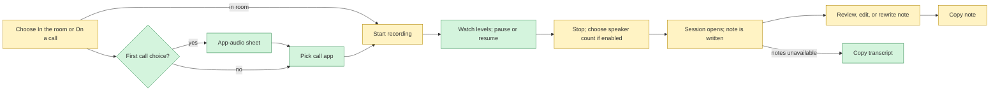

# Recording and session — Tauri spec
Status: approved (Patrick, 2026-11-16, incl. default decisions); Date: 2026-11-16

## Summary
- **What:** Choose an in-room or call recording, check both audio sources while recording, then review and copy a note on its own session page.
- **Why:** Therapists need to know the client is heard without delaying the session, and need a short path from Stop to a usable note.
- **User-visible change:** The record screen gains source choice, meters and Pause; Stop opens a note-first session with editing, playback and a copied marker. App-audio-only mode, the Settings source picker, the stacked result and Timings display go away.
- **Size / risk:** L, about 12–16 working days; late app capture and pause must preserve the microphone recording and its timeline.
- **Needs from Patrick:** Confirm or change the browser-audio default below.

## User workflow

**UX impact:**
- On a call, the microphone starts even while the chosen app is silent; the call meter warns after about 20 active seconds and clears when sound arrives.
- The live transcript starts open, then folds automatically; it can always be reopened.
- A note still in progress lives in its session, while New Recording is available for the next client.

---

## Intent (why users need it; who)
The approved [recording and session design](http://100.108.210.63:3000/pi0neerpat/scribular-docs/src/branch/main/design/recording-and-session/README.md) serves a therapist who alternates between in-person and remote sessions. They choose the source at recording time, verify capture, stop, check the note, correct it, and copy it into their records system. The design hub's [principles](http://100.108.210.63:3000/pi0neerpat/scribular-docs/src/branch/main/design/README.md) require local processing, permission at need, and progress where work is blocked. Patrick's 2026-11-16 decisions remove app-audio-only mode, select the note style at Stop, defer call-app and Meet detection, and rule out migration from the old app.

## Tauri state today (what exists, what is missing, with file refs)
- `InputMode` has `Mic`, `System`, and `MicAndSystem`; sessions store mode, status, prompt, transcript, summary and chunks. `SessionPatch` accepts summary edits but not prompt changes (`src-tauri/src/store/sessions.rs:17-78,191-215`; `src-tauri/src/store/migrations.rs:85-117`). Migrations v1–v7 are append-only and transactional (`src-tauri/src/store/migrations.rs:8-18,63-83`).
- `start_recording` checks access and delegates to `Recorder::start`; `stop_recording` starts finalization and returns the session ID. Opening app audio currently requires a playing app, and source-start failure deletes the new session (`src-tauri/src/commands.rs:1006-1046`; `src-tauri/src/audio/system.rs:31-85`; `src-tauri/src/jobs/session.rs:313-405`). Progress, segments and transcript-waiting events already cross Rust/TS (`src-tauri/src/commands.rs:71-80`; `src/lib/api.ts:297-353`).
- `RecordView` starts from Settings and keeps processing/results on that screen; it has Stop but no Pause or levels (`src/lib/components/RecordView.svelte:201-277,295-352`). Settings contains the three-mode and app picker (`src/lib/components/Settings.svelte:272-288,327-343`). The session component stacks note, speakers, audio and transcript; rewrite needs a second Regenerate click (`src/lib/components/SummaryPanel.svelte:104-120,161-187`).
- **Missing:** source choice and persistent call app on the record screen; late app attach and source health; pause; accurate active elapsed time; transcript collapse; Stop-to-session navigation; note-first tabs and in-place note edit; session-level copied state; per-session recovery placement; source-aligned playback transcript. The [gap review](http://100.108.210.63:3000/pi0neerpat/scribular-docs/src/branch/main/design/_gaps/recording-and-session.md) also identifies these seams.

## Goals / Non-goals / Anti-goals
**Goals:** Mic or mic-plus-one-app recording with reliable feedback; pause and resume; a Stop handoff that leaves capture available; a note-first session with edit, rewrite/undo, speaker naming, audio review, copy and recovery.

**Non-goals:** Styling the screens; implementing coaches, onboarding sheets, menu structure, sidebar, Settings window, shortcuts, themes or license policy owned by their specs; migration from the old app.

**Anti-goals:** Never auto-switch from mic to a call; never block microphone capture because the selected app is silent; never delete captured chunks on recoverable failure; never log, upload or expose clinical audio, transcript, speaker quotes or note text.

## Requirements (numbered R1..)

### Source and capture
- **R1** The record screen persists `record_location` (`inRoom` default, `onCall`) and `record_target_app` in this app's existing settings store; In the room maps to `mic`, On a call to `micAndSystem`. Reject `system` in `start_recording` and remove it from selectable modes, while retaining `InputMode.System` decoding for historical *this-app* DB rows. Remove source and app controls from Recording settings; that pane retains Identify speakers and Keep audio.
- **R2** On a call has one explicit manual app picker. Offer common apps/browsers by their AudioCapCLI source names even while silent, plus currently playing apps under Other App; refresh the latter on opening the picker. A chosen app remains selected across recordings/relaunches. On a call requires an app choice, but an already selected app being closed or silent does not block mic-first Start. A browser selection warns that capture includes audio from all its tabs. The picker does not detect whether Zoom, Meet or any call app is open, and does not infer a Meet tab.
- **R3** Selecting On a call for the first time invokes the onboarding-owned app-audio sheet; Not Now restores In the room without starting app capture. If access is missing later, the record screen offers Reopen System Audio Settings and Retry app audio; if macOS reports unknown, Try recording starts a real guarded capture attempt and only successful app capture marks access granted. Denial leaves In the room usable. Mic permission denial prevents Start and points to the Microphone pane. An outside recording start from the menu-bar icon or background shortcut interrupts an open Note Style Coach: discard its draft, close the sheet, start recording immediately, and show one closable line at the top of the record screen: “The note style coach closed because a recording started. You can start it again from Note Styles after your recording.” The line appears once for that interruption and never blocks capture.
- **R4** On-a-call Start creates one session and opens the default mic immediately, even when the target app has no sound or is closed. Attach the selected app source when AudioCapCLI can open it; retry while active and after app-source loss without stopping mic capture or creating a second session. Stop cancels retries. Only mic loss, no captured samples, or a fatal store failure ends the recording; saved chunks remain recoverable. A session with no captured call audio still finalizes its mic transcript and note.
- **R5** Emit a `session://levels` event for each source roughly 10 times per second with `sessionId`, source, bounded normalized level, hearing state and active elapsed milliseconds. The call source remains grey before attach or when silent; after about 20 active seconds without call samples show an amber warning, cleared by new call samples. In-room has one meter. No level history or raw PCM is persisted or logged.
- **R6** `pause_recording` pauses a running recording and is a no-op when already paused; `resume_recording` resumes a paused recording and is a no-op when already running; either command without an active recording returns a typed state error. Pause stops writes and transcription from both sources and suspends late attach; Resume restarts mic and app retry without opening a new session. Paused wall time is excluded from the displayed elapsed time, session duration, segments and retained audio. Stop is allowed while paused; crash during pause leaves the same recoverable interrupted session. A failed app resume keeps mic running; mic resume failure preserves chunks and reports interruption.
- **R7** The recording toolbar's style menu remains usable. Each change updates the active style for future sessions and the current recording's `prompt_id`; the style selected when Stop succeeds is the prompt queued for this session's note. A missing/deleted selected prompt follows the existing default prompt fallback. Once the summary job has been queued, later style changes never alter it.
- **R8** The live transcript starts visible and collapses at 60 active seconds or after five recognized words from **each** selected source, whichever comes first; in-room uses its one source. A silent call source cannot prevent the time trigger. Show/Hide manually overrides the automatic collapse for the remainder of that recording. Remove the word count display; transcript content stays on this Mac.
- **R9** If Identify speakers is enabled, Stop opens a nonmodal popover anchored to Stop for both modes: 2 people selected by default (Return), 3 people, 4 or more, and Keep Recording. Escape/Keep Recording closes it and continues. Stop passes the selected existing `num_speakers` contract; with Identify speakers off it stops directly. A background shortcut or menu-bar Stop skips the popover, uses automatic speaker detection when identification is on, and stops immediately, including while paused; the menu-bar speaker-count submenu still permits an explicit count.

### Session handoff and review
- **R10** On successful Stop, navigate immediately to the returned session ID, show finalization/transcription/summary progress where the note will appear, and make Transcript available when saved. The session list shows writing progress, and New Recording is available while the previous note processes. Stop in the note area cancels the pending summary but preserves the transcript and any completed note; failure keeps the session open with a recoverable error. The record screen no longer renders the result or Timings.
- **R11** A session opens on Note with Note, Transcript and Audio tabs. The header includes title, date/duration, speaker summary, style and Edit Speakers. Copy Note is primary when a note exists; when summary availability is `unsupported`, show “Summaries aren't available on this Mac. Recording and transcription still work.” in place of the note; when `loadFailed`, show “Summaries couldn't load. Recording and transcription still work.” with Try Again. In either case disable style rewrite and offer Copy Transcript. Note Styles consumes note-style-coach’s state-specific banner; a finished session waiting for the model shows retry in the note when download fails. A live/incomplete note is not copyable as final output. Remove the separate Regenerate and Delete buttons; deletion comes through app-shell-owned menu/context actions.
- **R12** The note body edits in place, saves atomically through `update_session`/`SessionPatch.summary`, and survives navigation/relaunch. A style selection on an eligible saved session immediately calls the existing regenerate path without a second click. Do not overwrite unsaved local edits; save or explicitly resolve them before rewrite. Every committed note edit, rewrite, or accepted Session Coach change records the prior note/style/model as one persistent per-session Undo step and clears Redo; Undo restores that prior state and creates one Redo step, and Redo reapplies the undone state. A fresh change after Undo clears Redo. Show a nearby Undo line after rewrite or Coach acceptance until edit, copy or navigation; Edit-menu Undo/Redo remain available while their steps exist. An edit replaces a stale rewrite step so Undo cannot erase newer text. A Coach candidate captures the exact `summary`, `prompt_id`, and `model_id`; accepting it compares all three in the same transaction as the write/Undo update and rejects stale candidates without changing note or history. Editing, rewriting, Coach acceptance, Undo, and Redo obey the app-shell-owned read-only license gate at both UI and command boundaries; view/copy remain allowed.
- **R13** After a successful clipboard write of the *final note*, atomically set `sessions.copied_at` and show temporary Copied button feedback plus a persistent session-list checkmark. Failed/denied clipboard writes do not mark copied. Copy Transcript never marks the note copied. Editing, rewriting, accepting a Coach candidate, Undo, or Redo clears `copied_at`; a repeated copy refreshes it. No note text enters diagnostics.
- **R14** For a session with multiple identified voices, show the existing quote-based speaker choices above the note; Me, Client or Other names are applied only on Done to note and transcript through the current speaker-map path. Edit Speakers reopens them. Pending choices survive leaving/reopening the session; calls and in-room sessions use the same behavior. License lapse makes speaker changes read-only.
- **R15** Audio is a disabled tab with an explanation when no retained playable audio exists; Keep audio remains opt-in, encrypted on this Mac, with existing seven-day expiry. When retained audio exists, native playback offers play/pause, scrub, 15-second back/forward and speed; its transcript follows and highlights the current line, and clicking a timed line seeks. Missing/expired audio never prevents reading or copying the note/transcript. Revoke the playback blob URL when the view closes or expires.
- **R16** An interrupted recording appears as its own session with a Recover marker; its page explains that saved local audio can be recovered and offers Recover Recording and Delete through the app-shell-owned deletion action. Recovery uses existing `recover_session` and resumes processing from chunks; it does not silently resume capture. Recovery failure leaves chunks and the action available. Remove the aggregate History recovery prompt.
- **R17** All new commands validate mode/state/session ID, enforce existing license and availability gates where a mutation occurs, and return actionable errors. Record only event kinds, state and counts in diagnostics; no PCM, transcript, note, speaker quote or app/browser title. Background model/coach work must yield to recording and must not delay mic Start. Source attach, pause, stop and navigation must behave correctly after a webview reload by querying Rust recording/session state.

## Acceptance scenarios (numbered AS1..; Given/When/Then; each tagged automated or manual)
- **AS1** (automated, `log/db/state`) Given a fresh app settings store, when location/app are saved and reopened, then defaults and selections round-trip; `system` Start is rejected, a legacy *this-app* `system` session remains readable, and Settings exposes only Identify speakers/Keep audio. (R1)
- **AS2** (manual real-app) Given a silent selected common app and a playing Other App, when the manual picker opens, then both are selectable, the playing list refreshes, a browser warning appears, and relaunch keeps the choice. Record the picker list, warning, and persisted selection on a real Mac; this is manual until a native picker/source-list fixture is added to the harness. (R2)
- **AS3** (manual real-app) Given first use of On a call, when Not Now is chosen, then the mode returns to In the room; given denied System Audio, the proper pane action appears and mic remains available. Record the sheet and permission states on a real Mac; this is manual until a native permission-state fixture is added to the harness. (R3)
- **AS4** (automated, `log/db/state`) Given a fake system source that appears late, disappears, and returns, when a call recording runs, then mic chunks are continuous, app chunks join the same session at the correct active offset, and Stop finalizes; given no app samples, then the mic note still processes. Given mic failure, stored chunks remain recoverable. (R4, R17)
- **AS5** (manual real-app) Given silent then audible app input, when 20 active seconds pass, then two bounded meter streams appear, amber call warning appears and then clears; in-room has one meter. Record meters and warning on a real Mac; this is manual until a source-level fixture is added to the harness. (R5)
- **AS6** (automated, `log/db/state`) Given active capture, when paused, resumed and stopped while paused in separate runs, then no paused samples/segments are saved, duration and timestamps exclude paused time, Stop succeeds, and reload shows the true state; invalid pause/resume returns a state error. (R6, R17)
- **AS7** (automated, `log/db/state`) Given styles A and B, when a recording starts on A and switches to B before Stop, then its queued note uses B; when B is removed, the documented fallback applies; a later global change does not change the queued note. (R7)
- **AS8** (automated, `ui-script`) Given one and two source recordings, when five words per source or 60 active seconds are reached, then the transcript folds at the first threshold; manually reopening keeps it open through Stop and no word count shows. (R8)
- **AS9** (automated, `ui-script`) Given Identify speakers on in either mode, when record-screen Stop is pressed, then Return accepts 2, alternatives pass 3 or 4+, and Escape/Keep Recording leaves capture running; with the setting off, Stop skips the popover. Given a background or menu-bar Stop, it stops immediately with automatic detection and no popover, even while paused. (R9)
- **AS10** (automated, `ui-script`) Given Stop succeeds, when processing continues, then the returned session opens immediately, its progress and transcript update there, its list row marks writing, and another recording can start; cancelling note writing preserves transcript/session after reopening. (R10)
- **AS11** (automated, `ui-script`) Given ready, unavailable and lapsed-access sessions, when Note/Transcript/Audio are opened, then Note is initial, Unsupported versus LoadFailed show the owned copy, only LoadFailed offers Try Again, Copy Transcript remains available, and rewrite is disabled, and lapsed access allows view/copy but no mutation. (R11, R12, R17)
- **AS12** (automated, `ui-script`) Given an edited note, when saved and reopened, then the edit persists; given a rewrite, when Undo is used via note line or Edit menu, then original note/style/model return; editing before Undo cannot erase the edit; Undo then Redo round-trips the latest note/style/model and a new edit clears Redo. A stale Coach candidate fails its exact snapshot check without changing history. (R12)
- **AS13** (automated, `log/db/state`) Given clipboard success, failure and note edits, when Copy Note is used, then only successful final-note copies set `copied_at`/checkmark, and edit/rewrite/Coach acceptance/Undo/Redo clears it; Copy Transcript does not set it. (R13)
- **AS14** (automated, `ui-script`) Given identified voices in an in-room or call session, when names change and Done is pressed, then note/transcript speaker names update and Edit Speakers reopens the form; pending choices survive reopen. (R14)
- **AS15** (manual real-app) Given kept audio with timed lines, when playback, skips, speed and line seeking are used, then playhead and highlighted line agree; given expired/missing audio, the tab explains why and no blob URL remains. Record playhead, highlighted line, and unavailable tab on a real Mac; this is manual until a native media/time fixture is added to the harness. (R15)
- **AS16** (automated, `ui-script`) Given an interrupted session with chunks, when Recover Recording runs, then only that session processes; on injected recovery failure, the chunks and Recover action remain after reopening. (R16)
- **AS17** (manual, `manual-only (real macOS AudioCapCLI and permission behavior)`) Given a real Mac, a selected silent call app, and one speaking mic, start, pause, resume, make app sound, and Stop; record elapsed/duration, both meters, warning transition, final transcript and local retained-audio playback evidence. If the native sidecar cannot attach late, record the exact failure as unverified/failed before release. (R3–R6, R15)
- **AS18** (automated, `log/db/state`) Given fault-injected attach, pause, clipboard and store errors, when they occur, then diagnostic output contains only event/state/count metadata, no clinical content, and committed chunks and notes survive; model/coach jobs cannot block mic Start. (R4, R13, R17)

## Design notes (modules, commands/events, data model + migration, UI components)
- **Where it runs / data flow:** Rust owns capture, timing, source retries, the session state and persistence. Svelte owns explicit source selection, popover/tabs, transcript visibility and rendering. At Stop, freeze the selected prompt before queue insertion; navigate using the returned session ID. Keep one recording at a time and use the existing summary queue for later notes.
- **Modules:** Extend `audio/system.rs` and `jobs/session.rs` for retryable app attach, per-source levels and pause; `store/settings.rs`, `store/sessions.rs`, `store/migrations.rs` for choices/copy state; `commands.rs` and `jobs/mod.rs` for IPC/events; `RecordView.svelte`, `LiveTranscript.svelte`, `SummaryPanel.svelte`, `SpeakersCard.svelte`, `SessionAudio.svelte`, and session-list view for behavior. App shell supplies navigation/sidebar/menu/Settings frame and read-only gate; this spec supplies the recorder/session behavior placed in them.
- **Commands & events:** Keep `start_recording(mode, app_id, title)`, `stop_recording(num_speakers)`, `current_recording`, `recover_session`, `update_session`, `regenerate_summary`, `undo_summary` and `list_audio_apps`; add `redo_summary`, `pause_recording`, `resume_recording`, `recording_state`, `set_recording_source`, and `mark_note_copied(id)` (called only after clipboard success). `recording_state` returns session ID, running/paused, active elapsed ms and selected target after reload. Add `session://levels` and a recording-state event; existing progress/segments events remain. Update `src/lib/api.ts` wrappers and regenerate affected `ts-rs` types, including `Session`, `SessionListItem`, `RecordingState`, `SessionLevel`, and source choice. Do not route raw audio through the webview.
- **Migration:** Append the next free migration at implementation time to add nullable `sessions.copied_at INTEGER` (Unix ms) and a persistent one-step Redo snapshot; use the existing prior-summary fields for the one-step Undo snapshot, extending them for style/model if needed. Update session/list queries and tests. Store record-screen location and target in existing settings key/value rows; no schema migration for those keys. Keep old `system` session decoding for this app's DB, but do not accept new app-audio-only recordings. Do not migrate settings or data from the former app. Pause intervals/levels are transient; final duration and segment offsets are persisted in the existing fields. Preserve the shipped migration sequence without editing old migrations.
- **UI components:** Record source choice and manual picker persist selection; meters and status consume `session://levels`; Stop popover provides accessible keyboard/focus behavior; session page holds note progress, tabs, in-place edit/undo and copy; playback consumes timed transcript segments. The sidebar owner displays the supplied writing/Recover/copied states. Browser capture warning belongs beside its manual selection.
- **Spec author's calls:** Use AudioCapCLI source *names* as current API does, with a small fixed list of common names plus live Other App results; no process/tab inspection is justified for this iteration. A missing call source is a continuing mic recording and a warning, never a start error. Pause uses one active-time timeline so late app audio, transcript and playback align. Copy success is recorded after the OS clipboard confirms writing. Displayed elapsed time is rebuilt from Rust state after reload.

## Dependencies and security check
**New dependencies: none.** Reuse AudioCapCLI, macOS permission handling, SQLite, native audio controls, the existing tests and UI harness. Review the changed sidecar invocation and diagnostics for unintended content or network access; retain current encrypted local audio and seven-day expiry. No new package, model or downloaded artifact is proposed, so dependency pin/license/install-script/URL checks are not applicable to this spec.

## Out of scope
- Zoom/Google Meet/call-app process detection, “Zoom is open” status, automatic Record Zoom Too offer and Meet tab detection: future call-source discovery iteration.
- Mini recorder, transcript-first/side-by-side/info-panel alternatives, device picker, echo cancellation, simultaneous capture of multiple apps, export and browser tab-specific capture: future recording/session iteration.
- App shell navigation structure/sidebar/menu bar/Settings window/read-only gate/update alert/Delete All: `app-shell`.
- Shortcut bindings/global shortcut/Shortcuts pane: `keyboard-shortcuts`. Welcome/first-call sheet, first-note tip and Note Styles empty card: `onboarding`.
- Coach engine/practice notes/shared coach availability gate/Show-in-style-menu: `note-style-coach`. In-note Coach conversation and style-update offer: `session-coach`. Appearance and stars: `theme`.
- Former-app data/settings migration, including stars animation: deliberately excluded by Patrick; append-only migrations for this app's own DB still apply.

## Depends on / interacts with (other specs by slug)
- **app-shell** (`plans/2026-11-16-app-shell-spec.md`): owns sidebar, native menu structure, Settings window, read-only license gate, update alert and Delete All. It provides session navigation and menu hooks; this spec supplies recording/session state, edit/undo behavior and list markers. Land shell hooks before integrating Stop navigation and Edit Undo.
- **recording-and-session** (`plans/2026-11-16-recording-and-session-spec.md`): owns record-screen source choice, recorder, Stop handoff, note-first session, in-place edit/undo and copied marker; this document is that owner.
- **keyboard-shortcuts** (`plans/2026-11-16-keyboard-shortcuts-spec.md`): owns accelerators, global shortcut and Shortcuts pane; consume Start/Stop/Pause/Resume and Edit Undo actions from this spec after those commands exist.
- **onboarding** (`plans/2026-11-16-onboarding-spec.md`): owns welcome, first On-a-call sheet, first-note tip and Note Styles empty card; this spec emits the first-call choice and respects Not Now.
- **note-style-coach** (`plans/2026-11-16-note-style-coach-spec.md`): owns coach engine, practice notes, shared coach availability gate and Show-in-style-menu; its gate observes recorder state, and its menu visibility filters this spec's style picker.
- **session-coach** (`plans/2026-11-16-session-coach-spec.md`): owns the in-note conversation and style-update offer; it uses this spec's note edit/undo and session placement, after note editing lands.
- **theme** (`plans/2026-11-16-theme-spec.md`): owns appearance; this spec adds no theme state or migration.

## Coordination notes
Keep the shared `RecordView`, `SummaryPanel`, settings and session-store edits in this spec's PR sequence; app-shell/onboarding/shortcut/coach PRs consume the published contracts rather than independently implementing recorder or note mutation. Schema version is allocated at merge time because other specs may add migrations first. The design and gap review predate Patrick's four decisions; those decisions take precedence over their app detection, `system` retention and old-app migration suggestions.

## Decisions for Patrick (with recommended default)
All defaults below approved by Patrick on 2026-11-16 unless marked otherwise.
1. If a browser is chosen, should Scribular permit recording all audible tabs after a plain warning? **Default:** yes, because AudioCapCLI selects an app, not a tab; show the scope clearly before Start and keep the manual choice. Tab-specific capture remains out of scope.

## Size (S/M/L, rough days) and suggested PR split if > ~1 PR
**L, about 12–16 working days.** Sequential PRs; each keeps capture/session data safe and includes the listed checks.
1. **PR1 (L, 4–5 days):** Rust source contract, mic-first late attach/retry, levels, pause/resume and timeline, with fake capture and error/recovery tests (AS1, AS4–AS6, AS18).
2. **PR2 (M, 2–3 days):** Record-screen source/picker, first-call hook, meters, transcript collapse and Stop popover; run manual native checks (AS2, AS3, AS5) and UI checks (AS8, AS9).
3. **PR3 (L, 4–5 days):** Stop handoff, note-first tabs, style-at-Stop, edit/rewrite/undo, copy migration, Coach snapshot guard, speaker/recovery placement and playback (AS7, AS10–AS16).
4. **PR4 (S–M, 2–3 days):** Real Mac AudioCapCLI/permission/playback walkthrough, privacy fault checks and integration fixes (AS17, AS18). Record manual evidence without claiming unrun hardware checks.
