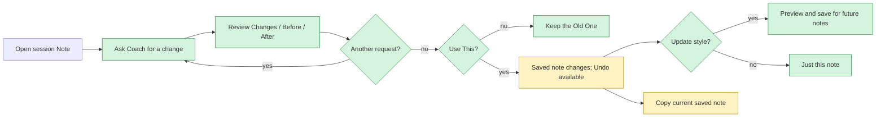

# Session Coach — Tauri spec
Status: draft for cwf; Date: 2026-11-16

## Summary
- **What:** Therapists can ask the Coach to revise a session note, inspect one proposed revision, and choose whether to use it.
- **Why:** A finished note needs a safe way to become shorter, change sections, or use quotes without losing the original.
- **User-visible change:** An always-present Coach input starts a conversation below the note; accepted changes can also be offered for future notes.
- **Size / risk:** L, about 8–12 engineering days; the main risk is an invented clinical fact or an unsafe style instruction derived from a real note.
- **Needs from Patrick:** approval of this spec and the recommended default below.

## User workflow

**UX impact:**
- The Coach input stays below the note; no separate Coach or Cancel button. A follow-up replaces the pending proposal, while Stop ends preparation without changing the note.
- Recording, ended access, and unavailable summaries disable the input with the reason inside it. Reading and copying remain available.

---

## Intent (why users need it; who)
Therapists reviewing a real session need to request a small writing change, compare it with the saved note, accept or reject it, then copy the saved result. The approved source is `scribular-docs/design/session-coach/README.md` (Option 3, 2026-11-16); `scribular-docs/design/README.md` supplies the native-Mac and on-device principles. Visual mockups are references for behavior, not implementation assets.

## Tauri state today (what exists, what is missing, with file refs)
- `src/lib/components/SummaryPanel.svelte:15-53,105-143,146-187` shows a read-only summary and transcript, Copy, style selection, Regenerate, transient summary preview, Stop, and Undo. `src/lib/components/RecordView.svelte:346-352` and `src/lib/components/SessionHistory.svelte:138-142` both use it.
- `src-tauri/src/store/sessions.rs:125-155,191-205,501-517,554-610` stores the summary, prompt ID, and a single prior summary snapshot. `update_session` can overwrite the summary without a compare-and-swap check or Undo snapshot; regeneration has a separate Undo path. `src-tauri/src/store/mod.rs:146-166` opens the encrypted local store.
- `src-tauri/src/commands.rs:345-350,379-380,405-485,629-630,733-750` exposes session edit/Undo, prompt CRUD, summary availability, and regeneration. `src/lib/api.ts:79-81,136,143-174,186-215,357-385` wraps these and license state. `src-tauri/src/jobs/summarize.rs:173-181` resolves the saved style for a summary job.
- `src-tauri/src/store/migrations.rs:1-19,67-82` uses append-only numbered schema migrations. `src-tauri/src/store/sessions.rs:125-155,191-205` derives frontend session types through `ts-rs`; generated `src/lib/types/Session.ts` and `SessionPatch.ts` match the current fields.
- **Missing:** inline Coach conversation and generation on a real note; candidate comparison and combined follow-ups; atomic guarded acceptance; a per-accepted-edit style offer and safe style update. The approved note-first view, shared edit/Undo, and shared availability/license gates belong to the adjacent specs below.

## Goals / Non-goals / Anti-goals
**Goals:** One local conversation per open session; one reviewable pending candidate; explicit atomic acceptance; safe one-step Undo; optional future-only style change from accepted edits.

**Non-goals:** New recorder, note editor, sidebar, Settings window, native menu bar, keyboard shortcuts, practice-note Coach, theme, or old-app data migration. No Google Meet or Zoom detection; the manual call-app picker belongs to recording-and-session.

**Anti-goals:** Never save a proposal before Use This; never invent or silently change clinical facts; never send note, transcript, speaker, or client content off device or into logs/telemetry; never make a style update retroactive; never let Coach work block recording or a real summary.

### Exception: real session notes may update a note style (Patrick, 2026-11-16)
The Note Style Coach spec excludes improving a style from feedback on a real session's note and uses fictional examples and practice notes. **“Also use this for my style” is the deliberate exception:** only after a therapist accepts a Coach change to a real session note may Session Coach offer to carry the change into that session's style. Save only reusable writing instructions derived from the accepted edits, such as length, sections, bullets, or quote use; never clinical facts, names, quotes, or other note/transcript content. The therapist must explicitly choose it after a preview. The update stays on device and affects only future notes; existing notes change only through an explicit edit or accepted Coach revision.

## Requirements (numbered R1..)

### Conversation and proposals
- **R1** Every session Note view with a saved note shows the Coach composer below it. Sending a nonblank request starts or continues inline chat; no separate Coach or Cancel control. Chat, unsent input, and candidate live only while that session remains open; leaving it or relaunching discards them, while accepted edits and Undo remain stored.
- **R2** A Coach job uses the current saved note and its session transcript locally to change supported writing form (length, quotes, sections, bullets), preserving clinical facts and source attribution. It returns either a full candidate note or a plain clarifying/unsupported reply; it never writes the session. Unsupported requests say “I can change length, quotes and sections” and invite another request. Never imply a clinical accuracy guarantee.
- **R3** Show one pending full-note candidate with Changes / Before / After against the current saved note and Use This / Keep the Old One. The input remains usable. A follow-up includes the prior requests and candidate as context but produces **one replacement candidate against the saved note**; it does not stack partial writes. While preparing a replacement, show the earlier candidate but disable its actions.
- **R4** While preparing either request, the send control becomes Stop. Stop cancels only this Coach job, applies nothing, keeps the saved note and any earlier candidate, restores its actions, briefly confirms stopping, and accepts another request. A late result from a stopped or departed job cannot appear in a different session or become applicable.
- **R5** Keep the Old One discards the pending candidate without changing the note or ending the conversation. Generation failure, unsupported output, or failed follow-up likewise leaves the saved note and earlier candidate intact, gives a short recoverable message, and earns no style offer.

### Save, copy, and availability
- **R6** Use This submits an opaque candidate ID, not client-supplied note text. Recording-and-session owns the transactional comparison of the candidate's captured `summary`, `prompt_id`, and `model_id` with the current session, followed by the note write and shared Undo/Redo update. If typing, rewrite, style change, or another Coach result made that snapshot stale, refuse the save and require a newly generated candidate reviewed against the current note. A failed write leaves the prior note and Undo intact.
- **R7** Accepted Coach edits survive session navigation and relaunch; the shared in-place Undo reverses the latest accepted edit and remains usable after leaving the conversation. Coach never owns a second Undo stack. Acceptance preserves the session's style provenance unless the therapist separately changes style, and clears `copied_at` through the recording-and-session note-write contract.
- **R8** Copy Note immediately copies the current saved note, never a pending candidate or transcript fallback. Copy remains possible while a candidate is pending or Coach is disabled. If an unanswered style offer exists, successful copy may show its one-time Update Style / Just This Note entry point afterward; a failed clipboard operation does not claim success.
- **R9** Use note-style-coach’s single `CoachAvailability` reason/message/retry table and app-shell’s read-only license gate in the UI and Coach commands. Show its applicable disabled-input message without an extra banner, including busy, Downloading, Unsupported, and LoadFailed; expose its Try Again action for LoadFailed. An in-flight Coach job stops when that gate closes, preserving note/candidate. The session stays readable and Copy Note works. The separate style-menu Coach action opens Note Style Coach through the same gate.
- **R10** Coach work is a cancellable local model job using the note-style-coach queue/engine. Real session recording and summary work takes priority; a queued or running real summary closes the shared gate, and starting a recording cancels Coach work. No Coach request, transcript, note, candidate, speaker content, or client facts enter logs, diagnostics, telemetry, persisted job queues, temporary plaintext files, or network requests. Only model downloads may use the network.

### Future-note style offer
- **R11** Each accepted edit set can earn at most one unanswered style offer, shared between the in-chat suggestion and post-copy entry point. Update Style or Just This Note resolves both; subsequent copy and Undo do not re-offer that set. A later accepted edit may earn a new offer. Undo before style update discards its outstanding offer. Leaving the session permanently discards unanswered offers along with chat; reopening does not restore or re-offer them.
- **R12** Derive a style change only from accepted writing instructions, with validated structural fields/allowlisted wording; never feed the real note or transcript into saved style instructions. If the request cannot be reduced safely to reusable instructions, omit the offer. Show the exact proposed change and require explicit confirmation before any style write; a dismissed or failed preview changes neither note nor style.
- **R13** For a custom style, Update Style saves the reviewed reusable change to that style, preserving the rest of its settings. For a built-in, create a clearly named custom copy (for example, “Brief DAP — My version”), set its note-style-coach `showInStyleMenu` visibility to on, and use that copy for future sessions. Neither path regenerates the current or any past note. The current session keeps its original style provenance and accepted note text.
- **R14** A style update or copy failure leaves the accepted note and its Undo intact. If the selected style was deleted, changed, or is no longer writable during preview, require a fresh preview rather than overwriting it. Backend validation enforces built-in immutability and the current license gate regardless of UI state.

## Acceptance scenarios (numbered AS1..; Given/When/Then; each tagged automated or manual)
- **AS1** (automated, vitest; evidence: `ui-script`; R1, R3, R5) Given a saved note, when a request is sent, a candidate arrives, Keep the Old One is chosen, and another request is sent, then the original saved note remains, the conversation continues, and only the new candidate is actionable. Leaving and reopening the session shows no chat/candidate.
- **AS2** (automated, cargo test with fake engine; evidence: `log/db/state`; R2, R5, R10) Given a fixture note/transcript with sentinel client facts, when the Coach handles a supported change and then an unsupported/failing one, then only an in-memory candidate or recoverable reply is produced, the session row is unchanged, and logs/diagnostics/telemetry contain no sentinels or Coach content.
- **AS3** (automated, vitest + fake engine; evidence: `ui-script`; R3, R4, R5) Given candidate A, when a follow-up starts, then A's actions are disabled and the send control is Stop; when Stop is pressed or the follow-up fails, A's actions return and the saved note is unchanged; when a follow-up succeeds, B compares the whole combined candidate with the saved note. A late cancelled result is ignored.
- **AS4** (automated, cargo test; evidence: `log/db/state`; R6, R7) Given a saved note and candidate ID, when Use This accepts with the captured base, then one transaction stores the candidate and prior-note Undo snapshot and clears `copied_at`; after reopen, Undo restores the prior note and Redo reapplies it. Given an intervening note edit, prompt/model change, or rewrite, acceptance fails as stale without overwriting either note or Undo; a new candidate requires another review.
- **AS5** (automated, vitest; evidence: `ui-script`; R6, R8) Given a pending candidate, when Copy Note runs, then clipboard text equals the saved note and the candidate remains pending; given a stale candidate, Use This presents review-again rather than silently applying it. A clipboard failure shows failure and no copied marker.
- **AS6** (automated, vitest + Rust command tests; evidence: `ui-script` and `log/db/state`; R9, R10) Given recording, ended access, busy real summaries, Downloading, Unsupported, or LoadFailed, when Coach is opened or submitted through IPC, then input/send are disabled with the note-style-coach table’s applicable reason and LoadFailed offers Try Again, and backend rejects generation/accept/style save; note reading and Copy Note work. Starting recording cancels a running Coach job without delaying recording.
- **AS7** (automated, vitest; evidence: `ui-script`; R11) Given an accepted edit, when the in-chat offer is answered or the note is copied and the popover is answered, then the other entry point closes and later copies do not re-offer it. Just This Note suppresses it; Undo clears it; a second accepted edit can earn one new offer. Leaving with an unanswered offer and reopening shows no offer.
- **AS8** (automated, cargo test; evidence: `log/db/state`; R12, R13, R14) Given accepted length/section/quote requests containing sentinel client names and facts, when style derivation runs, then the preview and persisted style contain only validated reusable instructions and no sentinels. An unsafe or non-structural request produces no offer.
- **AS9** (automated, cargo test; evidence: `log/db/state`; R13, R14) Given a custom style, when a preview is confirmed, then only that style changes and future sessions use it. Given a built-in, confirmation creates a named custom copy, marks it shown in the style menu, and makes it active for future sessions; the built-in, accepted note, prior sessions, and current session provenance remain unchanged. A stale/deleted style or write failure changes nothing.
- **AS10** (manual, real app with local fixture session; evidence: `ui-script+native`; R1–R9, R11–R13) Given a finished fixture note, send “Use bullet points in Assessment,” follow with “Also shorten Plan,” inspect all three comparison views, Stop a later follow-up, accept the combined proposal, copy, then Undo. Record the screen and saved DB/session state showing one accepted change, exact clipboard text, intact original on Undo, and one style offer. Use fictional content only.
- **AS11** (manual, real Mac with local model; evidence: `ui-script+native`; R2, R10, R12) Given a fictional fixture with distinctive facts and speaker labels, request shorter text, an exact quote, and a section change. Inspect candidate against the source for unsupported/new clinical facts; if one appears, report failure and do not accept. Confirm no note/transcript text in logs and that recording can start during a Coach job. Record the fixture, screen result, and redacted log inspection.

## Design notes (modules, commands/events, data model + migration, UI components)
- **Where it runs / data flow:** Note view holds transient chat and candidate. `api.ts` calls a Rust session-Coach job using the existing local LLM queue; job reads the current saved note/transcript and returns a candidate/reply. Candidate is never a store write. Use This calls a separate transactional store operation with expected base; style derivation/preview/save are separate operations after acceptance. Only actual note/style changes persist.
- **Modules:** add session-Coach orchestration under `src-tauri/src/coach/` beside the Note Style Coach engine; touch `jobs/` for bounded cancellation/priority, `commands.rs`, `lib.rs` registration, `store/sessions.rs`, `store/prompts.rs`, `src/lib/api.ts`, generated types, and the Note view component supplied by recording-and-session. Reuse the note-style-coach availability gate and app-shell license guard. `SummaryPanel.svelte` is today's integration point, but the implementing branch should use the owning spec's final Note view.
- **Commands & events:** `session_coach_start(sessionId, request, priorRequests, priorCandidateId?) -> jobId`, `session_coach_stop(jobId)`, `session_coach_accept(sessionId, candidateId) -> Session`, `session_coach_style_preview(acceptedEditId) -> StylePreview | None`, `session_coach_style_save(previewId) -> PromptList`. Emit `session-coach://result` / `session-coach://stopped` with `jobId`, `sessionId`, and typed candidate/reply; bind listeners before starting, or reconcile with a job snapshot, so an immediate result cannot be missed. Generated `ts-rs` types and `src/lib/api.ts` wrappers cover every payload. Backend-held, short-lived candidate/preview tokens bind the saved-note snapshot, accepted edit, and validated style delta; commands never trust client-supplied candidate or prompt text. These command and event names are the contract for implementation.
- **Data model + migration:** reuse `sessions.summary` as the saved note and the recording-and-session atomic edit/Undo model. If that model needs columns, its owner appends the next free migration; this spec adds no separate chat/candidate/offer table. Prompt style metadata comes from note-style-coach's `style_spec` migration; this spec writes through its validated style store. No migration from the old app or back-compat for old settings/data. New schema migrations within this app remain append-only (`store/migrations.rs`).
- **UI components:** mount a session-local Coach conversation below the editable Note and comparison view, keeping the composer available with a pending candidate; use the existing note toolbar's Copy and style menu. Give stopped/error/stale states clear messages. Keep Coach text out of Settings; style creation remains in sidebar. Accessibility: disabled reasons are available to assistive technology; comparison and action controls have names and keyboard focus.
- **Spec author's calls:** compare-and-swap uses the backend-captured `summary`, `prompt_id`, and `model_id` in the transaction; an old UI snapshot cannot overwrite an edit or rewrite. The offer is transient and expires on leave. Real summary jobs outrank Coach jobs, matching practice-job priority. If a style has no safely representable structured delta, the note edit still works and no style offer appears.

## Dependencies and security check
**New dependencies: none.** Reuse the local model, queue, diff display, prompt store, and clipboard path already selected by adjacent specs. No new model download is owned here. During implementation, confirm the existing pinned packages used by this path remain licensed for the closed-source app, check affected versions with `cargo audit` / `npm audit`, and inspect any newly touched install scripts or downloaded artifacts; record results in the PR. A material license, exploitable vulnerability, or functional failure is the only security-related approval blocker. Privacy verification is AS2, AS8, and AS11.

## Out of scope
- Creating a style from a real session note as the example input: future **note-style-coach** iteration; this spec only derives reusable instructions from **accepted** session edits.
- Google Meet/Zoom detection, “Zoom is open” status, and Meet-tab detection: future recording-and-session iteration. The plain manual call-app picker remains in that spec.
- App-audio-only recording mode: removed by Patrick; recording-and-session supports only In the room and On a call.
- Migration from the old app, including settings/data or stars-animation migration: excluded by Patrick. This does not waive this app's append-only SQLite schema migrations.
- Broader rewriting and multi-session Coach history: future **session-coach** iteration. Diagnostic correctness claims and cloud inference have no approved owner. Transcript/audio editing belongs to a future **recording-and-session** iteration.

## Depends on / interacts with (other specs by slug)
- **app-shell** (`plans/2026-11-16-app-shell-spec.md`): owns sidebar, native menu structure, Settings window, read-only license gate, update alert, and Delete All; its license rule lands before Coach mutation commands.
- **recording-and-session** (`plans/2026-11-16-recording-and-session-spec.md`): owns source choice, recorder/pause/levels/late app attach, Stop-to-session, note-first view, in-place edit/Undo, and copied marker. Its atomic note edit/Undo contract lands before Use This; its style selection at Stop is the one used to create that session's note, even if changed during recording.
- **keyboard-shortcuts** (`plans/2026-11-16-keyboard-shortcuts-spec.md`): owns accelerators, global shortcut, and Shortcuts pane; shared Undo/menu actions must target the active note, without defining shortcuts here.
- **onboarding** (`plans/2026-11-16-onboarding-spec.md`): owns welcome, first On-a-call sheet, first-note tip, and Note Styles empty-state card; the tip may point to the Coach input but Coach does not own it.
- **note-style-coach** (`plans/2026-11-16-note-style-coach-spec.md`): owns the Coach engine, practice notes, shared Coach availability gate, Show-in-style-menu, and style schema/validation. Session Coach reuses these and owns only the in-note conversation plus accepted-edit style offer; the menu command opens Note Style Coach.
- **session-coach** (`plans/2026-11-16-session-coach-spec.md`): this spec owns the conversation, candidate review/Stop, and future-style offer; this row records ownership, with no sequencing dependency on itself.
- **theme** (`plans/2026-11-16-theme-spec.md`): owns appearance; Coach adds no appearance setting or legacy stars migration.

## Coordination notes
- Land the recording-and-session note/Undo contract, app-shell read-only guard, and note-style-coach engine/availability/style schema before wiring acceptance and style save. Where those branches edit `SummaryPanel.svelte`, `commands.rs`, `api.ts`, or `jobs/`, integrate through the final owner interfaces instead of parallel implementations.
- The older `plans/2026-11-07-note-style-coach-spec.md` is useful implementation history; this design and Patrick's 2026-11-16 decisions control conflicts. Its fictional practice-note path remains separate from the real-session exception above.
- A native acceptance row requires a harness side-quest if the UI test runner cannot drive the Coach or read clipboard/DB evidence. Do that before claiming AS10/AS11 complete; otherwise report them unverified.

## Decisions for Patrick (with recommended default)
1. May a real session note itself be supplied as the example for **creating** a new style? **Default:** no; keep the approved fictional example/practice flow and this narrowly scoped accepted-edit exception. A later design can add explicit real-note intake.

## Size (S/M/L, rough days) and suggested PR split if > ~1 PR
**L, about 8–12 engineering days after the shared prerequisites land.**
1. **PR1 (M, 3–4 days):** local session-Coach job, cancellation, privacy/grounding checks, typed IPC; AS2 and backend half of AS6.
2. **PR2 (M, 3–4 days):** Note-view conversation, full-candidate comparison, Stop, guarded acceptance, Copy/Undo/Redo integration and availability states; AS1, AS3–AS6, AS10.
3. **PR3 (M, 2–4 days):** accepted-edit style derivation, preview, custom/built-in save, one-time offer, real-model/privacy walkthrough; AS7–AS9, AS11.
