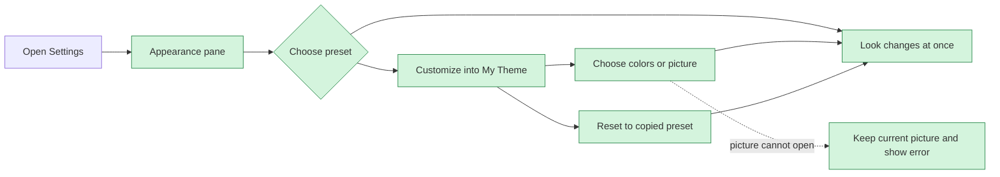

# Theme — Tauri spec
Status: approved (Patrick, 2026-11-16, incl. default decisions); Date: 2026-11-16

## Summary
- **What:** Therapists can choose a ready-made look or make one personal theme with colors and a local background picture.
- **Why:** The current fixed look cannot reflect a person's preference, while notes must stay easy to read.
- **User-visible change:** Appearance joins Settings; themes change immediately, and Stars motion moves out of General.
- **Size / risk:** L; local picture handling and keeping text readable over every picture are the main risks.
- **Needs from Patrick:** This is a draft pending approval of design option B and the defaults below.

## User workflow

**UX impact:**
- Built-in themes are fixed; Customize creates the one editable My Theme. Replacing an existing My Theme asks first.
- Picture choices and color changes appear immediately in open windows. Failed picture imports leave the current look in place.
- General no longer has a background-animation switch; Stars has an Animated motion switch in Appearance.

---

## Intent (why users need it; who)
Therapists need an app-wide look they can choose once, including the original Scribular look, their own picture, and colors, without obscuring clinical notes. The source is Patrick's theme request and the exploring option B design in `scribular-docs/design/theme/README.md:7-29`; `scribular-docs/design/README.md:9-14` places preferences in Settings and favors native Mac patterns. This spec gives cwf an implementable draft; option B still needs approval.

## Tauri state today (what exists, what is missing, with file refs)
- `src-tauri/src/store/settings.rs:18,26-40,72-107` stores two `AppSettings` booleans in local SQLite. `showBackgroundAnimation` defaults true. `src/lib/types/AppSettings.ts:3` is generated from the Rust type.
- `src/lib/api.ts:283-284`, `src-tauri/src/commands.rs:1067-1074`, and `src-tauri/src/lib.rs:175-177` carry get/set settings through IPC. `src/lib/components/Settings.svelte:122-128,197-215,346-353` loads and saves General's animation switch immediately.
- `src/App.svelte:76,145-150,174-190` loads the shared settings store, mounts the star canvas, and switches among main views. `src/lib/components/BackgroundAnimation.svelte:8-33,42-46` already pauses when hidden or Reduce Motion is enabled and speeds up during recording.
- `src-tauri/tauri.conf.json:13-28,30-45` configures one initial window, a restrictive image CSP, and no bundled theme pictures. `src-tauri/src/store/migrations.rs:10-19,70-82` requires append-only, transactional DB schema migrations. `src-tauri/src/commands.rs:365-375` clears sessions, not app appearance assets.
- `REVIEW.md:19-27,29-40` describes in-process local data, the Rust/TypeScript contract, and privacy-sensitive content. `plans/parity/08-app-shell-tray-notifications.md:100-120,253-256` is older shell/animation context; the new ownership map below governs this spec set.

**Missing:** appearance state and presets; system light/dark and accent tracking; My Theme; picture import, storage, access, and cleanup; theme tokens and protected content surfaces; cross-window application; appearance tests.

## Goals / Non-goals / Anti-goals
**Goals:** An app-wide theme that persists locally, applies live, supports the three designed presets and one editable copy, and keeps words on solid surfaces.

**Non-goals:** Per-session or per-note-style themes, theme sync/sharing/import, text-size or font selection, and changing the menu-bar icon or app icon.

**Anti-goals:** Putting transcript or note text over a picture; reading arbitrary local files from the webview; recording or session work waiting on picture processing; importing settings or data from the old app.

## Requirements (numbered R1..)
### Choice and persistence
- **R1** Appearance is the second pane in the app-shell-owned Settings window, after General. It contains Theme, Colors, and Background picture. General's `showBackgroundAnimation` control is removed. `Default` is the initial selection, with Automatic appearance, system accent, no tint, and no picture. The former animation boolean is ignored rather than migrated.
- **R2** `Default`, `Scribular V1`, and `Sage` are fixed built-ins. Default follows native system colors; V1 uses the original black/starfield and blue palette and is dark-only; Sage has the documented light/dark cream and sage palettes, with Sage green as its fixed accent (Spec author’s call; Default alone follows the Mac accent). Automatic follows Mac appearance as it changes. Light/Dark overrides work for Default, Sage, and My Theme. V1 disables the mode choice and remains dark.
- **R3** Built-in Colors and Background picture values are read-only. Customize copies the selected built-in's configured values and origin, retaining semantic choices such as system accent, into a single `My Theme`, selects it, and enables editing. Switching to a built-in preserves My Theme. Customize from another built-in asks before replacing it; Cancel changes nothing. Reset restores the copied preset values, keeps My Theme selected, and reclaims any now-unused picture copy.
- **R4** The accent choices are Same as your Mac, Blue, Purple, Pink, Red, Orange, Yellow, Green, Graphite, and a custom color chosen in the native Mac Colors panel. Same as your Mac tracks system accent changes while the app runs. Tint choices are fixed None, Warm, Cool, Sage, and Rose, with suitable light/dark variants; there is no custom tint.
- **R5** Selection, appearance mode, My Theme definition, accent, tint, background ID/path, blur, brightness, and Stars motion are stored on this Mac with app settings and loaded at startup. Changes commit atomically and propagate to every open app window without Apply or relaunch. A failed save reverts the visible choice and reports an actionable error. Unknown persisted values fall back to Default without preventing startup.

### Pictures and surfaces
- **R6** Background choices are None, bundled Stars/Dawn/Sea Glass/Linen, and a local picture selected by a Rust-owned Open panel or dropped on the picture row. For a drop, the frontend passes the OS-provided path only to the Rust import command and never reads the file. Accept JPEG, PNG, HEIC, and WebP after checking file content, decoding, dimensions, and size; reject an unreadable/unsupported file with a clear error naming those accepted formats and preserve the prior selection. Canceling the panel changes nothing.
- **R7** The Rust import command copies and downsizes a chosen picture to the display's usable pixel size, preserving aspect ratio, into an app-owned Backgrounds directory and selects it as one operation; settings store only the app-owned identifier/path, never the source path. The image fills the window. Blur and Brightness affect only the picture and are bounded to their UI ranges. Import or settings failure leaves the prior theme and removes the new copy. Removing/replacing a file picture deletes its owned copy only when no saved theme uses it. Delete All Sessions leaves pictures and theme settings intact.
- **R8** Stars uses the existing canvas as the built-in picture. Only Stars exposes Animated motion, which defaults on when Stars is first selected or copied from V1; the old animation setting is ignored. When motion is on, stars accelerate during recording; when off they remain still. Hidden windows and macOS Reduce Motion stop animation regardless of the switch. Choosing a different picture never leaves an active star canvas.
- **R9** Every note, transcript, and live transcript remains on a solid, theme-appropriate surface. A picture may appear in the window frame and through sidebar material. Record controls sit on one material plate; labels and controls remain legible. The Settings window uses the standard Mac appearance, with only the chosen accent applied. System font, control geometry, alert/sheet appearance, and red record/stop controls stay fixed.
- **R10** Picture display is limited to bundled resources and the app-owned Backgrounds directory. The frontend cannot open arbitrary local paths through CSP or asset routing. No picture bytes, source paths, transcript/audio/note content, or custom colors are sent to telemetry or logged; expected errors expose only safe user text.

### Availability and failure
- **R11** Appearance remains available while recording, while the app is read-only because of licensing, and when speech/summary/coach models are unavailable. Changing it never interrupts capture, blocks Stop, changes the selected note style, or changes existing session content. Settings remains reachable through the app-shell license gate.
- **R12** If a bundled or stored picture is missing/corrupt at startup or display time, render a solid background, keep the rest of the theme usable, and show a recoverable Appearance error. Re-selecting or resetting the picture clears the error. A theme failure must not lose a session or block recording.

## Acceptance scenarios (numbered AS1..; Given/When/Then; each tagged automated or manual)
- **AS1** (automated, cargo test) Given a fresh settings store or one with only the old animation key, when app settings load, then Default/Automatic/system accent/no tint/no picture is returned; the old key does not select Stars. Given an unknown theme value, loading falls back safely. (R1, R5)
- **AS2** (automated, vitest) Given each built-in and a simulated Mac light/dark change, when appearance resolves, then Default and Sage follow Automatic or their override, V1 stays dark, and V1 mode editing is disabled. (R2)
- **AS3** (automated, vitest) Given a customized My Theme, when the user selects a built-in and returns, then edits remain; when replacement is canceled, state is unchanged; when replacement is confirmed or Reset is used, copied preset values and origin are correct. (R3)
- **AS4** (automated, vitest) Given a system accent change, named accent, custom color, and each tint, when selected, then effective tokens update and tint never changes text or record/stop colors. (R4, R9)
- **AS5** (automated, cargo test) Given valid and invalid theme settings, when saved, then valid fields persist together and invalid enum/color/range/path input is rejected without partial writes; a simulated write failure leaves the prior saved theme. (R5, R7, R10)
- **AS6** (automated, cargo test) Given JPEG, PNG, HEIC, WebP, mismatched extension, malformed input, and a canceled/no-path selection, when imported, then only decodable allowed content creates an app-owned downsized copy, errors leave the prior selection and no partial file, and the original is untouched. (R6, R7)
- **AS7** (automated, cargo test) Given a picture referenced by My Theme and another no longer referenced, when a theme is reset or picture is replaced and Delete All Sessions runs, then only the unreferenced copy is removed and session deletion leaves theme assets/settings intact. (R3, R7)
- **AS8** (automated, vitest) Given Stars on/off, recording/idle, hidden/visible, and Reduce Motion on/off, when state changes, then animation runs only when allowed, recording changes its speed, and a non-Stars selection has no active star canvas. (R8)
- **AS9** (manual real-app) Given Default, V1, Sage, My Theme, a bright/busy custom picture, and Light/Dark, when viewing record, recording, note, transcript, and Settings windows, then all words remain on solid/material surfaces, the image fills without filtering controls, Settings stays standard apart from accent, and record/stop remain red. Record screenshots for each surface and the appearance mode. (R2, R9)
- **AS10** (manual real-app) Given two open app windows and Settings, when changing a preset, accent, mode, tint, picture, blur, or brightness, then both app windows update immediately without Apply; when save is forced to fail, the previous selection returns with an error. Record a short screen capture and failure text. (R4, R5)
- **AS11** (manual real-app) Given a local picture, when choosing it, dropping it, canceling, then trying corrupt/unsupported files, then the owned copy displays, cancel does nothing, failures keep the prior picture, and no original path is exposed by the webview. Inspect the Backgrounds folder and CSP/asset route; record filenames and error text, not picture contents. (R6, R7, R10)
- **AS12** (manual real-app) Given a missing stored picture, when launching, then a solid fallback and recoverable error appear. With read-only licensing, Appearance remains usable without bypassing the recording gate; with a valid license and unavailable summary/coach models, changing appearance does not interrupt a recording or Stop and the session is retained. Record visible errors, session ID/status, and license/model state without clinical content. (R10, R11, R12)

## Design notes (modules, commands/events, data model + migration, UI components)
- **Where it runs / data flow:** Rust owns validation, import, app-owned files, and durable appearance state. Svelte resolves preset tokens, system appearance/accent, and applies them to each window. Theme changes persist first, then broadcast a snapshot; a newly opened window reads the snapshot on mount so it cannot miss an event. Image decoding/downscaling runs off the UI thread and never on the recording/Stop path.
- **Modules:** extend `src-tauri/src/store/settings.rs` and `src/lib/types/AppSettings.ts` through ts-rs; add a focused Rust picture helper under `src-tauri/src/`; use `src/lib/api.ts` and a shared frontend appearance store; replace `BackgroundAnimation.svelte`'s global toggle with Stars selection; apply tokens at `App.svelte` and affected record, session, transcript, sidebar surfaces. App shell owns Settings window/sidebar/menu changes; theme supplies the Appearance pane content.
- **Commands & events:** keep `get_app_settings`/`set_app_settings` for non-theme settings. Add `get_appearance`, `set_appearance`, `choose_background_picture` (native panel), and `import_background_picture` (OS drop path) with a `ThemeState` snapshot, validated `Appearance`/`MyTheme`/`Background`/`Accent` ts-rs types, and `appearance-changed` carrying that snapshot. `set_appearance` validates all fields and owned picture references. Both picture commands copy, validate, and commit the new My Theme selection before returning a snapshot; cancellation returns the unchanged snapshot. A failed commit deletes the new copy. Use a scoped asset URL/handler and CSP entry for owned pictures only. Add `src/lib/api.ts` wrappers. Coordinate command registration in `src-tauri/src/lib.rs` and type generation in `src-tauri/src/commands.rs`.
- **Migration:** store one versioned appearance JSON value in existing SQLite settings, plus app-owned picture files; missing value means Default. The removed animation key is ignored; no old-app settings/data import or stars migration. No schema migration is needed for the key/value store. If implementation adds a table, use the next free append-only migration in `src-tauri/src/store/migrations.rs`; never edit shipped migrations.
- **UI components:** Appearance pane owns preset selection, mode, swatches, custom Mac color picker, picture picker/drop target, blur/brightness, Stars motion, Customize/Replace/Reset, and local error. Use app-shell Settings navigation. Use system appearance and accent notifications; resolve mode/token changes live for all app windows. Alerts/sheets and Settings use standard system surfaces.
- **Spec author's calls:** Save a versioned state value so the old boolean can be ignored without a special conversion. Validate file content in Rust because a filename is untrusted. Include WebP in the picture error because the design's draft copy omits one accepted format. Persist before broadcast so windows converge after failure or relaunch. Keep copy cleanup reference-based so a saved My Theme cannot lose its picture. No View ▸ Theme submenu in this release because the pane already supports the complete flow.

## Dependencies and security check
**New dependencies: none planned.** Reuse the project's current Rust, Tauri, and Svelte facilities; if HEIC decoding or a native material/color panel requires a new package, record its exact pin, license, audit result, install-time behavior, and artifact hashes in the implementing PR before adding it. The implementation must validate source content and dimensions, constrain asset access to app-owned files, and avoid logging paths or clinical data. There is no separate dependency approval gate absent a concrete material issue.

## Out of scope
- Google Meet/Zoom detection, "Zoom is open" status, and Meet tab detection: future recording-and-session iteration; its manual call-app picker remains.
- App-audio-only recording mode: removed by recording-and-session; only In the room and On a call remain.
- Note style selection timing during recording: recording-and-session owns the current-at-Stop rule.
- Per-session/style themes, font/text-size choices, sharing/import/sync, menu-bar tray and app icons: future theme work.
- Theme-specific accessibility overrides and a separate contrast checker: explicitly descoped in the design; honor macOS Reduce Motion and ordinary legibility rules.
- Old-app data/settings migration and old star-animation migration: excluded by Patrick's 2026-11-16 decision.

## Depends on / interacts with (other specs by slug)
- **app-shell:** lands Settings window/navigation and owns sidebar, native menu bar, read-only license gate, update alert, and Delete All. Theme adds Appearance pane content and theme tokens to those surfaces; coordinate shared `App.svelte`, Settings, and sidebar edits.
- **recording-and-session:** owns source choice (In the room / On a call and manual call-app picker), capture/pause/levels/late attach, Stop to session, note-first view, in-place edit/undo, and copied marker. Theme styles its surfaces only and cannot delay recording; style selected at Stop remains that spec's rule.
- **keyboard-shortcuts:** owns accelerators, global shortcut, and Shortcuts pane; Appearance adds no accelerator or View submenu by default.
- **onboarding:** owns welcome/first-use sheets, first-note tip, and Note Styles empty-state card; theme applies safe surfaces but adds no onboarding step.
- **note-style-coach:** owns coach engine, practice notes, shared coach availability gate, and Show-in-style-menu. Theme availability is independent of that gate.
- **session-coach:** owns the in-note conversation and style-update offer; theme changes only its surrounding surfaces, keeping words on solid pages.
- **theme:** owns appearance state, presets, My Theme, picture lifecycle, theme tokens, and the Appearance pane content; no other spec redefines these contracts.

## Coordination notes
The app-shell Settings window should land before mounting Appearance. The app-shell spec defines five panes with Appearance second; use that order in implementation and acceptance checks. Theme and app-shell touch shared navigation and sidebar code; theme and recording-and-session touch record/session surfaces. Coordinate those merges, then verify live appearance in all windows. Existing parity 08's General animation switch is superseded here. Do not infer functionality from design mockups.

## Decisions for Patrick (with recommended default)
All defaults below approved by Patrick on 2026-11-16 unless marked otherwise.
1. Approve exploring design option B (presets, accent, tint, and local pictures) as this spec's scope? **Default:** approve B; it is the only documented option that includes the requested picture and color controls with reading safeguards.
2. Does `Scribular V1` mean the original Electron app, and should its system font/red record controls remain native? **Default:** yes to Electron V1; keep system font and red controls.
3. Should V1 stay dark-only and should Sage ship as the third built-in? **Default:** yes to both, matching the source design.
4. Add a View ▸ Theme quick-switch submenu now? **Default:** no; keep theme choice in Appearance and leave menu structure to app-shell.
5. Is the draft Appearance/picture-error copy acceptable? **Default:** use the design's copy, with normal accessibility labels and localization-ready strings.
6. The design describes Sage both with a green accent and with Same as your Mac as its default accent; which should ship? **Default:** Sage green is the fixed preset accent (Spec author’s call); Default uses Same as your Mac, and My Theme can choose either.

## Size (S/M/L, rough days) and suggested PR split if > ~1 PR
**L, roughly 8–12 working days after app-shell Settings exists.**
1. PR1 (M, 2–3 days): appearance state, preset resolution, IPC/ts-rs contract, persistence, system mode/accent listeners, and state tests — AS1–AS5.
2. PR2 (M, 3–4 days): picture import/storage/cleanup, bundled assets, scoped CSP/asset access, and Stars behavior — AS6–AS8, AS11.
3. PR3 (M, 3–5 days): Appearance pane and theme tokens across windows/record/session surfaces, failure fallback, accessibility and real-app checks — AS9–AS12.
