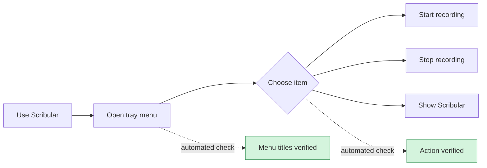

# Tray automation — Tauri spec
Status: draft for cwf; Date: 2026-11-19

## Summary
- **What:** The Mac tray menu and its recording actions gain repeatable automated checks.
- **Why:** Tray behavior currently needs a person to verify it, leaving recording and window recovery paths untested in the real app.
- **User-visible change:** None; the tray keeps its current items and behavior.
- **Size / risk:** M; macOS accessibility calls may still block while a native menu opens in the VM.
- **Needs from Patrick:** PR review of this spec; no open product decisions.

## User workflow

**UX impact:** No new prompts, settings, or steps. The automated checks exercise the existing tray behavior.

---

## Intent (why users need it; who)
Clinicians must be able to start or stop a recording and restore the app from the tray. The 2026-11-19 cwf improvements plan, Task 3, calls for automated evidence of these paths. Patrick's app-shell spec fixes the tray contents and close-to-tray behavior (`plans/2026-11-16-app-shell-spec.md:73-74`); its real-app tray scenario is still manual (`plans/2026-11-16-app-shell-spec.md:95-96`). The coach's external-recording scenario also stays manual because the harness cannot activate tray rows (`plans/2026-11-16-note-style-coach-spec.md:82,135`).

## Tauri state today (what exists, what is missing, with file refs)
- `src-tauri/src/shell/tray.rs:18-26,30-60` builds the tray and dispatches `show`, `start`, `stop`, speaker-count, `skip`, and `quit` in the menu callback. `start` emits `tray-start-recording`; `stop` runs the existing recorder path and reports errors (`src-tauri/src/shell/tray.rs:44-85`, `src-tauri/src/commands.rs:67`). The displayed titles and submenu are built in `src-tauri/src/shell/tray.rs:99-164`.
- The harness already finds the status item through `AXExtrasMenuBar` and `AXHelp` (`tools/uitest/Sources/uitest/AXDriver.swift:178-188`). Its script commands include status-item discovery and pressing (`tools/uitest/Sources/UITestCore/Script.swift:16-43`; `tools/uitest/Sources/uitest/AXDriver.swift:150-156`).
- The native-surfaces plan records that tray menu rows were not exposed or reliably activated on the VM, so the start/stop scenario was deferred (`plans/uitest/05-native-surfaces.md:119-125`). Root cause: `tray-icon` 0.25.1 temporarily attaches its macOS menu only around `performClick`, then detaches it (`tray-icon-0.25.1/src/platform_impl/macos/mod.rs:474-487`; pinned in `src-tauri/Cargo.lock:4954-4957`). An AX menu query before or after that nested event loop can see no menu.
- **Missing:** an external test path into the existing tray dispatcher; a bounded native menu smoke check; automated real-app evidence for the deferred coach and app-shell tray scenarios.

## Goals / Non-goals / Anti-goals
**Goals:** Exercise real tray actions from the external uitest process, verify the native menu titles in a VM, and convert the specified manual tray scenarios to automated evidence.

**Non-goals:** Change the menu contents, recording flow, or production UX; automate unrelated native menus or Windows/Linux trays.

**Anti-goals:** Ship any test trigger in release builds; invoke actions through the webview instead of the tray dispatcher; rely on an unbounded AX call or a fragile screen coordinate.

## Requirements (numbered R1..)
- **R1** Move the body of `on_menu_event` in `src-tauri/src/shell/tray.rs:40-60` into `handle_tray(app, id)`. Both the real menu callback and a `#[cfg(debug_assertions)]` trigger call that same function. Keep the current `show`, `start`, `stop`, speaker-count, `skip`, `quit`, and unknown-ID behavior, including stop error handling.
- **R2** The builder chooses the smallest local, debug-only trigger channel reachable by the external uitest process without webview IPC or a network listener. `tray-item <id>` sends one ID through that channel to the running debug app, reports transport/dispatch failure, and cannot silently pass against a release app. Limit accepted IDs to the menu's existing action IDs; no private session data enters the channel or logs. A release binary contains no trigger symbol or channel code.
- **R3** Add `expect-tray-menu "<title>" ...` to uitest. Find the app's status item through the existing `AXExtrasMenuBar` lookup, set `AXUIElementSetMessagingTimeout`, and issue `AXPress` on a background thread so a blocked native call cannot stall the runner. Poll its `AXMenu` child for at most two seconds, compare the ordered visible item titles with the arguments (ignoring separators), and send Escape to dismiss the menu on success or failure. Report the observed titles or timeout in a bounded failure.
- **R4** Convert note-style-coach AS1, including its external tray recording interruption, and the app-shell tray scenarios to automated real-app checks. Update their scenario tags and evidence method, and replace the tray-menu limitation in `plans/uitest/05-native-surfaces.md:119-125` with the verified harness scope. Preserve non-tray checks in those scenarios.
- **R5** Verify on the real VM app that `tray-item start` causes `tray-start-recording`, that `expect-tray-menu` reads the real native menu, and that a release build lacks the debug trigger. If native AX pressing of a menu row proves reliable in the VM, use it for one action scenario; otherwise use `tray-item` for action checks.

## Acceptance scenarios (numbered AS1..; Given/When/Then; each tagged automated or manual)
- **AS1** (automated, `ui-script+native`; R1, R2, R5) Given a running debug app and an idle tray, when uitest runs `tray-item start`, then the app emits `tray-start-recording` and recording starts through the same dispatcher as the menu. Repeat the stop and Show paths through their IDs; inspect app state and window/Dock state. An unknown ID produces no action and a clear test failure.
- **AS2** (automated, `ui-script+native`; R3, R5) Given the real app in the VM, when `expect-tray-menu "Show Scribular" "Start Recording" "Quit"` runs while idle, then the native menu opens, those ordered titles match, and Escape closes it within two seconds. Given recording, the expected top-level title becomes `Stop Recording`; the existing tray-model test covers its speaker submenu. A timeout or mismatch fails with bounded diagnostics.
- **AS3** (automated, `ui-script+native`; R4, R5) Given the coach sheet is open, when an external `tray-item start` action runs, then the sheet closes, recording begins promptly, the owned explanation appears once, and Cancel/Escape leaves no draft state. The updated note-style-coach AS1 cites this run and covers its other existing assertions.
- **AS4** (automated, `ui-script+native`; R4, R5) Given the main window is closed, when the app-shell tray scenario runs, then the tray stays visible, the Dock icon hides, `expect-tray-menu` verifies only the specified titles for idle and recording states, and `tray-item show` restores the window and Dock icon. Keep the existing tray-model unit check for app-shell AS17; update AS18 to cite this real-app run.
- **AS5** (automated, `log/db/state`; R2, R5) Given debug and release app builds, when the binaries are inspected with `nm` and `strings` for the chosen trigger symbol/channel marker, then it exists only in debug. Running `tray-item` against release fails explicitly; no listener or trigger artifact is present in release.

## Design notes (modules, commands/events, data model + migration, UI components)
- **Where it runs / data flow:** The real menu and debug trigger converge on Rust `handle_tray(app, id)`. The external Swift runner sends a tray ID through the local debug channel. Separately, the runner opens the macOS status menu through AX and reads its native menu titles. No new webview command is needed.
- **Modules:** Touch `src-tauri/src/shell/tray.rs` and only the startup wiring needed by the chosen trigger; extend uitest's script parser, driver, and focused parser/driver tests. Add or update tray scenarios. Update `plans/2026-11-16-note-style-coach-spec.md`, `plans/2026-11-16-app-shell-spec.md`, and `plans/uitest/05-native-surfaces.md` when implementation lands.
- **Commands & events:** `tray-item <id>` and `expect-tray-menu "<title>" ...` are uitest script commands, not Tauri IPC. Reuse `TRAY_START_RECORDING_EVENT` and existing tray action IDs. No new TypeScript type or `src/lib/api.ts` wrapper.
- **Migration:** None.
- **UI components:** None; native menu titles and behavior remain as built today.
- **Spec author's calls:** Compare top-level visible titles in order and exclude separators, because separator AX labels are not user-facing. Keep the trigger mechanism an implementation choice, subject to external reachability, debug-only compilation, and the release check. Prefer actual AX row activation for one scenario only if verified on the VM.

## Dependencies and security check
**New dependencies: none.** Reuse Tauri, Swift ApplicationServices, and standard local OS facilities. The existing `tray-icon` pin is recorded in `src-tauri/Cargo.lock:4954-4957`.

No new package, install-time code, or downloaded artifact is introduced. The implementation PR records the chosen channel and proves with `nm`/`strings` that it and its trigger symbols are absent from release. Keep the debug channel local and restrict it to the existing tray IDs; never log transcript, audio, or session content. Dependency audits and license checks remain the repository's existing release process.

## Out of scope
- Changing the `tray-icon` crate or patching its macOS menu lifetime; this spec tests the current behavior.
- General native menu automation and coordinate-based tray clicking; the existing native-surfaces plan owns broader harness work.
- New production control APIs, settings, or user-facing tray actions.

## Depends on / interacts with (other specs by slug)
- **2026-11-16-app-shell-spec:** Keep R14/R15 and AS17's model test; automate AS18's real-app tray evidence without changing the agreed menu.
- **2026-11-16-note-style-coach-spec:** Automate AS1's external recording path and retain its sheet-state assertions.
- **uitest/05-native-surfaces:** Update the deferred tray-menu and start/stop notes to match verified VM capability; retain unrelated limitations.

## Decisions for Patrick (with recommended default)
No unresolved product decisions. **Default:** retain the fixed Task 3 behavior above; Patrick reviews this draft in its PR.

## Size (S/M/L, rough days)
**M, about 2–3 engineering days, one PR.** The Rust dispatcher and debug trigger, two uitest commands, focused checks, VM scenarios, and plan updates should land together so every converted scenario has working evidence.
