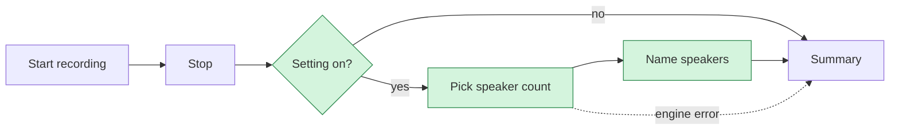

# <Feature name> — Tauri spec
Status: draft for cwf; Date: YYYY-MM-DD

<!-- Template notes (delete before committing):
  - Sections 1 and 2 are for a human reading in under a minute. Keep them tiny. No file paths, no R/AS numbers, no jargon.
  - Everything from "Intent" down is for the implementing agent and reviewers. Keep the existing level of detail there.
  - "(optional)" sections: delete the heading if empty. Never leave placeholders.
-->

## Summary
<!-- 3-5 lines max. Plain language, written for Patrick. -->
- **What:** one sentence on what users get.
- **Why:** one sentence on why it matters (who is blocked or lost without it).
- **User-visible change:** what is new / changed / removed, in one line each.
- **Size / risk:** S/M/L, and the one thing most likely to go wrong.
- **Needs from Patrick:** the decisions or approvals below, or "none".

## User workflow
<!-- One Mermaid flowchart of the end-user path. 12 nodes or fewer.
     Mark changed steps `new` / `changed`; unmarked steps are unchanged.
     Show failure and fallback paths only where the user sees them.
     If a flow is replaced rather than extended, add a second "Before" diagram. -->

**UX impact:** 1-3 bullets. Extra steps, waiting time, new prompts, new settings, new failure messages, anything removed.

---

## Intent (why users need it; who)
Who the users are, what they need to do, in what order. Reference the source of the request (todo item, feedback) if there is one.

## Electron behaviour today (with file:line refs) (optional)
Include only for parity work. Setting, UI flow, pipeline, data, IPC, tests, and inconsistencies to *not* port. Delete for new features.

## Tauri state today (what exists, what is missing, with file refs)
Existing modules, commands, tables and UI the feature touches, then an explicit **Missing:** list.

## Goals / Non-goals / Anti-goals
**Goals**: …
**Non-goals**: …
**Anti-goals** (things we must not do even if tempting): …

## Requirements (numbered R1..)
Group with `###` subheadings if over ~12.
- **R1** One testable statement. Name the command/type/setting/column where relevant.
- **R2** …
<!-- Keep the standing privacy and failure rules where they apply: no transcript/audio/speaker content in logs; any failure falls back and never loses a session; recording is never blocked by background work. -->

## Acceptance scenarios (numbered AS1..; Given/When/Then; each tagged automated or manual)
- **AS1** (automated, cargo test) Given … when … then …
- **AS2** (automated, vitest) …
- **AS3** (manual real-app) …
<!-- Every R maps to at least one AS. Manual checks say exactly what to do and what evidence to record. Unverifiable checks are reported as unverified, never fabricated. -->

## Design notes (modules, commands/events, data model + migration, UI components)
- **Where it runs / data flow**
- **Modules** touched or added
- **Commands & events** (ts-rs types, `src/lib/api.ts` wrappers)
- **Migration** (next free version at implementation time; append-only), or "none"
- **UI components**
- **Spec author's calls:** each judgment call and the reason, one line each.

## Dependencies and security check
**New dependencies: none.** <!-- or fill the table -->

| Crate / package | Exact pin | License | Why not in-house |
|---|---|---|---|
| | `=x.y.z` | | |

Bare-bones security check, recorded here or in the PR description (about 10 lines, no separate review doc, no approval gate):
- [ ] **License** is compatible with shipping a closed-source app.
- [ ] **Known vulnerabilities:** `cargo audit` / `npm audit` / OSV for the versions we pin. List findings and whether the affected code path is actually used.
- [ ] **Install-time code:** read `build.rs` / npm install scripts for network access, downloads or command execution. Note what they fetch.
- [ ] **Downloaded artifacts** (native libs, models): URL and SHA-256 recorded for repeatability.
- [ ] **Exact version pin** (`=x.y.z` / `save-exact`).

Stop and ask Patrick only for a concrete material issue: incompatible license, a known exploitable vulnerability that affects our use, or a functional failure. Not required: publish-date cutoff, maintainer/download/star tables, whole-lockfile date checks, dependency history, independent archive authentication, SBOM, or a separate `DEPENDENCY_REVIEW_*.md`.

## Models (optional)
File, size, license, source URL, sha256, required or optional download, and how the manager handles it.

## Out of scope
Deferred items and the spec or issue that owns each.

## Depends on / interacts with (other specs by slug)
- **<slug>**: what is shared, which lands first, and any conflict to watch.

## Coordination notes (optional)
Added after a gap check: ordering, shared files, who owns what.

## Decisions for Patrick (with recommended default)
1. Question. **Default:** …
2. …

## Size (S/M/L, rough days) and suggested PR split if > ~1 PR
**M, about N days.**
1. PR1 (S): …
2. PR2 (M): … — covers AS1–ASn.
3. PR3 (M): … — manual checks.

## Execution notes (optional)
Dated notes added at hand-off: reviewer, approved decisions, parallel-work constraints, what is out of bounds, which manual checks can honestly be done.
